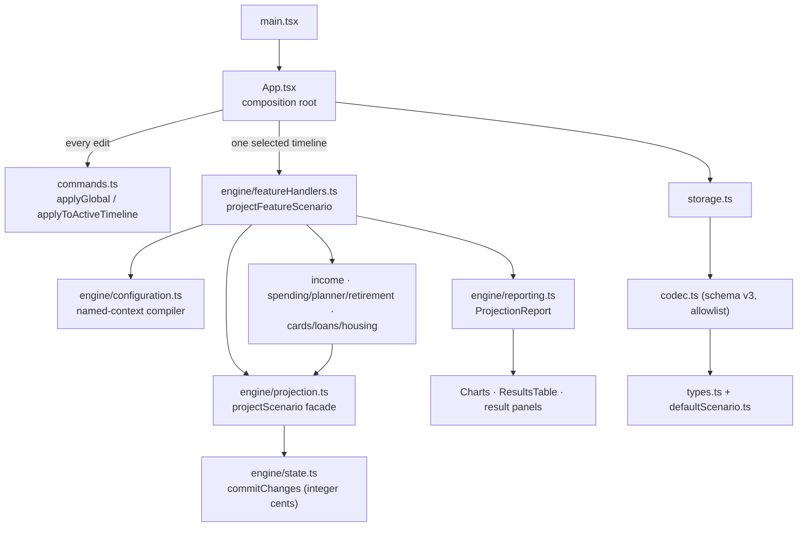

# Code Map

Fast orientation for the current account-only runtime. `src/` is the source of truth;
the authoritative status/evidence docs are listed under **Authority** at the bottom.

## Project Tree (Core Runtime)

```text
Finance Planner/
  AGENTS.md                     agent/contributor jumpstart
  README.md                     overview, diagrams, commands
  CODEMAP.md                    this file
  CHANGES.md                    tracked session changelog
  gitchanges.md                 chronological session log (gitignored)
  index.html
  package.json                  scripts: dev / build / preview / test / test:e2e
  playwright.config.ts          Chromium-only e2e harness (port 4173)
  vite.config.ts                React plugin; Vitest excludes e2e/**
  docs/
    INDEX.md  TEST_MAP.md  ARCHITECTURE.md  CALC_ENGINE.md  DOMAIN_MODEL.md
    FEATURE_MAP.md  MONEY_FLOW.md  STATE_PERSISTENCE.md
    LegacyRemoval.md  ManualContributionLeakPlan.md  PLAN_DATE_BASED_CAREERS.md
  refactor/                     phase handoffs, coverage/audit registers, ADRs
  e2e/                          Playwright specs + fixtures.ts
  src/
    main.tsx                    React root
    App.tsx                     composition root: commands + one projection + rendering
    commands.ts                 canonical write/read surface (commands)
    codec.ts                    schema-v3 allowlisted save codec
    storage.ts                  localStorage load/save guard
    autosave.ts                 coalescing autosave controller + pagehide flush
    types.ts                    domain contracts (no imports)
    defaultScenario.ts          default Scenario + factory creators
    paycheck.ts                 granular paycheck -> flat PaycheckInfo compile
    trajectoryFreeze.ts         canonical cents trajectory snapshot
    trajectoryReportAdapter.ts  report <-> canonical trajectory mapping
    engine/
      projection.ts             projectScenario kernel facade (scheduler + commit + APY)
      featureHandlers.ts        projectFeatureScenario: one projection path + one report
      configuration.ts          named-context compiler
      reporting.ts              read-only ProjectionReport
      scheduler.ts  state.ts  journal.ts  contracts.ts
      funding.ts  taxes.ts  money.ts  valuation.ts  dates.ts  opening.ts
      income.ts                 payroll + ordered net allocations
      spending.ts  planner.ts  retirement.ts
      cards.ts  loans.ts  housing.ts
      *.test.ts                 kernel + feature + phase5 acceptance tests
    components/                 editors, charts, results panels (*.tsx + *.test.tsx)
    importers/
      expenseImport.ts          CSV/expense parser (occurred imports are view-only)
    utils/
      ageDate.ts  dateMarkers.ts  colorPalette.ts  perfTools.ts  viewAdapters.ts
    styles.css  vite-env.d.ts
```

## Architecture Flow



## Module Roles

- `src/App.tsx`: composition root. Reads one `projectFeatureScenario` context, routes
  every mutation through `commands`, and renders tabs/sub-tabs and editors. No local
  scenario rebuild and no second projection.
- `src/commands.ts`: the single canonical write/read surface (`createConfigurationCommands`,
  `applyGlobal`, `applyToActiveTimeline`, timeline/career/account/marker CRUD).
- `src/codec.ts`: schema-v3 allowlisted encoder/decoder. Prunes derived fields and keeps the
  granular `CareerEntry.paycheck`/`PaycheckInfo` in sync.
- `src/storage.ts`: localStorage load/save with a guard that never overwrites newer-version
  or corrupt bytes on automatic saves.
- `src/autosave.ts`: coalesces edits into one deferred guarded save; flushes on `pagehide`.
- `src/engine/featureHandlers.ts`: `projectFeatureScenario` — selects one timeline, compiles
  one context, composes the streams, builds exactly one immutable report.
- `src/engine/projection.ts`: `projectScenario` kernel facade — scheduler + `state.commitChanges`
  + month-close APY. `complete` stays `false` unless the call site claims and earns coverage.
- `src/engine/configuration.ts`: compiles the selected timeline into a named context.
- `src/engine/reporting.ts`: read-only report and the D16 shortfall/exhaustion/fallback selectors.
- `src/engine/{income,spending,planner,retirement,cards,loans,housing}.ts`: feature streams.
- `src/engine/{dates,money,state,taxes,funding,scheduler,valuation,opening,journal,contracts}.ts`:
  shared kernel (dates, integer-cents money, state atomics, tax/penalty solver, ordered
  funding, scheduling, exact-APY valuation, opening observations, posting journal, contracts).
- `src/paycheck.ts`: derives flat `PaycheckInfo` from the granular paycheck on read.
- `src/components/*`: editors and presentational views. Views read the single `ProjectionReport`
  (`ChartPanel`, `SavingsStackedChart`, `ResultsTable`, `NetWorthHistoryChart`,
  `TrajectoryComparisonChart`, `HousingResults`, `LoanResults`, `RetirementWithdrawalResults`).

## Fast Path

- Projection entry: `src/engine/featureHandlers.ts` (`projectFeatureScenario`) → `src/engine/projection.ts`.
- Writes: `src/commands.ts`.
- Save/load: `src/codec.ts`, `src/storage.ts`, `src/autosave.ts`.
- Schema/defaults: `src/types.ts`, `src/defaultScenario.ts`.
- Funding and tax: `src/engine/funding.ts`, `src/engine/taxes.ts`.
- Valuation (exact APY, debt, appreciation): `src/engine/valuation.ts`.
- Report + D16 selectors: `src/engine/reporting.ts`.
- Expenses import: `src/importers/expenseImport.ts`.
- Tests: see `docs/TEST_MAP.md`.

## Authority

- Runtime source of truth: the `src/` files above.
- Current status/evidence: `refactor/phase5_handoff.md`, `refactor/coverage_register.md`,
  `refactor/frozen_contracts.md`, `refactor/gui_browser_coverage.md`.
- `docs/*` guides are partly historical or target-state descriptions; treat `src/` and the
  phase-5 handoff as authoritative.
