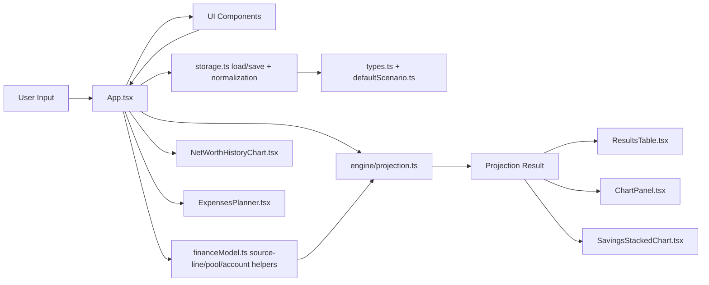

# Code Map

## Project Tree (Core Files)
```text
Finance Planner/
  AGENTS.md
  CODEMAP.md
  gitchanges.md
  testplanfix.md
  README.md
  todo.txt
  docs/
    ARCHITECTURE.md
    CALC_ENGINE.md
    DOMAIN_MODEL.md
    FEATURE_MAP.md
    INDEX.md
    STATE_PERSISTENCE.md
    TEST_MAP.md
    LegacyRemoval.md
    ManualContributionLeakPlan.md
  src/
    components/
      BufferedNumberInput.tsx
      CareerPlanEditor.tsx
      CashflowItemEditor.tsx
      ChartPanel.tsx
      ColorPickerField.tsx
      ExpensesPlanner.tsx
      HousingEditor.tsx
      NetWorthHistoryChart.tsx
      ResultsTable.tsx
      SavingsStackedChart.tsx
      YearMonthInput.tsx
      flagCalloutLayout.ts
    data/
      historicalReturns.ts
    engine/
      projection.ts
      projection.test.ts
    importers/
      bankImport.ts
      bankImport.test.ts
      expenseImport.ts
    utils/
      ageDate.ts
      colorPalette.ts
    App.tsx
    App.test.tsx
    defaultScenario.ts
    financeModel.ts
    main.tsx
    storage.ts
    styles.css
    types.ts
```

## Architecture Flow (Block Diagram)


## Component Roles
- `src/App.tsx`: Composition root, tab routing, state updates, universal timeline bar + `applyToActiveTimeline`, purchase sorting, category management, housing editor wiring, credit card editing, and current-dollars deflation.
- `src/storage.ts`: Persistence and normalization including credit card, purchase category, timeline, housing, cashflow, and paycheckInfo mode fields.
- `src/financeModel.ts`: Small helpers (~35 lines, `normalizePurchaseFundingSource` + `getDefaultBankAccountIdForPool`).
- `src/engine/projection.ts`: Deterministic projection simulation (careers, retirement, purchases, loans, credit cards, housing). Monthly loop processes cashflow/life-event income, credit cards, long-term purchases, housing, and sourceLine contributions; growth compounds at exact APY.
- `src/components/CareerPlanEditor.tsx`: Career timeline, paycheck editing with retirement/HSA amount/percentage mode toggles, "Copy Pay from Previous" button.
- `src/components/HousingEditor.tsx`: Chip-based housing editor (mortgages + rentals mixed, drag/reorder/duplicate, inline property form, grouped payment sources, "use previous housing end date as start date").
- `src/components/CashflowItemEditor.tsx`: Cashflow add-on editor with account selector and persisted year-month inputs.
- `src/components/ExpensesPlanner.tsx`: Expense planning/tracking workspace and import audit UI.
- `src/components/ChartPanel.tsx`: Monthly portfolio value chart with credit card debt line overlay and monthly hover tooltip.
- `src/components/ResultsTable.tsx`: Dynamic account-based yearly/monthly output table.
- `src/components/SavingsStackedChart.tsx`: Monthly pool-based stacked chart with per-pool hover tooltip.
- `src/components/NetWorthHistoryChart.tsx`: Historical net worth chart.
- `src/components/ColorPickerField.tsx`: Color picker for purchase/loan flags.
- `src/components/YearMonthInput.tsx`: Year-month input with up/down buttons.
- `src/components/flagCalloutLayout.ts`: Flag callout layout on charts (month-aware anchoring).
- `src/importers/bankImport.ts`: Bank statement import parsing for net worth updates.
- `src/importers/expenseImport.ts`: Expense import parsing for expense entries.

## Fast Path
- Projection logic: `src/engine/projection.ts`
- Scenario model/schema: `src/types.ts`, `src/defaultScenario.ts`, `src/storage.ts`
- Paycheck/take-home math: `src/engine/projection.ts` (lines ~581-613)
- Retirement/HSA match deposit math: `src/engine/projection.ts` (lines ~693-707)
- Credit card processing: `src/engine/projection.ts` (lines ~853-943)
- Income waterfall: `src/engine/projection.ts` (lines ~483-544)
- Depletion detection: `src/engine/projection.ts` (line ~1531)
- Purchases/loans UI: `src/App.tsx`
- Credit card UI (table + edit modal + schedule): `src/App.tsx` (creditCards sub-tab)
- Expenses: `src/components/ExpensesPlanner.tsx`, `src/importers/expenseImport.ts`
- Session changelog: `gitchanges.md`
- Test fix plan: `testplanfix.md`
