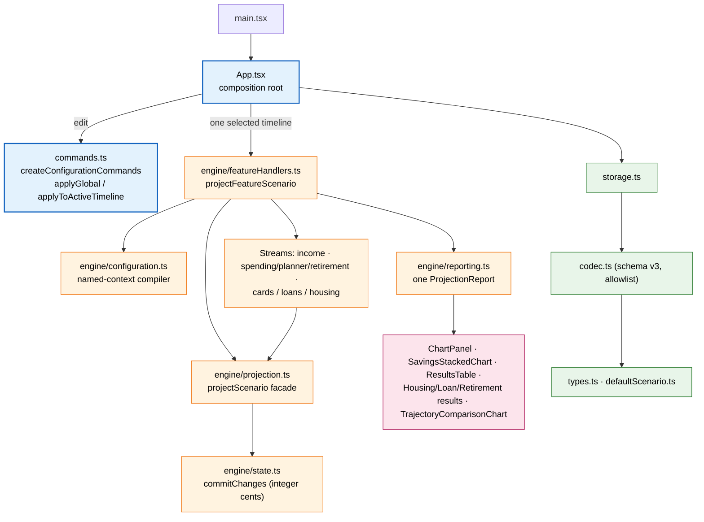
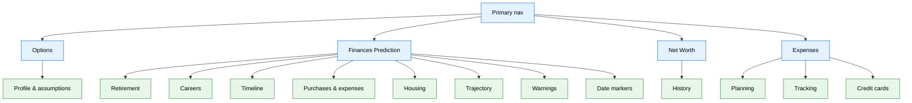

# Finance Planner

A React 19 + TypeScript + Vite finance/retirement projection app. One deterministic,
account-led engine; one projection path; one read-only report. There is no pool-based or
`financeModel` layer.

> Phase 5 is a runnable integrated candidate for Phase-6 measurement, **not** a release.
> This README does not claim Phase-6 measurements, Phase-7 exit, CI wiring, or a release.
> See `refactor/phase5_handoff.md` for status, local gates and explicit non-claims.

## Commands

- Install: `npm install`
- Dev server: `npm run dev`
- Run all tests: `npm run test -- --run` (the script is `vitest run`)
- Single test file: `npm run test -- --run src/engine/projection.test.ts`
- Build: `npm run build` (`tsc -b && vite build`)
- Browser gate: `npm run test:e2e -- --project=chromium`
  (Playwright/Chromium over the real dev server; one-time `npx playwright install chromium`)

These are local gates. The browser suite is a bounded smoke/flow gate — it is not
wired into CI and does not certify the GUI-A/G or CA matrices.

## Architecture

`App.tsx` is the composition root. Scenario edits route through the canonical command
surface in `commands.ts` — the only exception is the explicit user reset, which replaces the
scenario with `createDefaultScenario`. The App makes exactly one `projectFeatureScenario`
call, which selects one named timeline and builds one report. The read-only result views are
backed by that single report; editors read and write configuration through commands.

**How to read it**

- **One write surface.** `commands.ts` exposes `createConfigurationCommands`; `App.tsx`
  routes global edits through `applyGlobal` and timeline-local edits through
  `applyToActiveTimeline`. There is no local scenario rebuild.
- **One projection path.** `engine/featureHandlers.ts` `projectFeatureScenario` selects one
  timeline, compiles one context (`engine/configuration.ts`), composes the feature streams,
  and attaches exactly one immutable report (`engine/reporting.ts`). The raw
  `engine/projection.ts` `projectScenario` is the kernel facade.
- **Kernel.** `engine/{dates,money,state,taxes,funding,scheduler,valuation,opening,journal,contracts}.ts`.
  Integer cents; mutation only through `state.commitChanges`.
- **Streams.** `engine/income.ts` (payroll + ordered net allocations),
  `engine/{spending,planner,retirement}.ts`, and `engine/{cards,loans,housing}.ts`.
- **Persistence.** `storage.ts` loads/saves through `codec.ts` (schema v3, allowlist);
  `autosave.ts` coalesces writes and flushes on `pagehide`.

## Projection Invariants

Deterministic and side-effect free. No wall clock — dates and horizons are explicit inputs.

- **Unit rule.** Persisted configuration is dollars; runtime postings/balances are integer
  cents, converted once at the posting boundary (half-away-from-zero).
- **Exact APY.** Account growth uses `monthlyRate = (1 + rate)^(1/12) - 1`, so
  `(1 + monthlyRate)^12 === 1 + rate`. A month clipped by the valuation window uses the
  fractional exponent. Debt accrues at the nominal `annualRate / 12`; property appreciation
  uses the effective rate (`engine/valuation.ts`).
- **Signed net worth.** `netWorthCents = accountAssets − liabilities` (may be negative).
  Each month close reconciles `closing = opening + Σ committed deltas`; a mismatch is a
  reported diagnostic, never silently clamped.
- **Same-date phases.** `accrual → income → cap → mandatory → discretionary → close`.
  Mandatory band order is `loan/mortgage → housing → cards → planner/living → retirement`.
- **Funding.** Primary-first, ordered, eligible split, deduplicated; every obligation is
  partial (`executed = Σ funded`, `shortfall = requested − executed`). No pool/type sweep,
  no implicit borrowing or retry. Zero-fund or invalid plans debit nothing.
- **Income fallbacks compile to funding order.** The retained
  `incomeFallbackAccountId` / `incomeFallbackAccountId2` values compile into the global
  funding config as `incomeFallbackAccountIds` (`engine/configuration.ts`) and are consumed
  as ordered fallbacks when an income-funded obligation is quoted (e.g. loans,
  `engine/loans.ts`).
- **Depletion is ledger-based.** The D16 selectors (`report.shortfall.warning`,
  `report.exhaustion`, `report.fallback.occurrences`) are warning/reporting only and never
  change projection math.

## Tabs and Routes

- **Options** holds profile/assumptions (date of birth, current/retirement age, retirement
  years, inflation) plus shared cashflow items and the projection summary.
- **Finances Prediction** is where the projection is edited and shown: retirement spending
  and results, careers (paycheck + dated pay plans), timeline management, purchases/loans,
  housing, trajectory snapshots, warnings, and date markers.
- **Net Worth** holds account/liability/property configuration, the opening snapshot, and
  the signed net-worth history chart.
- **Expenses** has Planning, Tracking, and Credit cards.
  - **Planning** uses `AccountExpensesPlanner`: manual/recurring expense entries plus CSV
    import with a staged review workflow. Occurred imports are view-only and stay separate
    from the projection plan.
  - **Tracking** (`Expense history`; the `src/App.tsx` expenses `tracking` sub-tab) mounts the
    same `AccountExpensesPlanner` as Planning, so it is an expense-history/plan view over
    recorded and imported entries. It is not a separate projection and not a full
    transaction-tracking product.
  - **Credit cards** hosts timeline-local card plans (`CardPlanEditor`): expected payment
    schedules and permanent-0% payoff plans linked to a single observed liability.

## Feature Overview

- **Universal timelines.** `Scenario.timelines` + `activeTimelineId`. A timeline holds
  independent copies of `purchases`, `longTermPurchases`, `loans`, `creditCards`,
  `cardPlans`, `careerPlan`, and `housing`; global configuration (accounts, rates, policies,
  liabilities, properties, markers, withdrawal plan) stays on the base scenario.
- **Date markers.** Named ISO dates most date fields can link to, so one marker change moves
  every referencing field.
- **Current-dollar display.** A "today's dollars" toggle deflates graphs, summary and table
  through `utils/viewAdapters.ts`; it is display-only and never changes the projection.
- **Results.** Charts (`ChartPanel`, `SavingsStackedChart`, `NetWorthHistoryChart`,
  `TrajectoryComparisonChart`), the yearly/monthly `ResultsTable`, and read-only result
  panels (`HousingResults`, `LoanResults`, `RetirementWithdrawalResults`,
  `PurchaseFundingResults`) all read the single report.
- **Save lifecycle.** Schema v3 (`CURRENT_SCHEMA_VERSION = 3`); the codec is allowlist-only
  and prunes derived fields (e.g. the flat `paycheckInfo` cache is re-derived on load).
  `CANONICAL_TRAJECTORY_FORMAT_VERSION = 2` marks cents-only trajectory snapshots.

## Docs and Authority

- Runtime source of truth: `src/`.
- Current status/evidence: `refactor/phase5_handoff.md`, `refactor/coverage_register.md`,
  `refactor/frozen_contracts.md`, `refactor/gui_browser_coverage.md`.
- Guides: `CODEMAP.md`, `docs/INDEX.md`, `docs/TEST_MAP.md`; other `docs/*` files are partly
  historical or target-state.
