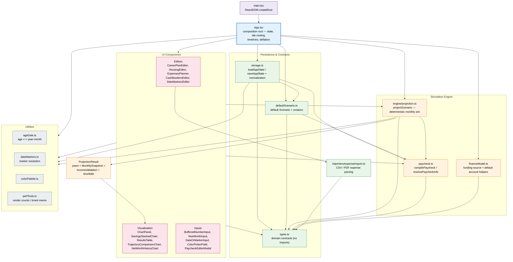
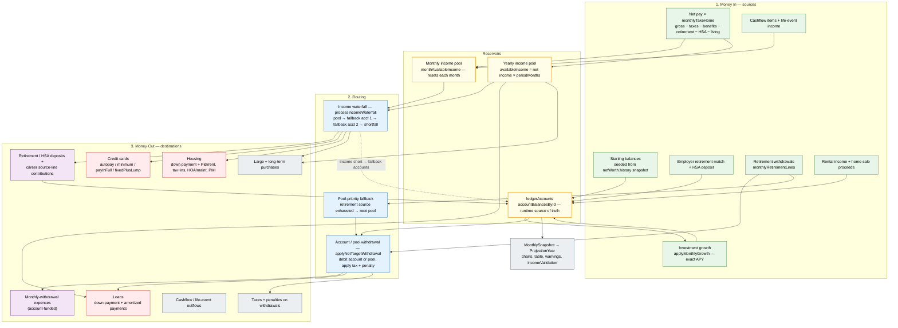

# Finance Planner

This project is basically all vibe coded.

A React + TypeScript + Vite retirement/finance projection app. The UI is a composition
of tabs and editors; the deterministic simulation lives in `src/engine/projection.ts`.

## Code Architecture

How the modules depend on each other. `App.tsx` is the composition root that wires
persistence, the simulation engine, utilities, and the component tree together.

**Reading the diagram**

- **`main.tsx` → `App.tsx`** boots the app. `App.tsx` owns all app state and orchestrates
  every tab; it is intentionally the single composition root.
- **Persistence** (`storage.ts`) loads/saves `PersistedAppState` (`scenario` + `ui`) from
  `localStorage` and normalizes every persisted field on load. `defaultScenario.ts` and
  `types.ts` define the shape it round-trips.
- **Engine** is pure and side-effect free: `projectScenario(scenario)` returns a
  `ProjectionResult`. `paycheck.ts` is the single read point for paycheck math;
  `projection.ts` imports it and `utils/ageDate.ts`.
- **Components** are presentational/editor UI. They may call engine formatters
  (`formatCurrency`, `formatPercent`) and `paycheck.ts` helpers, but never mutate the engine.
- **Utilities** are shared leaf modules (dates, markers, colors, perf instrumentation).

## Money Flow Architecture

How money moves through the projection engine (`projectScenario`, `projection.ts`). The
whole flow repeats **once per month** for every simulated age; every month starts with
fresh income and draws down the same running `ledgerAccounts`.

**Reading the diagram**

- **Two income reservoirs.** Net pay (`S2`) never lands in an account directly: it fills
  the **monthly income pool** (`PM`) and the **yearly income pool** (`PY`). Everything else
  accumulates in `ledgerAccounts` (`PL`), the runtime source of truth for account math.
- **Income-funded spending** (credit cards, housing, monthly + age-only purchases, loans)
  draws a pool through the **income waterfall** (`W`). Loans and age-only purchases draw
  the yearly pool; the rest draw the monthly pool.
- **Account-funded spending** (monthly-withdrawal expenses, account/pool-funded payments,
  retirement spending) debits the ledger through `applyNetTargetWithdrawal` (`WD`), which
  applies the pool's tax + penalty rates.
- **The waterfall falls back to the ledger.** When income is short, `processIncomeWaterfall`
  debits `incomeFallbackAccountId` then `incomeFallbackAccountId2`; if still short it records
  a shortfall (`incomeValidation`). That is the dotted edge `W --> PL`.
- **Retirement withdrawals** go through `WD` and, if their source pool is exhausted, hop
  across pools by `priority` (`PF`).
- **Depletion** is ledger-only: the projection "runs out" when `currentLedgerSum <= 0`.

## GUI Architecture

The rendered structure of the app: a two-column shell with a tabbed sidebar and a shared
results panel. `renderTabBody()` in `App.tsx` switches on the active tab.

```mermaid
flowchart TD
  classDef shell fill:#ede7f6,stroke:#4527a0,color:#000;
  classDef tab fill:#e3f2fd,stroke:#1565c0,color:#000;
  classDef sub fill:#e8f5e9,stroke:#2e7d32,color:#000;
  classDef comp fill:#fce4ec,stroke:#ad1457,color:#000;
  classDef res fill:#fffde7,stroke:#f9a825,color:#000,stroke-width:2px;

  Shell["App shell — main.app-shell"]:::shell
  Top["Top tabs (TOP_TABS)"]:::shell
  Timeline["Timeline bar — Add Timeline / Timelines /<br/>Default + timeline chips"]:::shell
  Grid["app-grid — sidebar + results"]:::shell

  Shell --> Top
  Shell --> Timeline
  Shell --> Grid

  Top --> T1["Options"]:::tab
  Top --> T2["Finances Prediction<br/>(activeTab: careers)"]:::tab
  Top --> T3["Net Worth"]:::tab
  Top --> T4["Expenses"]:::tab

  Grid --> Side["sidebar — renderTabBody()"]:::shell
  Grid --> Results["results panel<br/>(hidden on Expenses)"]:::res

  T1 --> OptionsBody["renderOptionsTab +<br/>shared results"]:::tab

  T2 --> F1["Retirement"]:::sub
  T2 --> F2["Careers"]:::sub
  T2 --> F3["Timeline Management"]:::sub
  T2 --> F4["Purchases and expenses"]:::sub
  T2 --> F5["Housing Expenses"]:::sub
  T2 --> F6["Trajectory"]:::sub
  T2 --> F7["Warnings"]:::sub
  T2 --> F8["Date Markers"]:::sub

  T3 --> NWBody["renderNetWorthTab<br/>+ account config"]:::tab
  T4 --> E1["Expense Planning"]:::sub
  T4 --> E2["Expense Tracking"]:::sub
  T4 --> E3["Credit Cards"]:::sub

  F1 --> RPanel["renderRetirementTab<br/>+ renderFutureRetirementPanel"]:::comp
  F2 --> CareerEditor["CareerPlanEditor"]:::comp
  F3 --> TL["renderTimelineManagementTab<br/>timeline + waterfall"]:::comp
  F4 --> Purch["renderPurchasesTab<br/>purchases / loans / credit cards"]:::comp
  F4 --> Cashflow["CashflowItemEditor"]:::comp
  F5 --> Housing["HousingEditor"]:::comp
  F6 --> Traj["renderTrajectoryTab<br/>save/compare snapshots"]:::comp
  F7 --> Warn["renderWarningsTab<br/>incomeValidation groups"]:::comp
  F8 --> Markers["DateMarkersEditor"]:::comp

  E1 --> Planner["ExpensesPlanner"]:::comp
  E2 --> TrackPlaceholder["Expense tracking placeholder<br/>(&quot;coming soon&quot;) + account picker"]:::comp
  E3 --> CC["credit card schedule +<br/>account balance tracking"]:::comp

  CareerEditor --> PayModal["PaycheckEditorModal"]:::comp

  Results --> G["Graph card<br/>ChartPanel | SavingsStackedChart |<br/>TrajectoryComparisonChart | NetWorthHistoryChart"]:::res
  Results --> Sum["Summary — depletion / ending balance"]:::res
  Results --> Table["ResultsTable<br/>yearly or monthly rows"]:::res
```

**Reading the diagram**

- **Shell = top tabs + timeline bar + `app-grid`.** The timeline bar is global: it switches
  the active timeline whose independent copies of purchases, loans, credit cards, careers,
  and housing feed the sidebar editors.
- **Sidebar** is the editing surface (`renderTabBody()`). It renders top-level tabs, their
  sub-tabs, then the matching editor component.
- **Results panel** is shared across Options and Finances Prediction. It hosts a graph card
  (portfolio / stacked savings / trajectory comparison / net-worth history), a summary line,
  and the yearly-or-monthly `ResultsTable`. It is hidden on the Expenses tab, which uses the
  full width for `ExpensesPlanner`.
- **Editors** live under `src/components/`; `App.tsx` keeps the tab-specific panels (e.g.
  purchases, warnings, trajectory) inline and delegates the larger workspaces to components.

## Existing Features

A snapshot of what the app actually does today, grouped by area. Runtime files are the
source of truth.

### Global shell & configuration

- Four top-level tabs: **Options**, **Finances Prediction**, **Net Worth**, **Expenses**.
- **Universal timelines**: a global timeline bar with add / switch / rename / duplicate /
  delete. Each timeline holds independent copies of large purchases, long-term purchases,
  loans, credit cards, career plan, and housing (`activeTimelineId`; `null` = base).
- **Date markers**: named ISO dates that most editable year-month / date fields can link to,
  so changing one marker moves every referencing field at once.
- **Current-dollar display**: a "Display values in current dollars" toggle deflates graphs,
  summary, results table (yearly + monthly), and income usage by cumulative inflation.
- **Persistence**: scenario + UI state round-trip through `localStorage`
  (`finance-planner-state`), normalized on load.
- **Reset to defaults** from the Options tab (with confirmation).

### Options tab

- Date of birth, retirement age, retirement length, and the global inflation toggle + rate.
- Shares the same graph, table, and summary as Finances Prediction.

### Finances Prediction tab

- **Retirement** — retirement withdrawal plan plus the Future Retirement panel and cashflow
  add-ons (Social Security, pensions, inheritance, college, real estate, etc.).
- **Careers** — dated career entries with annual raise, a granular paystub editor
  (`PaycheckEditorModal`: earnings, taxes, pretax/posttax, employer items, percent-of-gross),
  dated **net pay plans** (`CareerPayPlan`), source-line savings allocations (percent-of-net
  or fixed per period, "increase with paycheck"), account caps + overflow rerouting,
  monthly-withdrawal expenses, and two income fallback accounts.
- **Timeline Management** — timeline chips plus a monthly income/expense waterfall chart and
  timeline item bars.
- **Purchases and expenses** — large purchases, long-term monthly purchases, loans, and
  credit cards, with sorting, categories, funding-source selection, and shortfall highlighting.
- **Housing Expenses** — chip editor mixing mortgages and rentals: grouped payment sources
  (P&I/extra, taxes+insurance, HOA/maintenance, PMI), PMI auto-drop, sell proceeds, rental
  income, appreciation, and "use previous end as start" / career-date links.
- **Trajectory** — save/name immutable projection snapshots and compare one against the live
  projection and actual net-worth history.
- **Warnings** — income-validation groups (overspend / unmet income) plus engine warnings.
- **Date Markers** — editor for the global marker list.

### Net Worth tab

- Bank account + pool configuration with priorities, account types (checking, savings,
  taxable, 401k, Roth, HSA), and per-pool pre/post-retirement return rates.
- "Save Account Balance" snapshots, net-worth history chart with range filters, and an
  as-of baseline. Projections anchor to the most recent saved snapshot and seed the ledger
  from it ("Simulating from &lt;date&gt;" note).

### Expenses tab

- **Expense Planning** — `ExpensesPlanner`: manual entries, categories, recurring rules
  (on-date / every-Friday / first-Monday-after), weekly-balance chart, and CSV/PDF import
  with a staged review workflow.
- **Expense Tracking** — account picker only; the tracking view is a placeholder
  ("Expense tracking view coming soon.").
- **Credit Cards** — card table plus a 24-month payment-schedule projection with a
  per-card income (fallback/shortfall) notice.

### Results & reports

- **Portfolio graph** (`ChartPanel`): monthly portfolio line, credit-card debt line, hover
  tooltip, age-range slider, and purchase/housing flag visibility + colors.
- **Stacked savings graph** (`SavingsStackedChart`): per-pool stacked areas with hover.
- **Results table** (`ResultsTable`): yearly or per-month rows, per-account columns,
  net income, taxes/penalties, withdrawals, returns, and per-account activity tooltips.
- **Net-worth history** and **trajectory comparison** overlays.
- Summary line with depletion age / ending balance.

### Engine / calculation

- Deterministic, side-effect-free monthly simulation (`projectScenario`).
- Exact-APY growth: `monthlyRate = (1 + rate)^(1/12) - 1`.
- Income = paycheck net pay; employer retirement/HSA match deposited separately.
- Per-month career and pay-plan resolution; inflation-escalated retirement targets.
- Tax/penalty-aware pool withdrawals, HSA penalty-free at 65+ after retirement.
- Income waterfall with two ordered fallback accounts; split/partial funding allowed.
- Credit-card modes: `fixed`, `minimum`, `payInFull`, `fixedPlusLump`, `autopay` (with end date).
- Housing mortgage amortization, PMI, grouped funding, rental income, and home sale.
- Loans with down payment, amortization, and extra payments.
- Ledger-only depletion detection (`currentLedgerSum <= 0`).

### Data & utilities

- Expense CSV/PDF-like import parser (`src/importers/expenseImport.ts`).
- Date/age utilities, date-marker resolution, color palette, and perf instrumentation.

## Known Bugs & Issues

Grouped by confidence. "Confirmed" items are reproduced or baked into the current
implementation; "Suspected" items are documented defects from the audit in
`refactor/feature_specification.md` that still need validation. Runtime file references are
included for each.

### Confirmed

- **Expense planner is not wired into the projection.** `scenario.expenses` is never read by
  `src/engine/projection.ts`, so planned entries, recurring occurrences, and their funding
  sources do not affect long-horizon balances. The tracking view is also still a placeholder
  (`src/App.tsx:4768`). Impact: the Expenses tab is planning-only. (Audit F22 / R09.)
- **Pre-existing failing test: loan row not marked red for the income source.**
  `src/App.test.tsx:495` expects the loan row to still be `invalid` after switching "Loan
  Payment Source" to `income`; it receives `purchase-row` (`src/App.test.tsx:519`). Latest run:
  **207/208 passing**. Root cause is the annual-income budget below, not a lost account
  warning (static triage in `refactor/testing_correctness_audit.md`). (R15 / TC01.)

### Suspected defects (documented, pending validation)

- **Annual income is re-spent.** After all monthly snapshots, `availableIncome` is re-created
  as the full period net income (`src/engine/projection.ts:1569`) and used for loans and
  age-only purchases — even though that income was already spent monthly. The same dollar can
  cover both. (R01 / R07.)
- **Debt amortization ignores actual funding.** Mortgage principal is scheduled
  (`src/engine/projection.ts:1431`–`1521`) regardless of whether payments were funded, and
  income-funded loan payments reduce debt by `paymentTarget` rather than the actual covered
  amount. Failed down payments can still be marked applied, and an underwater sale floors
  proceeds at 0 and clears the debt. (R02 / R14, F14/F17/F18.)
- **Source-line savings post before the income check.** `applySourceContributions` deposits
  the full requested amount (`src/engine/projection.ts:952`–`966`) before the available-income
  clamp, so overspecified savings can mint deposits the paycheck never funded. (R04, F06.)
- **Net worth excludes liabilities and property.** `endBalance`, history, and projected net
  worth are asset-only; credit-card / loan debt and home value are reported separately and
  never subtracted. (R05 / F24.)
- **Annual vs monthly figures don't reconcile.** Period-end loans and age-only purchases are
  absent from monthly snapshots; annual `netIncome` = last monthly value × 12; monthly
  `careerContribution` is a cumulative average and `salary` is divided by `periodMonths`, not
  always 12 (`src/engine/projection.ts:1541`–`1543`). (R07 / F24.)
- **Independent UI estimators can disagree with the engine.** The credit-card schedule
  (`src/App.tsx:4850`–`4957`), career balance estimator, and loan payoff preview each run
  their own math and time base instead of the projection output. (R08 / MD03.)
- **Career month gaps and enable flags.** The engine can still fall back to age-based career
  selection when an explicit month gap exists, and `careerPlan.enabled` is persisted but not
  checked during selection. Fixed payroll deposits can continue at zero salary. (R11 / F03/F04.)
- **Date handling risks.** Date-only strings parse via UTC then convert to local months,
  which can shift the month in western timezones; leap-day and month-length boundaries are
  not fully covered. (R12.)
- **Current-dollar display inconsistency.** Annual figures deflate by full-year factors while
  monthly figures use elapsed months/12, and account activity tooltips are not deflated
  alongside their balances. (R17 / F25.)
- **Persistence fragility.** There is no schema version; a single malformed nested item trips
  a broad `try/catch` that falls back to whole-plan defaults, and first-launch/reset reuse
  shared mutable default objects. (R23 / F26, TC05–TC08.)
- **Test coverage gaps / misleading tests.** The "uses 4 percent" test passes a fixed
  `amount` source while only the global mode is `four_percent`, so it never exercises the
  percentage branch (`src/engine/projection.test.ts:129`–`188`); the minimum-miss test title
  says "marks depletion" though it asserts survival. (TC02 / TC03.)

### Documentation drift

- `AGENTS.md`, `CODEMAP.md`, and `docs/` reference `src/importers/bankImport.ts` and
  `bankImport.test.ts`, which **do not exist** in the tree.
- `AGENTS.md` states legacy migration code was removed, but `src/storage.ts` still contains
  legacy paycheck / account-rule / tab adapters. (MD08.)
