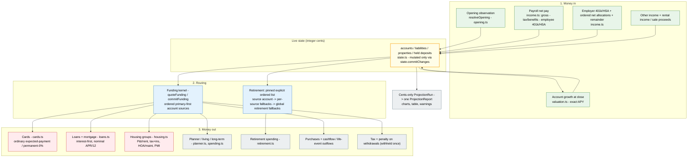

# Money Flow

How money moves through the projection engine. Entry point:
`projectFeatureScenario` (`src/engine/featureHandlers.ts`), which composes the
streams and delegates to `projectScenario` (`src/engine/projection.ts`).

There is **no income reservoir or pool**. Payroll posts net pay into its
configured destination accounts, and obligations are then funded from live
account balances in the same ordered, partial way. Every value is integer cents,
and every mutation is exactly one `state.commitChanges` call.

## Reading the Diagram

- **Money in.** The opening observation seeds the accounts. Payroll posts net pay
  directly to destination accounts (employee/employer retirement and HSA lines
  post separately; ordered net allocations and the remainder follow the active
  plan). Other income, rental income and sale proceeds deposit to their
  configured accounts. Accounts grow at month close by the exact APY.
- **No reservoir.** Net pay never lands in a monthly or yearly income pool. A
  spending obligation is funded from account balances through the funding kernel.
- **Routing.** `quoteFunding` selects eligible sources in configured order,
  primary first and deduplicated; `commitFunding` posts one sparse change set
  through `state.commitChanges`. Retirement uses a fully pinned explicit ordered
  list and never consults the global policy.
- **Money out.** Each stream owns its obligation. Partial and unfunded outcomes
  are reported, never retried; tax and penalty are withheld from gross once.
- **Reporting.** The frozen run's postings are read once to build one report.

## Blocks to Code

| Block | Code | Notes |
| --- | --- | --- |
| One projection path | `projectFeatureScenario`, `src/engine/featureHandlers.ts` | Selects one timeline, composes four streams, builds one report |
| Kernel facade | `projectScenario`, `src/engine/projection.ts` | Kernel-only; returns a cents-only `ProjectionRun` |
| Opening observation | `resolveOpening`, `src/engine/opening.ts` | Seeds state; start date is the observation date |
| State mutation | `commitChanges`, `src/engine/state.ts` | Sole mutation route; revision-checked, all-or-none |
| Scheduler | `createScheduler`, `src/engine/scheduler.ts` | Lazy month batches in `accrual → income → cap → mandatory → discretionary → close` |
| Payroll / net allocations | `src/engine/income.ts` | Posts net pay to destination accounts; date-based raises |
| Spending / planner / retirement | `src/engine/spending.ts`, `planner.ts`, `retirement.ts` | Obligations + retirement withdrawals |
| Cards / loans / housing | `src/engine/cards.ts`, `loans.ts`, `housing.ts` | Debt and property obligations |
| Ordered funding | `quoteFunding` / `commitFunding`, `src/engine/funding.ts` | Primary-first, eligible, deduplicated, partial; no sweep/borrow/retry |
| Tax / penalty | `src/engine/taxes.ts` | Gross = net + tax + penalty, withheld once |
| Valuation | `src/engine/valuation.ts` | Exact-APY account growth, nominal debt accrual, appreciation |
| Report | `buildProjectionReport`, `src/engine/reporting.ts` | One immutable report read once from the run |
