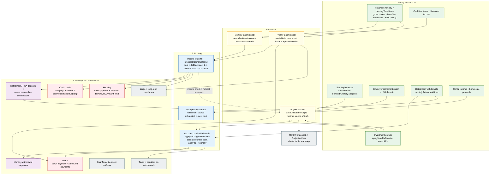

# Money Flow

How money moves through the projection engine (`src/engine/projection.ts`, entry point `projectScenario`, `projection.ts:509`).

The whole flow below repeats **once per month** for every simulated age. Each month starts with fresh income and draws down the same running `ledgerAccounts`.

## Reading the diagram

- **Two reservoirs.** Net pay (`S2`) never lands in an account directly — it fills the **monthly income pool** (`PM`) and the **yearly income pool** (`PY`). Everything else accumulates in `ledgerAccounts` (`PL`), the runtime source of truth for account math.
- **Income-funded spending** (credit cards, housing, monthly purchases) draws the monthly pool through the **income waterfall** (`W`). Loans and age-only purchases draw the yearly pool.
- **Account-funded spending** (monthly-withdrawal expenses, account/pool-funded payments, retirement spending) debits the ledger through `applyNetTargetWithdrawal` (`WD`).
- **The waterfall falls back to the ledger.** When income is short, `processIncomeWaterfall` debits `incomeFallbackAccountId` then `incomeFallbackAccountId2`; if still short it records a shortfall (`incomeValidation`). That is the dotted edge `W --> PL`.
- **Retirement withdrawals** go through `WD` and, if their source pool is exhausted, hop across pools by priority (`PF`).

## Blocks to code

| Block | Code | Notes |
| --- | --- | --- |
| `projectScenario` yearly loop | `projection.ts:741` | Per age; the month loop inside is `projection.ts:837` |
| Net pay is income | `projection.ts:908` | `monthlyTakeHome = max(0, gross - deductions) / 12`; all amounts scale by `raiseFactor` |
| Retirement / HSA deposits | `projection.ts:934` | `applyAccountDeposit` to `retirementAccountId` / `hsaAccountId` |
| Career source-line contributions | `projection.ts:955` | percent of **net income**, or fixed per pay period |
| Monthly-withdrawal expenses | `projection.ts:972` | account-funded; never reduces income |
| Cashflow / life-event in-out | `projection.ts:1011` | monthly deposit to / withdrawal from `accountId` |
| Retirement withdrawals | `projection.ts:1076` | spread `planned / periodMonths`; spread across pools |
| Credit cards | `projection.ts:1121` | autopay pays `fixedPaymentAmount` through `autopayEndYearMonth` |
| Housing | `projection.ts:1381` | down payment + grouped sources (P&I/rent, tax+ins, HOA/maint, PMI) |
| Loans | `projection.ts:1615` | down payment, then monthly amortization |
| Large + long-term purchases | `projection.ts:1226`, `projection.ts:1752` | income-funded run monthly; age-only run in the yearly pool |
| Income waterfall | `processIncomeWaterfall`, `projection.ts:667` | pool clamped at 0 -> fallback 1 -> fallback 2 -> shortfall |
| Account / pool withdrawal | `applyNetTargetWithdrawal`, `projection.ts:321` | applies `taxRate` / `penaltyRate`; returns net cash |
| Pool-priority fallback | `projection.ts:1085` | retirement source exhausted -> next pool by `priority` |
| Growth | `applyMonthlyGrowth`, `projection.ts:223` | `monthlyRate = (1 + rate)^(1/12) - 1` |
| Depletion | `projection.ts:1855` | `currentLedgerSum <= 0` (ledger-based) is the only depletion trigger |
| Aggregation | `projection.ts:1538`, `projection.ts:1876` | `MonthlySnapshot` -> `ProjectionYear` |
