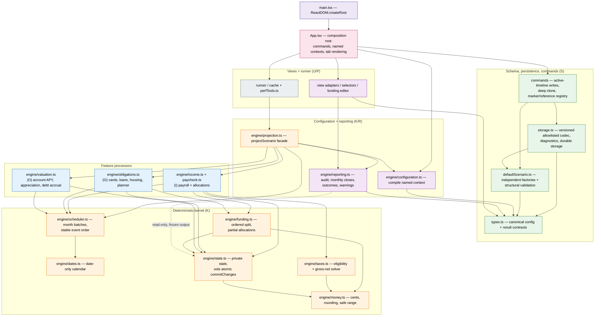
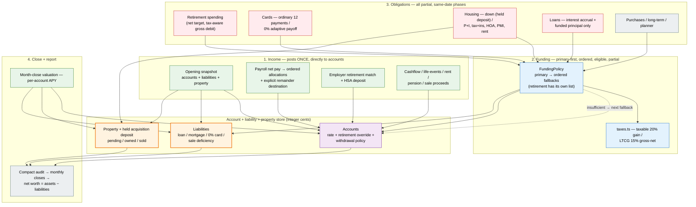

# Account Cashflow Refactor

Planning documents and historical baseline evidence created during this session.

Start with [audit coverage and readiness](audit_status.md) for all six requested audit areas, verified evidence and priority follow-up. Incremental implementation is authorized by [ADR-022](architecture_decisions.md#adr-022--incremental-implementation-authorized-intermediate-breakage-permitted); inspection and authorization do not mean target implementation/acceptance is complete.

Use [the manual review checklist](review.md) for accepted product rules, implementation authorization and the separate final-release sign-off.

RV01–RV31/clarifications recorded in review/ADR-019/020: home partial payments held as deposits until fully funded; taxable gain20% gross/default editable LTCG15%; user withdrawals/residual0% lump sum/twelve ordinary payments/view-only occurred imports/net-worth graph/responsive eighty years. Prior acquisition/tax ambiguities resolved; target implementation/verification still pending.

ADR-021 records the later accepted exact-cent quote, residual and 0% installment rules, the HSA age-65 penalty treatment, and a **user-configurable initial-balance withdrawal percentage** (new-item default 4%) on each retirement source. These remain target contracts, not current runtime behavior.

## Plans and specifications

Start implementation with [the consolidated parallel implementation plan](implementation_plan.md): nine phases, task-level dependencies and ownership, reusable code/ideas, feature and audit coverage, and verification gates. ADR-022 authorizes incremental work and temporary intermediate breakage; no target-runtime implementation or release is claimed by this index.

1. [Existing feature specification and preservation matrix](feature_specification.md)
2. [Phases and sub-plans](account_cashflow_refactor_plan.md)
3. [Architecture specification](architecture_specification.md)
4. [Architecture decisions](architecture_decisions.md)
5. [Save format transition](migration_plan.md)
6. [Account-only / pool removal sub-plan](account_only_subplan.md)
7. [GUI compatibility audit](gui_compatibility_audit.md)
8. [Performance and scalability audit](performance_scalability_audit.md)
9. [Testing and correctness audit](testing_correctness_audit.md)
10. [Maintainability and documentation audit](maintainability_documentation_audit.md)
11. [Frozen contracts](frozen_contracts.md)
12. [Coverage register](coverage_register.md)
13. [Phase 1 task breakdown](phase1_plan.md)

## Target architecture (draft)

These diagrams show the **target** account-only architecture from [the frozen contracts](frozen_contracts.md) and the [implementation plan](implementation_plan.md), not the current pool-based code. They describe where the refactor is headed; none of this is implemented in `src/` yet.

### Target code architecture

`App.tsx` becomes a thin composition/commands/context boundary instead of a monolith. The engine splits into a kernel (dates, money, state, taxes, funding, scheduler), feature processors (income, obligations, valuation), and reporting, each with a single owner.

**Reading the diagram**

- **`main.tsx` → `App.tsx`.** `App.tsx` no longer holds normalization/rebuilds; it issues **commands** and selects **named result contexts**. All state changes route through canonical commands so unrelated edits never drop new fields.
- **Schema/persistence (S).** `types.ts` is the only leaf contract module; `defaultScenario.ts` exposes independent factories; `storage.ts` is a versioned allowlisted codec with diagnostics — no financial math.
- **Kernel (K).** `dates.ts` and `money.ts` are pure primitives. `state.ts` owns the private account/liability/property/deposit state and is the **sole** atomic mutation point. `taxes.ts` and `funding.ts` are pure quote/commit logic; `scheduler.ts` batches months and orders events without mutating balances.
- **Feature processors** (`income.ts`, `obligations.ts`, `valuation.ts`) call the kernel — they never maintain separate ledgers. `paycheck.ts` stays the shared payroll compiler.
- **Reporting (R).** `reporting.ts` reads `state.ts` only (read-only) and returns **deep-frozen** result/snapshot objects, so no view can alias or mutate engine state outside `commitChanges`. `configuration.ts` compiles the selected named context from already-hydrated config — it has no dependency on `storage.ts`. `projection.ts` stays the public `projectScenario` facade orchestrating the rest.
- **Views (U) + runner (P).** Editors and charts consume only adapters/selectors (no local financial simulations). The runner/cache invokes the `projectScenario` facade (`Runner → Facade`) on demand, guarded by revision IDs, cancellation, and stale-result rejection.

### Target money flow

Income posts **once, directly to accounts** — there is no monthly/yearly income reservoir. Obligations debit accounts through a primary-first, ordered, eligible split funding policy; all obligations are partial.

**Reading the diagram**

- **No reservoirs.** Net pay (`Pay`) is allocated straight into accounts; the remainder goes to an explicit destination. There is no monthly or yearly income pool — this removes the root README's "annual income is re-spent" defect (R01).
- **Funding is a policy, not a pool sweep.** `FundingPolicy` (`FP`) lists a primary account and ordered fallbacks; retirement has its own explicit list. Every allocation is partial (`executed ≤ requested`), and `taxes.ts` computes exact gross-net for taxable withdrawals.
- **Liabilities and property are first-class.** Debt reduction happens only for actually funded principal; a partial home down-payment becomes a held acquisition deposit (`Prop`) until completion; net worth is `assets − liabilities`.
- **Retirement is spending, not income.** Each source can use a fixed amount or user-configured initial-balance percentage (4% new-item default) at its selected valuation date; its net spending target results in a tax-aware gross account debit, never a deposit into another reservoir. Qualified HSA medical expenses and non-qualified age-65 penalties follow ADR-021.
- **Close and report.** Valuation applies per-account effective APY at month close; a single compact audit feeds monthly closes, annual totals, and warnings.

## Improvements over the root README

The root `README.md` diagrams describe the **current** pool-based engine. The diagrams above describe the **target** and fix the defects the root README already flags under "Suspected defects".

**Code architecture**

| Root (current) | Target | Why |
|---|---|---|
| `App.tsx` is a monolith: state, tabs, timelines, deflation, and duplicate normalizers | `App.tsx` = commands + named contexts; normalization lives in `commands`/`storage` | Unrelated edits currently drop new fields (`App.updateScenario` rebuild) — G01/MD02 |
| One `projection.ts` monolith + `financeModel.ts` pool helpers | Kernel (`dates/money/state/taxes/funding/scheduler`) + processors (`income/obligations/valuation`) + `reporting` | Single owner per rule; pool-first lookup removed — MD01/MD04 |
| `storage.ts` embedded legacy adapters + a broad whole-load `try/catch` | Versioned allowlisted codec with record-local diagnostics | One malformed item no longer resets the whole plan — TC07/ADR-018 |
| `BankAccountDefinition.poolId` ties accounts to pools | `AccountDefinition` owns its own rate/override/withdrawal policy | Rates/policies belong to accounts, not pools — ADR-014 |

**Money flow**

| Root (current) | Target | Why |
|---|---|---|
| Two income reservoirs (monthly + yearly pools) alongside `ledgerAccounts` | Income posts once, directly to accounts; no reservoir | The yearly pool lets the same dollar fund monthly *and* annual spending (R01) |
| Pool-priority fallback with pool tax/penalty rates | Per-account rates; `FundingPolicy` primary-first ordered split, partial | Explicit eligibility/order; no pool sweep — ADR-007/ADR-014 |
| Net worth is asset-only; debt/property reported separately | Liabilities + property + held deposit are first-class; net worth = assets − liabilities | Signed net worth; debt only reduced by funded payments — R05/R02 |
| Retirement withdrawals are income; debt amortizes regardless of funding | Retirement = spending; funded-only debt reduction; held deposit for partial down payments | No fabricated principal reduction / no second down-payment charge — ADR-003/ADR-011/ADR-020 |
| Implicit same-date ordering | Explicit phases: accrual → income → cap → mandatory → discretionary → close | No future income/gains funding earlier requests — RV23/ADR-010 |

The root README documents the **pre-refactor baseline**; this `refactor/README.md` documents the target account-only codebase. Under ADR-022 intermediate code may be incomplete or broken, so neither diagram should be read as proof that a partially migrated build runs.

## Evidence and references

- [Original Pre-Step 0 projection baselines](fixtures/projection.pre-refactor.snap) — full inputs/outputs, including behavior subsequently changed with approval.
- [Parent agent plan](../agent_plan.md)
- [General project documentation](../docs/INDEX.md)

The approved standalone-contribution removal is implemented. The broader account-only rearchitecture is **authorized for phased implementation** (ADR-022) but not yet implemented or verified; final release remains gated on complete integration, tests/build, measurements and sign-off.
