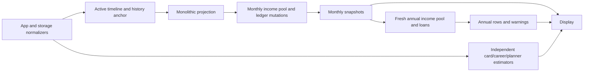
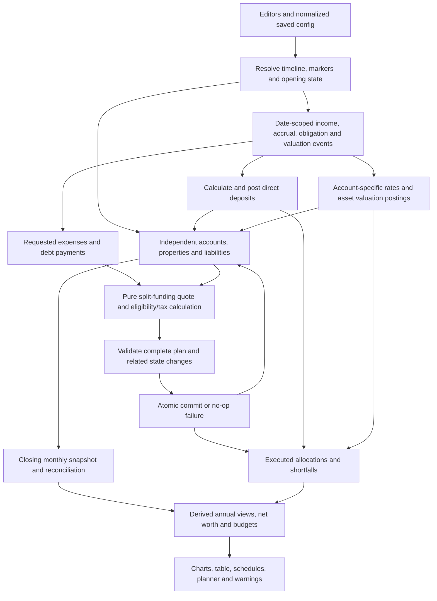

# Account-Based Cashflow Architecture — Review Draft

## 1. Status, scope and authority

**Target specification; incremental implementation authorized by ADR-022.** The explicitly approved standalone manual-contribution removal is implemented; the broader account-only architecture is not yet implemented. Based on the code audit, `agent_plan.md`, and user decisions. Accepted rules/proposed assumptions are tracked in [architecture_decisions.md](architecture_decisions.md); save handling in [migration_plan.md](migration_plan.md).

Accepted: original rules plus RV01–RV31/ADR-019 and follow-up ADR-020. Partial acquisition holds a deposit until complete; taxable gain20% of gross with default editable LTCG15% is clarified. Rates/defaults/allocation/caps/monthly timing/growth/calendar reports/view-only occurred imports/default net-worth/responsive80years reviewed. No implementation/test success implied by approvals; user withdrawal/percentage-base/payoff dates and source contracts explicit.

**Authorized target direction:** remove Pools entirely; each account owns its interest/return assumptions. [account_only_subplan.md](account_only_subplan.md) specifies affected rules, priorities, views and saved fields. ADR-022 permits current consumers to be removed while other work remains incomplete; prior pool-preserving target contracts are superseded by ADR-014. Historical descriptions remain evidence of current code, not mandatory compatibility behavior.

Use React/TypeScript and the existing components. The engine remains deterministic and side-effect free with respect to its inputs; it operates on a private runtime state. No general transfer editor, individual card-purchase simulator or full double-entry product.

GUI compatibility is a cutover requirement: [gui_compatibility_audit.md](gui_compatibility_audit.md) traces actual writes/inputs/result consumers and lists G01–G40 risks. App-local normalization can strip new fields, and local previews/legacy warning paths can disagree with correct engine results. The target requires canonical shared normalization, named projection contexts, a dollars/measurement/date view adapter, and shared funding/outcome/recurrence selectors. These are proposed boundaries, not implemented code or a new state framework.

Performance/scalability requirements are proposed in [performance_scalability_audit.md](performance_scalability_audit.md), PS01–PS20/ADR-016. The new engine has no measured benchmark yet. Refine scheduling to month-batched/indexed occurrences, funding to sparse atomic overlays, audit to one compact indexed trace, contexts to bounded/on-demand recomputation and views to windowed output. Background runner/typed buffers/async storage remain measured design options; no audit or financial behavior may be removed to hit a performance goal.

Supplementary correctness/ownership contracts: [testing_correctness_audit.md](testing_correctness_audit.md) (TC01–TC13/CA01–CA13), [maintainability_documentation_audit.md](maintainability_documentation_audit.md) (MD01–MD11), ADR-017/018. Actual tests must exercise account percentage/funding/debt/default branches, not matching fixed examples; archived defect snapshots are not target correctness. Shared canonical factories/validation must distinguish missing from valid empty/0/false/null, isolate mutable defaults/reset, and recover malformed records without discarding valid siblings. [audit_status.md](audit_status.md) separates completed inspection from pending implementation/execution.

## 2. Existing architecture and intended corrections

Current: App normalizes saved fields and markers, resolves active timelines, seeds bank accounts from the latest history entry, and passes one of two scenario variants to `projectScenario`. The monolithic engine holds asset accounts plus side maps of debts. Monthly income is an unposted spendable pool; loans receive a fresh period income pool after closing snapshots. Several views separately simulate balances. Reports are not a full monthly assets-minus-liabilities ledger.

Corrections explicitly carried forward from the audit:

- R01/R04: one posted income dollar, no unfunded savings deposits or independent annual spending.
- R02/R14: debt decreases only for funded principal; failed acquisition cannot create home/debt/down-payment side effects; underwater liabilities remain accounted for.
- R07/R13/R17: complete monthly changes and requested/executed audit, actual annual totals, one display valuation date.
- R09: planner events execute as obligations.
- R03 resolved: approved removal of unposted standalone contributions and unused scalar calculation; career allocations/other income remain.
- R05/R06/R16: explicit asset/debt identity, new card types, default/pruning save contract.



## 3. Proposed decomposition and ownership

Paths below are proposed modules, not files already created. Split further only when contracts justify it.

| Module | Contract and exclusive responsibility |
|---|---|
| `src/storage.ts` / `defaultScenario.ts` | Shared canonical allowlist/structural validation and independent factories for load/edit/save/reset; missing defaults distinct from valid empty/0/false/null; record-local malformed handling/save diagnostics; prune approved obsolete fields. No projection math or debt conversion. |
| `src/engine/configuration.ts` | Compile requested named context/selected timeline/opening snapshot/markers/dependencies into read-only indexed configuration; retain stable ID maps/boundaries and localized invalidation. Never mutate histories or eagerly simulate every inactive timeline. |
| `src/engine/dates.ts` / `money.ts` | Valid date-only/calendar arithmetic, month ordinals, exact cents conversion, deterministic rounding/order. Never depend on wall clock inside simulation. |
| `src/engine/scheduler.ts` | Emit stable dated events/obligations in clipped month/chunk batches with recurrence cursors and active boundary indexes, not eager all-horizon expansion. Dynamic debt targets resolve at execution; no balance mutation in scheduler. |
| `src/engine/income.ts` | Compile active paycheck, gross/deductions/employee and employer deposits, net-pay account allocation and other income postings. No independent spendable balance. |
| `src/engine/state.ts` | Own account balances, property valuations, debt balances and opening identity/provenance; validate and atomically commit balance changes; track state revision for funding quotes. |
| `src/engine/funding.ts` | Pure indexed primary-first quote with sparse touched-state overlay, not whole-ledger cloning per request. Exact bounded/proven gross-net calculation, then atomic commit validation. No persistence/UI. |
| `src/engine/taxes.ts` | Account eligibility/purpose/configured withdrawal rules and taxable20%-gross gain proxy/default editable LTCG15%; exact rounding/gross-net quote. No inferred actual basis/statutory brackets/tax-lot ledger. |
| `src/engine/obligations.ts` | Translate planned/recurring spending into requests; repayment allocation to interest/principal, 0% target recalculation, failure policy. Commit account and related payment debt changes together through state. |
| `src/engine/valuation.ts` | APY, property appreciation and debt interest accrual as explicit non-payment postings. No income budget. |
| `src/engine/reporting.ts` | Own compact canonical audit/indexes and monthly state; aggregate annual/account/asset/debt totals and derived budgets once. Query visible preview/detail windows rather than clone full audit for each view. No pool totals/debits. |
| `src/engine/projection.ts` | Public facade and orchestrator; retain `projectScenario` entry point while new engine is integrated behind adapters. |
| App/components | Write through canonical config helpers; receive named projection context and display-dollar/measurement view model; shared funding/outcome/date selectors. Render results/warnings and display-only deflation; no independent financial preview simulation. Adapt all G01–G40 consumers before cutover. |



## 4. Persisted configuration versus runtime state

Persisted values are **configuration and historical opening observations**. Runtime balances/results are newly calculated for each projection. Never save calculated closing balances back over user opening balances.

### Proposed schemas

- `ProjectionAccount`: ID/label/type/opening balance, direct annual rate/optional retirement override, color/display order and withdrawal eligibility. Missing rate0%/override none/opening$0; no pool inheritance/scalar seed. Taxable account explicitly assumedGainPercent=20 of gross and default capitalGainsTaxRate=15 editable; no actual basis/tax-lot ledger or inferred statutory bracket. Scope global; funding order separate.
- `LiabilityDefinition`: ID, kind `loan | mortgage | zeroInterestCard | saleDeficiency`, source configuration ID, opening balance, optional linked property ID, interest/payment terms. Positive values represent debt; negative account balances are not a debt representation.
- `PropertyDefinition`: ID/home config, observed opening value/debt link or future acquisition dates/costs/appreciation. Future acquisition includes required down payment, explicit dated funding events, status pending/owned/sold, held acquisition-deposit asset and actual completion date. Pending deposit counts once in assets/net worth but is non-liquid/no default growth; full property/mortgage only on completion. No automatic reattempt/extra borrowing.
- `OpeningSnapshot`: date; account/property values and liability entries **keyed by stable IDs**; measurement metadata and source snapshot ID. An already-recorded 0% debt uses the same liability ID, not an additional unlinked balance. Prior asset-only snapshots keep an asset-only measurement label.
- `FundingPolicy`: primary/fallback IDs, default override/purpose/eligibility; obligations universally partial, no indivisible toggle. Actual payment/account/debt/deposit changes atomic. RV12 zero-fund=no debit/no retry; partial home funding held as deposit until full required amount, then atomic full acquisition. Retirement explicit list; missing primary unresolved.
- `CareerDepositPlan`: percentage/fixed-per-pay-period net allocations plus a designated remainder account. Employee/employer bucket deposit lines preserve individual destinations. Allocation lines are not expenses and do not also debit an account.
- `OrdinaryCardSchedule`: kind=expectedPayment, amount, inclusive start/end (default end=start+11, twelve payments), payment day/funding/flags. No tracked balance/charges/APR/purchase ledger. RV20/RV25 accepted.
- `ZeroInterestCardPlan`: `kind: 'zeroInterestPayoff'`, liability ID, initial balance, start month, inclusive target month, payment day, funding policy and flags. APR always zero. Initial balance is not reinjected at each month or if linked snapshot debt exists.
- Planner entry/event: manual plans default projected, category/account/provenance/dates/rules/funding retained. RV22 occurred imported history is permanently view-only/no projection or planning-budget effect; sourceDate/sourceSign/asOf retained, not clamped/re-executed by changing display date. Future planned records separate; recurrence parent not a second obligation.
- `CashflowItem`/life events/retirement/housing/purchases retain their **final target** capabilities through canonical configuration and the shared engine. ADR-022 allows redundant stored computed totals, old consumers and obsolete income selectors to be deleted before every replacement is wired; record interim failures and do not save a partial fallback over user data.

All new fields have documented factory defaults. Choosing defaults for absent fields is different from making finance assumptions about existing values. Missing IDs produce defaults/empty references, and invalid funding references produce visible configuration shortfalls rather than invented accounts with money.

Defaults must not reuse exported mutable singleton scenario/UI objects. Fully absent storage and a partial supported record with absent fields use the same applicable factories; deliberately empty lists stay empty. Canonical validation happens before engine inputs; TypeScript assertions on raw JSON are not runtime validation. Exact invalid-record recovery/report/save policy is proposed in ADR-018 and tested through CA11, not implemented yet.

### Runtime state

```ts
interface ProjectionState {
  revision: number;
  accountBalancesCents: Record<string, number>;
  propertiesById: Record<string, {
    valueCents: number;
    mortgageId: string | null;
    status: 'pending' | 'owned' | 'sold';
    acquisitionDepositCents: number;
    completedDate: string | null;
  }>;
  liabilitiesById: Record<string, {
    principalCents: number;
    accruedInterestCents: number;
    feesCents: number;
  }>;
}
```

The state object is local to simulation. `commitChanges` is the only balance mutation entry point, including growth, contributions and liability changes. Per-event accounting is a compact posting list. Pure quotes overlay only touched entities; full global before/after copies are not needed per event. Runtime cents and aggregate sums need safe-integer validation after valuation/rounding/commit, not just at input normalization (PS20).

## 5. Monetary precision and funding lifecycle

**Accepted precision policy (ADR-021):** cash balances/postings/liabilities use integer cents. Reject nonfinite/unsafe numeric inputs and negative request amounts at normalization. Convert persisted dollar inputs once by rounding half away from zero. Represent accepted rate decimals exactly for taxable quotes, round each posted tax/penalty separately once, and round valuation only at its posting boundary. Annualized allocation requests use per-line cumulative rounded target differences, including applicable percentage-based initial targets and employer contributions; actual deposits remain bounded by available pay. Never use a $0.01 tolerance to erase unpaid principal.

```ts
interface FundingRequest {
  id: string;
  occurrenceId: string;
  date: string;
  requestedCents: number;
  primaryAccountId: string;
  fallbackAccountIds: string[];
  purpose: 'livingExpense' | 'medical' | 'debtPayment' | 'acquisition' | 'plannedExpense';
}

interface FundingAllocation {
  accountId: string;
  grossDebitCents: number;
  netFundedCents: number;
  withheldTaxCents: number;
  penaltyCents: number;
  assumedGainPercent?: number; // Informational taxable proxy,20% of gross.
  capitalGainsTaxRatePercent?: number; // Actual configured rate used,default15%.
}

interface FundingPlan {
  stateRevision: number;
  request: FundingRequest;
  allocations: FundingAllocation[];
  feasibleCents: number;
  executedCents: number;
  shortfallCents: number;
  status: 'funded' | 'partial' | 'unfunded';
}
```

1. Build primary + explicit per-obligation fallbacks, else configured global fallbacks. Deduplicate IDs preserving first position; never sweep accounts by type or former membership. Retirement spending uses a separately configured explicit account fallback order.
2. Quote indexed read-only balances/rules with sparse tentative debits, not live state; configured ordered sources/quotas retained. Gain proxy/rate metadata retained; no actual basis balance mutated.
3. Cash debit/net funding are equal when tax/penalty-free. With tax-aware sources, calculate tax and penalty separately as rounded fractions of gross; choose the smallest cent-valued gross debit whose exact rounded net covers the assigned net amount without exceeding balance. Derive and enumerate a proven rounding-error bracket of at most 256 candidates; if it exceeds the limit or safe numeric range, report an unsupported-range diagnostic. Never assume the net proceeds are monotone across consecutive cents. Deduct withholding/penalty from gross proceeds once; any unavoidable rounding remainder stays in the source account, not unexplained income. Validate allocation identity exactly (ADR-021).
4. RV11: executed=sum actual net funded, unpaid=requested−executed. Zero-fund no debit/no implicit retry; atomic validation/commit preserved. Partial home funding creates deposit asset; until down-payment funding complete, no full property/mortgage/ownership costs. Explicit later funding events can complete acquisition without inventing borrowing.
5. Combine account debits and actual debt/deposit/acquisition effects into one change set; check revision/nonnegative balances/ownership/conservation; stale quote recomputed. Brokerage assumption metadata is not an actual basis reduction/posting.
6. Commit once or no-op. No intermediate transfer, no income injection for withdrawals, and no negative cash borrowing. Accrual events independent of payment still occur even when funding fails.

### Eligibility and taxes — accepted target direction (ADR-021); implementation pending

- RV14/RV16: checking/savings/taxable ordinarily liquid; explicit retirement/Roth/HSA eligibility/purpose/settings. Taxable brokerage only gain taxed, never all proceeds. No tax-lot product or inferred actual basis.
- RV15 clarification: taxable gain assumed20% of **gross account debit**, assumed cost80%; LTCG default15% editable per account. Tax=roundToCents(gross×0.20×configured LTCG rate) at posting boundary, default effective3% gross. High-precision/rational intermediate gain, not prematurely rounded gain; gross debit/net payment/withholding separately recorded. No actual-basis option/tax-return brackets inferred; assumption always labeled. Do not apply brokerage proxy to HSA/401K/property sale/payroll by default.
- 401K/Roth/HSA are excluded from *implicit* automatic fallback. Explicit primary/fallback/retirement sources may use them under configured rules/purpose. Preserve user-configurable retirement tax/penalty and HSA restriction capability; unknown Roth contribution/earnings splits are not inferred.
- HSA medical spending: tax/penalty-free if explicitly identified as qualified. Non-qualified HSA spending: configured income tax and a configurable default 20% extra penalty before the holder's 65th birthday; waive **only** that penalty at age 65 regardless of retirement status (ADR-021). A generic category named “medical” is not silently classified qualified without explicit config.
- Account liquidity/purpose/automatic-fallback eligibility is explicit; no pool enable flag or inherited rule lookup. Retained account assets still count in valuations regardless of chart visibility. Property/illiquid assets cannot fund ordinary requests.
- Withheld taxes/penalties are paid from gross debit, not charged a second time as another expense. Separately scheduled tax expenses need their own event IDs and funds. Payroll tax deductions are reported distinctly from withdrawal withholding.

## 6. Direct income, deposits and caps

Calculate paycheck from active month career/plan, including raises, employee taxes/benefits/retirement/HSA and actual posttax payroll deductions. Ordinary living expenses are not subtracted from paycheck net. Preserve percent/amount/cap employer-match modes and distinct employer HSA amount, but retain granular destination per line rather than compile into a single first account.

Required reconciliation:

`gross pay = payroll cash deductions + employee bucket deposits + net pay`

`account deposits = allocated net pay + employee bucket deposits + employer deposits + explicit other income`

RV05/RV07 accepted: quote %/fixed deposits in explicit configured order up to actual remaining net, report unmet allocations, remainder directly into configured account. No proportional scaling, minted deposits or silent redirect of missing/deleted destinations. GUI must display requested/posted/unmet amounts.

All allocations are direct deposits, not a net-pay deposit followed by duplicate transfers. Unallocated remainder deposits to the configured account. A first-launch checking/payment account provides the initial destination; if that account is deleted, default references are empty/invalid until configured, not redirected to a retirement account.

Salary zero outside active career/break/after retirement means no ordinary employee/employer deposits. Explicit career months do not fall back to an overlapping age-only career in a date gap. Preserve source monthly expense requests as separate obligations, not payroll deductions. Job-change/break effects become month-scoped rather than age-period-scoped.

RV08 accepted: incoming cap excess routed directly; existing-balance rerouting only through explicitly configured separately audited cap policy. No general transfer workflow/cycles/restriction bypass.

Other income (rent, pensions, benefits, cashflow/life-event inflows) deposits to its configured account on its scheduled date. Property sale is asset disposition and debt settlement, not ordinary earnings. Investment growth is valuation, not deposited salary.

## 7. Scheduling and monthly event order

Date-only fields use parsed year/month/day, never `new Date('YYYY-MM-DD')` followed by timezone-local extraction. Use month ordinals for month-range inclusion; validate leap/day rules. Engine receives explicit start date and resolved end date. New saved opening snapshot is an observation **before modeled events on its date**; old snapshot timing is unknown and may require a new save.

**Accepted RV06/RV23/RV25:** month-oriented dated events, configurable income day (default1), explicit debt/card/withdrawal days and month-only default1. Frequency annualizes, not invented paycheck calendar; actual weekly expense dates retained. No later-date pay funds earlier spending. **RV18/ADR-021:** user selects withdrawal timing with per-source start/date/day and optional retirement/marker link; the configurable initial-balance percentage (4% new-item default) and its valuation date/control must be explicit instead of forced to a global retirement date.

Events sort by date/phase/configured priority/stable occurrence ID. Accepted same-date phases (RV23):

1. Debt interest accrual due on date and scheduled asset acquisition/disposition preparation.
2. Payroll and other direct income.
3. Explicit cap policy.
4. Mandatory obligations: loan/mortgage required installment, rent/housing ancillary groups, ordinary card and 0% scheduled payoff, recurring living expenses and retirement spending.
5. Discretionary expenses/purchases/extra debt payment.
6. Asset valuation at month close, then closing snapshot.

No date allows spending future deposits or month-close investment gains. Unknown intraday timing is a same-date income-before-payment approximation. Property acquisition and required down-payment funding are one event; linked mortgage installments begin only after successful acquisition. Same-date sales and purchases need a documented configured ordering so sale proceeds cannot be used before sale commits.

**Accepted RV01/RV24:** per-account APY/optional retirement override, month-close positive post-event balance with `(1+rate)^(1/12)-1`, partial exponent activeDays/daysInMonth/12. Disclose full active-period growth of deposits and exclusion of spent funds. Weighted display rate never drives account math; debt APR/property appreciation remain separate.

Reporting years aggregate calendar months and carry age/date labels; age-period views may remain as a separately labeled grouping over the same months. Proposed end boundary: through the month before the birthday reaching retirement age + retirement years, with explicit derived start/end metadata. Partial periods never use an annual rate as if it were actual income.

RV25/RV26 accept calendar aggregation and stated boundary conventions. RV31 requires the configurable projection to support **80 years/960 full months from its selected opening date**; do not silently limit it to fifty years/shorter current defaults or assume eighty is a hard maximum for every plan. End metadata/partial periods must reconcile with actual chosen horizon.

## 8. Obligation-specific behavior

| Kind | Proposed partial/failure policy | Accounting and preservation |
|---|---|---|
| Retirement spending | Partial allowed; unmet minimum/spending warning, no fictional income | Preserve account-specific configurable initial-balance percentage (4% new-item default) or specified targets, inflation, caps/start dates and explicit account exhaustion/fallback order. Spend net funded once. Other configured expenses are additional unless user reduces the target; no automatic offset guess. |
| Career expenses, ordinary cards, rent/ancillary housing, recurring planner, cashflow/event expenses | Partial allowed; actual paid vs requested retained; no automatic retry/debt for unmet expense | Preserve all schedules/sources and visible shortfalls. Subsequent occurrence is its own request, not an arrears repayment. |
| Loan/mortgage installment | Partial allowed; accrued interest then principal; liability persists on shortfall | Never reduce by desired payment. Maintain missed scheduled payment information; no invented late fees/default/foreclosure without terms. Required installment before extra payment. |
| 0% card | Partial allowed; funded amount reduces principal, no interest | Adaptive target to inclusive end; unpaid balance survives deadline. |
| One-time purchases/down-payment funding | Universal partial spending/funding | Ordinary expenses reflect funded spend; partial home down payment becomes held acquisition-deposit asset. Full acquisition waits for required funds; zero-fund no debit/no automatic retry; no implicit borrowing. |
| Long-term planned monthly purchase | Partial funding allowed (RV11) | Inclusive dates/duration; unmet amount visible, no invented debt or retry. |
| Tax/penalty withholding | Part of gross funding allocation | Not separately charged again. |
| Sale | Atomic asset removal/liability settlement/proceeds | Insufficient equity cannot erase residual debt; explicit deficiency liability remains. |

RV11 supersedes indivisible payment defaults; actual state changes always atomic. ADR-020 reconciles incomplete acquisition by retaining funded deposit asset, not rejecting partial funding or pretending full home/debt. Test no-op on zero-fund/invalid transaction separately from valid partial payment; phantom debt reduction remains a defect.

### Reviewed configurable withdrawal/payoff dates

- Each retirement account source has an explicit first-withdrawal date/month and payment day; retirement/marker linking is optional. Percentage mode uses an editable `initialWithdrawalRatePercent` per source (new-item default 4%, valid 0–100%). Its initial net target uses the selected account's authoritative balance at its valuation date × the selected rate; this date defaults to **that source's first withdrawal date**, even if it starts later than retirement. The target then escalates under the configured inflation rule. Explicit earlier valuation dates require an available observation; no future/past unknown balance is invented. Gross debit/tax are shown separately (ADR-021).
- Each0% payoff has an explicit date/source policy; default date is the final scheduled payment date and default source its regular funding policy. If payoff and final installment coincide, execute **one** remaining-principal request labeled final payoff/lump sum. If user schedules payoff later, request only principal still outstanding on that date; retain overdue warning/liability until actually funded. No automatic monthly retry or second charge of already-paid principal.
- These are visible/configurable engineering defaults implementing RV18/RV19; user can select dates/sources. Scheduler, marker registry, funding editor, summary and actual-paid preview use the same fields/context.

### Ordinary card and permanent-0% mechanics

Ordinary: one expected expense per inclusive month, default twelve payments end=start+11 (RV20). No balance/charges/interest, blank end uses that factory default, no legacy ongoing inference. Start/payment day explicit.

0%: opening liability identified exactly once; schedule dates start at max(config start, simulation anchor). Per ADR-021, on a payment month through inclusive target, requested cents = `ceil(actual remaining principal cents / remaining scheduled payment count)`, capped at principal. Example $100 over three fully funded payments: $33.34, $33.33, $33.33. Shortfall of first payment leaves more principal to divide over remaining dates. Early payoff stops requests. Missed pre-simulation payments are not assumed funded; opening snapshot balance wins.

RV19: unpaid remaining principal requires a lump-sum payoff; liability/overdue warning retained, no new interest/fees. Make payoff request/date/source explicit and partial-fundable. The final adaptive installment already equals remaining principal when one scheduled month remains; never emit a second duplicate payoff. An unpaid future lump sum needs user-specified timing/source rather than silently repeating debit attempts or injecting funds. Exact default payoff scheduling still to finalize.

### Housing and loans

Existing property/debt observed at opening, not inferred perfect payment history. Future acquisition: each explicit funding event targets at most the outstanding required down payment; funded net amount added to held deposit asset, taxes/penalties actual expense. Pending full home value0/no mortgage principal or ownership costs/appreciation/PMI; deposit non-liquid/no default growth. Once required funds complete, atomically remove deposit and create configured full property/mortgage at actual completion date, with configured financing only. No automatic retries or extra borrowing; later funding explicitly dated. Zero-down acquisition may complete at configured date if other terms valid. Loan opening debt does not auto-inject proceeds without explicit purpose.

Maintain independent housing funding groups for PI/rent, tax/insurance, HOA/maintenance, PMI and down payment; group report labels may consolidate per home without losing allocations. PMI uses actual remaining principal and current consistent property value. Taxes/insurance/maintenance continue after payoff until disposition/end.

Sale posting: remove property; settle linked principal/interest/costs from sale price; deposit actual positive proceeds; preserve unpaid deficiency if proceeds insufficient. Sale proceeds are not a second account-funded purchase. New net worth changes by selling costs/valuation, not a double-count of principal.

## 9. Planner/import integration and occurrence identity

User-approved planner obligations feed the same scheduler/funding engine. One-time entry executes once at startDate; endDate represents its display span, not an automatic daily repeat. Recurring event executes once per resolved occurrence; weekly-Friday/first-Monday/monthly-on-date rules retained. Short months: proposed monthly day31 clamps to last day rather than disappearing; explicit change needs review.

Stable IDs `planner:<entryId>:<date>` and `recurrence:<eventId>:<date>` provide execution/dedup keys. No generation of second LongTermPurchase copies and no implicit label/amount matching across card/purchase/planner records. Explicit links identify the same economic obligation if shown in multiple views. Distinct configured records execute distinctly unless linked.

**Accepted RV22:** imported transactions that already occurred are view-only with zero projected/planner spending/income/balance/budget effect. Preserve original date/sign and classify occurrence using explicit as-of provenance, not a clamped display/planning date or an older simulation anchor. They are not promoted/re-executed by moving a GUI card; an intentionally new future manual obligation has a new identity/provenance link. Future imported plans require explicit planned status. Manual entries/recurrences project by default.

Planner future balance curves use authoritative monthly closes (or event-date snapshots where available), not interpolated annual unrelated estimates. Weekly category spend remains a requested/paid view; make labels distinguish the two.

## 10. Audit and reporting contracts

Audit: source/date/phase/occurrence IDs/requested/executed/unpaid, gross/net/tax/penalty and assumption metadata, touched account/property/deposit/liability deltas, principal/interest/fees/warnings. Formula uses unrounded intermediate gain; any displayed gain/cost rounded only for presentation, never reused to recompute tax. One compact full trace, no global copies/UI shadow logs/truncation. Account debit gross, funded amount net, tax separate.

Monthly close: account/property/held-acquisition-deposit/liability balances and asset/debt/net-worth totals. Pending deposit counted once, non-liquid and excluded from ordinary funding; completion replaces deposit with property equity, not another down-payment expense. Preserve endBalance explicitly account-assets-only; primary graph net worth plus optional account assets. Signed net worth allowed; negative account cash forbidden.

Annual rows sum actual months for gross/net income, employee/employer deposits, career savings, executed expenses, principal, interest, taxes/penalties and shortfalls. Start/close balances are first/last month observations, not sums. No calculation mutates balances during aggregation. Complete event posting reconciliation:

`closing account = opening account + all account postings`

`closing debt = opening debt + accrued interest/fees/new principal − funded debt payment/disposition settlement`

`net-worth change = external income − expense/withholding − debt interest/fees + valuation changes` (internal principal settlement/asset reshuffling does not itself create another expense).

RV27: **Net worth is the default graph; account assets available as another view.** Use “eligible funding accounts exhausted” only for actual exhaustion of eligible configured accounts. Independently show “Some scheduled payments could not be fully funded, beginning in [month].” Partial/unmet/restricted payment is not proof every account empty; negative net worth is not cash exhaustion and property equity not automatic liquidity. Retain signed metrics and accurate monthly first-failure dates.

Income budget diagnostics become comparisons of dated requested obligations to posted income/deposits, not authorizations to spend. Yellow fallback/red shortfall and grouped warnings remain; aggregation based on actual allocation results. No claim an asset draw is paycheck income.

All card schedule previews, loan payoff views, career start/end balance estimates and planner forecasts consume shared results. Current-dollar display uses elapsed time from the same opening date for annual/monthly amounts, balances, debt and activity. Freeze saved trajectory output with schema/engine/measurement metadata; supported old asset-only output stays labeled asset-only, unsupported derived data may be pruned under the new-save rule.

Stacked savings is account-based: layer/legend/color/hover keyed by account ID. Career-end and retirement-withdrawal breakdowns likewise use account IDs; remove pool-keyed savingsBalances/legacy four-bucket maps. AccountType remains descriptive/rule-bearing, not a replacement balance/rate group. Expense planner/import APIs and filters use accounts/categories only; historical pool data is never counted in addition to account snapshots.

## 11. Feature coverage and rollout contracts

| Preserved features | Modules / new behavior | Acceptance contract |
|---|---|---|
| F01/F02/F23/F26 | Independent account configuration, opening identity, schedule, defaults/pruning | Account CRUD/rates without Pools; timeline/markers/history preserved; missing defaults/obsolete pool pruning; explicit debt identity. |
| F03–F07 | Income, scheduler, special cap, obligations | Same career/pay-plan/paycheck/match/savings/expense controls; single posted dollar; no zero-salary phantom deposits. |
| F08/F09 | Funding/taxes/state | Primary-first split/eligibility, exact gross/net, atomic no-op, visible shortfall; no annual reservoir. |
| F10/F11 | Account-only retirement spending/valuation | Per-account configurable initial-balance percentage (4% new-item default) or specified amount, inflation/min/max/explicit fallback/HSA; spending once; independent account rates and exact APY. |
| F12/F13/F19/F20/F22 | Scheduled obligations and other income | Purchase/source/category/flag/cashflow/event/planner/import views retained; explicit failure policy and occurrence identity. |
| F14/F17/F18 | Debt/property/accrual/disposition | Actual funded debt payments; housing groups, extra payment/PMI/rent/sale; equity/deficiency retained. |
| F15/F16 | Expected-card schedule and permanent-0% liability | Agreed two-type product; no equivalent old-card conversion; inclusive end/adaptive payoff/deadline debt. |
| F21 | **Removed with user approval (ADR-005)** | Controls/configuration/unposted calculation removed; no conversion into extra income. Career allocations/other-income events retained. |
| F24/F25 | Audit/reporting/display | Annual sums, shared previews, account vs net-worth metrics, consistent deflation and warnings. |

Rollout: retain original B01–B09 evidence → Gate B/ADR-022 implementation authorization → canonical schema/default/codec and state/funding kernel tests → income and monthly obligation integration → cards/debts/housing/planner → shared reporting → measured integrated candidate → final residual-obsolete-path sweep. Superseded consumers may be deleted at any earlier point and the intermediate app/build/tests may fail, with exact failures recorded. **Final release** waits until no user flow mixes new and old spending engines and the Phase-8 checks pass.

GUI exit: account rates/policies survive unrelated edits/reload; no-career plans render; atomic failures visibly marked without negative balances; funded card/debt/planner previews use same engine context; shared date/units/metrics/deflation are consistent; nested timeline policies clone safely; GUI-A01–A10 acceptance completed. Detailed GUI list/verification is in the compatibility audit.

Remaining substantive choices/defaults are in ADR-004 through ADR-018 and the linked account-only/GUI/performance/correctness/default/ownership plans. Last code verification: 207 passing tests plus one pre-existing App failure, passing build. Supplementary inspection and documentation updates have not changed that runtime baseline or executed target acceptance.

GUI/performance review additions: ADR-015/016, PS01–PS20 and B-P1–B-P8 benchmarks. Validate compile/run/audit/view/save complexity and response/memory targets with a declared production-browser environment before claiming scalability. No new-engine performance measurements currently exist.

Correctness/maintainability review additions: ADR-017/018 and CA01–CA13/MD exit criteria. Fix test coverage claims/fixtures separately from approved formula changes; triage baseline failure, verify defaults/field persistence/clone isolation, and assign one owner before module extraction. Refresh general runtime docs only when code is actually implemented. All inspection findings documented; Gate B and numerical/UI/performance execution remain pending.
