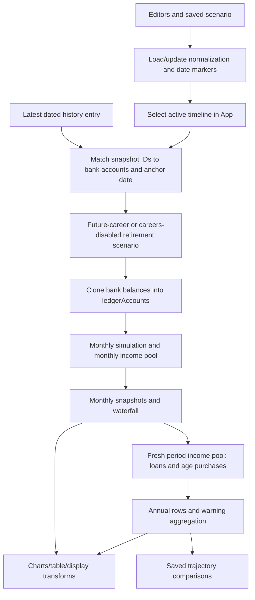

# Existing Feature Inventory, Specifications, and Preservation Checklist

> **As-of status (P7.5, 2026-10-16).** This is a historical observed-behavior inventory (audited 2026-10-12), retained as evidence. Authority is now the live `src/` runtime and [`phase5_handoff.md`](phase5_handoff.md): the account-only rearchitecture is a runnable **Phase-5 integrated candidate, not a release** — Phase-6 measurements and Phase-7 code cleanup remain open. The "Gate A unresolved / Gate B pending review" and "no source/schema/storage changes" framing below describes that earlier session, not current status.

## Review status and evidence boundary

- Phase: mandatory Pre-Step 0 complete; user decisions received and architecture draft available. **Gate A has unresolved items; Gate B is pending review.** This is an observed-behavior specification, not authorization to rewrite financial behavior.
- Audited 2026-10-12 against the current working tree, including pre-existing uncommitted work. Runtime source, not older documentation, is authoritative.
- The user accepts a new save/pruning and explicitly approved removal of standalone manual contributions. That removal is implemented; remaining behavioral changes require validated contracts/Gate B review. The inventory below describes the original audited code unless an implemented change is noted.
- **New direction, planning only:** user requests removing Pools and moving interest/return rates to individual accounts. Original pool features remain documented as historical/current-code behavior, but their target preservation decisions now follow ADR-014 and `account_only_subplan.md`. No source/schema/storage changes made for this request.
- Evidence: `src/App.tsx`, the complete `src/engine/projection.ts`, `src/types.ts`, `src/defaultScenario.ts`, `src/storage.ts`, `src/paycheck.ts`, `src/financeModel.ts`; scheduler/estimator/reporting paths in components and utilities; existing engine/UI/paycheck/date-marker tests; new characterization inputs and snapshots.
- Existing docs are navigation aids. In particular, `AGENTS.md` says old migration code was removed, but `storage.ts` still contains legacy paycheck, account-rule, annual-return and tab adapters. Older test titles sometimes describe removed depletion rules although assertions reflect newer behavior.
- Supplementary audit coverage: [audit_status.md](audit_status.md), [testing/correctness](testing_correctness_audit.md) and [maintainability/documentation](maintainability_documentation_audit.md). All six requested areas inspected; actual 4% test branch/default normalization/shared-default/malformed recovery gaps recorded below. No target implementation or new test execution implied.
- **Current authorization update (2026-10-14):** the Gate-status statements above describe the 2026-10-12 inspection, not the current approval. [ADR-022](architecture_decisions.md#adr-022--incremental-implementation-authorized-intermediate-breakage-permitted) now authorizes phased implementation, direct removal of current consumers and intermediate App/build/test breakage; this inventory's observed behavior and archived baselines remain historical evidence.

### Baseline verification

Before adding audit artifacts, `npm run test -- --run` ran 195 tests: **194 passed, 1 failed**. Failure: `src/App.test.tsx:504`, “marks loan rows red when the selected account cannot fund the loan”; expected class `invalid`, received `purchase-row`. Root cause has not been established; do not attribute it to this refactor. `npm run build` passed.

After adding the audit artifacts, the full suite ran 204 tests: **203 passed, the same 1 pre-existing test failed**. All nine characterization snapshots passed without updating them on this verification run. Build passed again; `git diff --check` reported no whitespace errors. Architecture and financial implementation remain gated.

After the explicitly approved standalone contribution removal: **207/208 tests passed**, same pre-existing loan-row highlighting failure (now App.test.tsx:519). All 90 engine tests, nine current characterization snapshots and new UI/storage removal tests passed; build and whitespace checks passed. Broader architecture remains pending review.

Nine original deterministic input/output baselines are archived in `refactor/fixtures/projection.pre-refactor.snap`, including all months, activity, annual rows, warnings and shortfalls. Current expectations in `src/engine/projection.characterization.test.ts` and its `__snapshots__` reflect the approved standalone contribution removal; B09 now verifies obsolete config injects no contribution/income. Each case also verifies repeated results/input immutability. Original evidence is retained rather than overwritten.

| Fixture ID | Snapshot/test title | Verified sample observation |
|---|---|---|
| B01 | opening balances and exact APY | $10,000 at 6.5% APY for two years ends at approximately $11,342.25. |
| B02 | payroll deposits, matching, capped savings and monthly expenses | Employee/employer retirement deposits, 10% net savings, $20 monthly expense and cap overflow produce $11,680 closing assets. |
| B03 | monthly and annual spending use independent income budgets | $12,000 net pay covers $12,000 autopay **and** $12,000 loan payments; assets remain $10,000, annual `extraCashflow` is −$24,000, no overspend validation catches the combined spending. |
| B04 | split fallback and tax-aware retirement exhaustion | $1,000 retirement assets at 20% withholding plus $500 taxable assets fund $1,300 net retirement spending; accounts exhaust. |
| B05 | all credit card modes with interest, intro period and shortfalls | All five modes, recurring charges, introductory period, end date, constrained account and unpaid balances are captured. |
| B06 | mortgage funding failure, rental income and home sale | $3,750 of requested payments are unfunded; scheduled amortization still yields sale cash. Closing account assets are $4,050. |
| B07 | scheduled purchases, cashflow and life events | $1,200 recurring inflow, $400 purchase, three $200 payments and $75 event leave $10,125. |
| B08 | partial first period and effective pay plan | Birthday-based partial first period and April pay-plan change are captured; annual income uses the last monthly rate, not actual period total. |
| B09 | manual contribution is reported without an account deposit | $1,200 annual manual contribution appears in reporting while account assets remain $10,000. |

Fixtures use explicit local `2026-01-01T00:00:00` to avoid date-only UTC/local ambiguity, and fixed planner dates/IDs. Invalid DOB in most fixtures deliberately selects twelve-month periods. They do not cover every UI, import, migration or long-horizon edge case; coverage gaps are listed below.

## Repository inventory

| Layer | Actual locations and responsibility |
|---|---|
| Browser bootstrap | `index.html` → `src/main.tsx` → React `App`; Vite configuration in `vite.config.ts`. |
| Composition/configuration | `src/App.tsx`: state, normalization, active timelines, opening-snapshot anchoring, two projection variants, forms, warnings, card schedule preview and display transforms. |
| Calculation | `src/engine/projection.ts`: ledger mutation, monthly cashflow, period-end loan/age-purchase processing, aggregation. `src/paycheck.ts`: granular payroll compilation. `src/financeModel.ts`: default account selection and purchase funding-source conversion. |
| Persisted domain | `src/types.ts`, `src/defaultScenario.ts`, `src/storage.ts`; single localStorage key `finance-planner-state`, no explicit schema version. |
| Editors | `CareerPlanEditor`, `PaycheckEditorModal`, `CashflowItemEditor`, `HousingEditor`, `ExpensesPlanner`, `DateMarkersEditor`, `DateOrMarkerInput`, `YearMonthInput`, buffered number/color controls. Many purchase, loan, card and net-worth forms remain inside `App`. |
| Reports | `ChartPanel`, `SavingsStackedChart`, `ResultsTable`, `NetWorthHistoryChart`, `TrajectoryComparisonChart`; flags via `flagCalloutLayout` and color utilities. |
| Dates/performance | `src/utils/ageDate.ts`, `dateMarkers.ts`, `perfTools.ts`. Date markers are resolved outside the engine. |
| Imports | `src/importers/expenseImport.ts` handles expense CSV/PDF-like text. `sample expenses/` holds manual sample files. No `bankImport.ts` or `bankImport.test.ts` exists despite references in AGENTS/docs. |
| Tests/fixtures | Engine 90, App 82, paycheck 6, date markers 11, color 6 baseline tests; new B01–B09 snapshots. No dedicated import test file currently exists. Vitest uses jsdom and `vitest.setup.ts`. |
| Persistence/migrations | Adapters embedded in `storage.ts` and `App.updateScenario`; no standalone versioned migration framework or rollback archive. Saved trajectory outputs have their own normalizer. |
| Documentation/build | `docs/`, `CODEMAP.md`, `AGENTS.md`, `CHANGES.md`, ignored `gitchanges.md`; TypeScript/Vite build, generated `dist` and build metadata. |

## Observed end-to-end execution and financial assumptions

### Dates, periods, ordering and precision

1. Engine takes optional `startDate`; absent or invalid means wall-clock now. Age is DOB-derived, fallback `profile.currentAge`, clamped 18–100. Retirement age is clamped current age–110, retirement years 1–60. End age = retirement age + retirement years.
2. First period is `ceil(daysUntilNextBirthday / 30.4375)`, clamped 1–12; subsequent periods are twelve months. There are `endAge - currentAge` periods. These are **age periods, not guaranteed calendar years**, and the first partial period affects the last simulated calendar month. Annual `calendarYear` is start year + period offset; monthly dates use serial month progression. Monthly displayed age is period age + 1.
3. Career and pay-plan selection happens monthly; job-change/career-break effects are still selected per age period. Explicit month ends are generally inclusive, with different card intro semantics below. Missing ages/months have feature-specific fallbacks. Regex checks do not universally validate real calendar dates.
4. **Actual monthly order**: payroll employee/employer deposits → source-line savings → source-line expenses → account cap overflow → effective-APY growth → cashflow items → life-event flows → retirement withdrawals/fallbacks → credit cards → income large purchases → income long-term purchases → account long-term purchases → account large purchases → housing down payment/groups/amortization → housing rental income/sale → monthly closing snapshot/waterfall.
5. **After all monthly snapshots for a period**: initialize `availableIncome = periodNetIncome` → affordability estimates → loans (down payment and loop of monthly installments) → age-selected purchases not already processed → contribution/report calculations → yearly row/depletion checks. Loans therefore mutate balances after closing snapshots; this is not a unified monthly cashflow order.
6. Calculations use JavaScript floating-point numbers and assorted tolerances ($0.001, $0.01, $0.000001); no single cents-rounding policy. `formatCurrency` displays whole USD. Some UI estimators round independently. Warning grouping buckets dollars in tens but does not round the underlying spending.
7. Ledger accounts are cloned; input scenario is not intentionally mutated. Account and pool ties sort by priority then label; several event loops retain array order, career/pay-plan equal-start ties prefer later entries. Identical explicit-date inputs are characterized as deterministic; clock defaults and generated UI IDs are not deterministic inputs.

### Authoritative state, mutations and bypasses

| Mutation/spend path | Actual behavior | Audit consequence |
|---|---|---|
| `applyAccountDeposit` (160–170) | Credits existing account; missing account silently receives nothing. | Payroll, cashflows, events, rent, sale share this helper; labels are generic “Deposit”. |
| `applySourceContributions` (270–309) | Direct credit of full requested savings to account or first-priority account in pool. | Happens before income-clamp validation; excessive configured savings can create unfunded deposits. Not recorded in accountActivity. |
| `applyCareerAccountCaps` (238–268) | Debits excess and credits configured fallback account. | Special existing rerouting capability; not ordinary expense funding, not recorded in activity. Must reconcile with no-general-transfer target. |
| `applyMonthlyGrowth` (223–236) | Mutates each real account by effective monthly APY; absent/disabled pool resolves to 0%. | Growth not recorded in activity; deposits earlier in month receive growth. |
| `applyNetTargetWithdrawal` (321–394) | Immediately debits one account or priority-ordered pool accounts, grossed up for pool withholding; partial funding accepted. | No atomic plan/commit; no hard account-type eligibility. Activity records net debit, not gross balance change. |
| `processIncomeWaterfall` (667–739) | Spends transient income without ledger debit, then two configured fallback accounts via withdrawal helper. | Partial funding; only account fallback changes actual balances. Monthly and annual pools are independent. |
| Retirement exhaustion | Pool requests fall back across enabled pools by priority; explicit account requests do not. | Fallback withdrawal omits activity recorder; preserve capability and resolve eligibility. |
| Debt/asset side states | `loanBalances`, `creditCardBalances`, `housingLoanBalances`; property value calculated ad hoc. | Card debt is exposed separately; loan/mortgage balances and home values are not exposed as unified liabilities/assets. |
| Scalar `balance`/`rawEndBalance` (1826–1867) | Includes manual contribution and signed cashflows; falls back when ledger total is zero. | Annual output still uses ledger sum; scalar is not a reliable second state authority. |
| UI-only estimators | Career balances, card schedules/payoff, loan payoff, planner weekly balance interpolation. | Independent assumptions can disagree with funded projection; must retain views using shared results. |

`accountBalancesById` and pool totals are closing asset views, clamping negative values to zero. Historical “net worth” and projected `endBalance` are not currently a complete assets-minus-liabilities computation. Opening history contains no liability identity/provenance links.

## Feature specifications and acceptance checklist

Status terminology: **confirmed in code**, **partially implemented**, **unclear**, **missing**, **suspected defect**. Preservation decisions below apply to capabilities; defects are observations to reconcile, not immutable requirements. All feature records inherit ordering, precision and date assumptions above.

### F01 — Opening balances, account/pool management and history
- **Purpose/inputs/defaults:** `NetWorthConfig` bank accounts (ID, label, pool, priority, type, balance), pool definitions, legacy pool balances, custom accounts, dated history/as-of; `portfolio.currentAssets` defaults $500,000, four default accounts start at $0. Account types: checking/savings/taxable/401K/Roth/HSA. History empty by default.
- **Behavior/evidence:** `App` 702–735 anchors latest lexically sorted history date and matches account IDs; missing snapshot IDs retain current configured balances. With no bank accounts, history total becomes legacy currentAssets. Engine 558–601 clones bank balances; positive ledger/pool sums beat scalar starting assets. Scalar fallback does not seed actual accounts. Custom historical assets are not independently seeded into ledger. `saveNetWorthSnapshot` overwrites same-day manual saves; changed balance edits can append entries.
- **Outputs/edges:** Baseline “Now” row, simulation-start note, history chart/range filters, per-account balances. History totals sum nonnegative assets, including custom accounts. Latest deleted/missing IDs, duplicate dates, zero balances and no accounts need explicit migration semantics.
- **Status/decision:** confirmed in code; scalar/custom opening reconciliation partially implemented. **Redesign with equivalent capability**; retain snapshots and IDs unchanged as historical evidence.
- **Acceptance:** Existing UI tests “anchors … last saved balance snapshot”, dated save/same-day overwrite; B01. Add missing-ID/custom/no-account/zero snapshot migration and liability-provenance tests.

### F02 — Projection horizon and retirement scenario variants
- **Inputs/defaults:** DOB `1980-10-01`, fallback age 45, retirement age 65, thirty years; `futureRetirement.useCareerEndAge=true`, independent future controls. `App` creates career-enabled future scenario or careers-disabled retirement scenario.
- **Behavior/outputs:** `projectScenario`, age/date helpers, `getCareerDerivedRetirementAge`; latest enabled career end age can set future retirement. Options and Finances share future reports; other tabs may select retirement projection. Empty enabled-career sets suppress future chart/table in App. Annual baseline plus age-period rows, start date, horizon and summary.
- **Status/decision:** confirmed in code; period/calendar semantics require reconciliation. **Redesign with equivalent capability**.
- **Acceptance:** Existing horizon/baseline/invalid-DOB/start-anchor tests, B08; add February 29, DST/timezone, actual final-month and full horizon boundary expectations.

### F03 — Careers, overlaps, raises, date chaining and pay-plan changes
- **Inputs/defaults:** Enabled entries, inclusive age/month ranges, chain previous end + 1 month, birthday start, markers, annual raise default 3.5%; Initial paycheck/source lines plus dated `CareerPayPlan` snapshots (optional raise override).
- **Behavior/evidence:** Engine `getCareerEntryForMonth` selects latest-start matching enabled career; if no match it falls back to age-based selection, so explicit gaps can still select a career. `resolveActiveCareerPayPlan` chooses latest effective month, later entry on ties. Raises use whole age difference from plan/career start age, not elapsed fractional months. App/storage normalize base and all timelines; career duplication, deletion, reorder, unique-ID repair and housing-link cleanup exist.
- **Outputs/accounts:** Monthly income and source-line activity, career labels/end pool balances, selected-plan editors. Annual label uses age selection; annual salary/net rate use last month's resolved paycheck. `careerPlan.enabled` is persisted but engine selection checks entry.enabled, not plan.enabled.
- **Status/decision:** confirmed in code; date-gap and enable-flag discrepancies **suspected defect**. **Redesign with equivalent capability**.
- **Acceptance:** Existing overlap, chaining, plan-effective-month, fixed-deposit/raise tests; B02/B08. Add explicit gap, overlap ties, plan toggle, retirement cutoff and within-year annual sums.

### F04 — Granular paycheck, payroll deductions and net income
- **Inputs/defaults:** `Paycheck` frequency weekly=52, biweekly=26, semimonthly=24, monthly=12; categories earning/tax/pretax/posttax/employer, lines with amount or % gross, rate/hours/YTD, bucket/account. Default gross $98,000 annual flat info; default granular earnings rounded per period. `PaycheckInfo` contains taxes/benefits/living expenses, amount/percentage contribution/match modes and period metadata.
- **Behavior/evidence:** `compilePaycheck` annualizes, aggregates pretax bucket deposits and first destination ID per bucket; non-bucket pretax goes to healthBenefits, posttax to otherBenefits, employer bucket amounts to match. `resolvePaycheckInfo` prefers explicit flat info; storage recompiles when granular paycheck exists. Engine 855–920 raises salary and flat deductions; monthly net = max(0, gross − taxes − benefits − other − employee retirement − employee HSA − living expenses)/12. Employer additions are not deducted. Flat period metadata is not read by the engine. Negative net warns. Rate/hours/YTD are not separately consumed by projection.
- **Outputs/edges:** Net income, savings/income budgets, editor totals; multiple lines targeting different accounts collapse to first bucket account, legacy living-expense meaning differs from payroll deductions. Flat amount deposits may continue when salary becomes zero through retirement/break because their branches are not salary-gated.
- **Status/decision:** confirmed in code; multi-destination and no-employment deposits **suspected defect**. **Retain with corrected behavior** after contracts validated.
- **Acceptance:** Existing paycheck and net-income/raise tests, B02/B08. Add every frequency, multi-account bucket, employer-only, break/retirement and legacy period/expense tests; deposit one dollar once.

### F05 — Employee retirement/HSA deposits and employer matching
- **Inputs/defaults:** Flat retirement/HSA employee amounts default zero; salary-percentage modes, retirement match % employee contribution and optional salary cap, HSA match % employee HSA, independent employer HSA amount/% salary; destination IDs required for actual deposit.
- **Behavior/evidence:** Engine 864–952 calculates employee and employer components monthly; employee fully deducted from net, employer added independently. Amount modes grow by raise factor. Retirement cap applies to percentage-match mode; cap 0 means uncapped. Missing ID prevents deposit despite employee deduction. Granular compiler combines employer HSA into match field.
- **Outputs/accounts:** Retirement/HSA account balances and careerSavingsDeposits, generic deposit activity; these payroll deposits are not included in `careerContribution` (source-line savings only). Payroll taxes are deductions, not `taxesPaid` withdrawal report.
- **Status/decision:** confirmed in code. **Redesign with equivalent capability**; preserve all independent contribution/match controls and destinations.
- **Acceptance:** Existing percent retirement/match math tests, B02; add cap boundaries, missing destination, distinct employer HSA, multiple granular destinations and no-employment behavior.

### F06 — Net-pay savings allocations, fixed deposits, account caps and overflow
- **Inputs/defaults:** `CareerSourceLine`: enabled account/pool, % rate (legacy name percentOfSalary), fixed per-pay-period amount, increaseWithPaycheck, savingsMonthly display toggle, maxBalance and overflowFallbackAccountId. Default rates 2% emergency, 3% HSA, 6% investments, 6% 401K; cap 0 = off.
- **Behavior/evidence:** `getSourceContributionMonthlyAmount`, `applySourceContributions`, `applyCareerAccountCaps`; percent base is net income. Fixed deposit = amount × pay periods / 12 × optional raise. Full credits posted before income availability warning. Pool deposits choose first-priority account. Cap moves entire existing excess after source expenses and before growth, so later growth may exceed cap. Missing/self overflow leaves money and warns.
- **Outputs/edges:** Career savings table, source contribution total, waterfall deposits, validation overspend. SavingsMonthly controls display/conversion, not separate simulation cadence. `CareerPlanEditor` independently estimates prior career start/end balances using APR/12 and age durations; projected end balances are supplied separately.
- **Status/decision:** confirmed in code; excessive savings minting **suspected defect**. **Redesign with equivalent capability** including configured overflow rerouting as a special deposit/cap policy.
- **Acceptance:** Existing cap, active-career-only, fixed/raise tests; B02. Add allocations >100%/net, invalid destinations, cap cycles and estimator/projection reconciliation.

### F07 — Career monthly account-funded expenses
- **Inputs/defaults:** Per-source monthlyWithdrawal=0; increaseWithdrawalWithPaycheck=false. Selected account/pool, line enable and active pay plan govern requests.
- **Behavior/outputs:** Before growth, withdrawal helper consumes account gross/net and taxes/penalties without reducing income pool. Unfunded requests accumulate by source ID in `careerWithdrawalShortfalls`; editor red rows/tooltips and engine warnings. These expenses are tracked in waterfall careerWithdrawals, not retirement `withdrawal` field.
- **Status/decision:** confirmed in code. **Redesign with equivalent capability** using account-funded obligations.
- **Acceptance:** Existing monthly withdrawal/raise/shortfall tests, B02; add explicit source exhaustion, taxes and no double deduction from pay.

### F08 — Transient income funding and ordered fallback accounts
- **Inputs/defaults:** Most funding unions allow `income` or account (loans/housing also pool); income fallbacks 1/2 default null. Purchase normalizer returns no source lines for income or invalid selected account.
- **Behavior/evidence:** `processIncomeWaterfall` spends monthly net reservoir then fb1 then fb2, allows split/partial, clamps income at zero; gross debit occurs only on fallback accounts. No unspent net-pay deposit. Fresh annual reservoir created after months for loans/age-only purchases. Account-funded payments generally do not use global income fallbacks. Deleting invalid fallback clears it and shows dismissible notice in App.
- **Outputs/edges:** Covered/yellow fallback/red shortfall status, fallback account amounts, firstFallbackYearMonth, `incomeUsageByMonth`, separate monthly/yearly validation. Some repeated purchase statuses overwrite prior severity/date; housing/cards/loans preserve worst severity. B03 reproduces income reuse rather than assuming a diagram proves it.
- **Status/decision:** confirmed in code. **Redesign with equivalent capability** for visibility and ordered split funding; independent reservoirs superseded by agreed direct-account model.
- **Acceptance:** Existing both fallback, insufficient-income, no-career and income-usage tests; B03/B04. Target: single deposit, primary plus multiple fallbacks, duplicate fallback IDs not double-counted, derived metrics never spend.

### F09 — Tax-aware withdrawal, restrictions and account priority
- **Inputs/defaults:** Enabled pools have priority, taxRate/penaltyRate default zero, isHSA and softRestrictionNote; account priority within pool. AccountType is descriptive, not a withdrawal gate.
- **Behavior/evidence:** `applyNetTargetWithdrawal`: net factor=max(0.01, 1−max(0,tax+penalty)/100); requested net grossed up, capped by account balance. Withholding split by tax/penalty ratio. Applies to whole withdrawal proceeds, including taxable pools; no brokerage basis/gains model. Soft restrictions only warn. HSA penalty/note clear only if age >= retirementAge **and** age >=65, tax remains.
- **Outputs/edges:** taxesPaid/penaltiesPaid, gross pool depletion, net activity labels, deduplicated restriction warnings. Enabled-pool list determines available pool requests; direct accounts in absent/disabled pools get default zero rules. No atomic all-or-nothing support.
- **Status/decision:** confirmed in code; hard eligibility/gains taxation **missing**. **Retain with corrected behavior** using explicit assumptions/compatibility handling, never invent basis.
- **Acceptance:** Existing HSA and retirement tests, B04; add gross/net reconciliation, restricted account rules, 100% rates, disabled pool and cost-basis unknown cases.

### F10 — Retirement withdrawals, four-percent start, min/max and source exhaustion
- **Inputs/defaults:** Specified/four_percent mode, firstYearAmount $40,000, min=0, max=$1,000,000, source amount/four_percent, startAge and sync flag; default pool 401K $40,000. App source controls carry actual plans.
- **Behavior/evidence:** Engine 774–835/1075–1119 computes initial source targets (4% account/pool balance if line.mode=four_percent), spreads over period months, proportionally caps yearly target; later targets/min/max inflate from previous plan rather than recomputing four percent. Gate uses displayAge against sourceStartAge. Pool exhaustion tries other pools by priority; account-only requests do not. Net withdrawal leaves modeled assets, not income/deposit account. firstYearAmount/global mode do not independently fund a source-free withdrawal plan.
- **Outputs/edges:** withdrawal, firstRetirementYearPlannedAccountWithdrawals (actually funded gross by four legacy pools), min unmet warning, depletion summary; custom-pool gross not represented in legacy first-year map. No explicit retirement spending account.
- **Status/decision:** confirmed in code; labels/start timing partially inconsistent. **Redesign with equivalent capability** preserving source priorities, min/max, inflation and HSA behavior pending reconciliation.
- **Acceptance:** Existing four-percent, cap, source start age, inflation, minimum and depletion tests; B04. Add all sources exhausted, explicit account vs pool, tax-aware target and clarify whether withdrawal is spending or a deposit for later obligations.

### F11 — Investment/savings growth, return summaries and inflation
- **Inputs/defaults:** Pool pre/post retirement yields (2.5%,5%,6.5%,6% defaults), inflation enabled 2.9% globally; weighted portfolio rate derives from positive balances.
- **Behavior/evidence:** Effective monthly APY `(1+r)^(1/12)-1`, growth after payroll/source flows but before most obligations. Pre/post rate selected by period age. Weighted rate calculated before period, not recomputed monthly for reporting. Inflation escalates retirement targets/min/max and cashflow/life-event amounts; it is not applied uniformly to every nominal purchase/rent/card amount. >25% weighted returns warn.
- **Outputs/edges:** Asset valuations, annualReturnRate/inflationRate, warning; no gain-as-income deposit. Invalid rate <=−100% handling not fully validated.
- **Status/decision:** confirmed in code. **Retain unchanged** effective-APY formula; preserve configurable return/inflation capability with explicit timing.
- **Acceptance:** Existing exact APY/simple growth/inflation toggles, B01; add negative yields, missing pools, pre/post boundary and growth-versus-spend separation.

### F12 — One-time large purchases, categories and affordability display
- **Inputs/defaults:** Date/age, amount, enable/flag/color/category, income/account selector and optional multiple sourceLines; new default $10,000 investment-funded next age. App normalizes selector to a single account source and supports sort/filter/category management.
- **Behavior/evidence:** Scheduled monthly branches honor exact month and ignore pre-start date. Account source lines get first pass up to source.amount then second pass using remaining balances; partial debits allowed with aggregate shortfall. Age-period fallback processes not-already-monthly IDs. Affordability estimation is not a rescheduling executor; income may be marked affordable without a funded event. Missing lines can yield a negative **display override** while ledger stays nonnegative.
- **Outputs/edges:** Flags, shortfall red row, firstAffordableAge, post-purchase per-account balances; income shows N/A. Purchase amount is not consistently inflation adjusted.
- **Status/decision:** confirmed in code; affordability/display semantics partially implemented. **Redesign with equivalent capability**; decide indivisibility/postponement before replacing partial debit behavior.
- **Acceptance:** Existing schedule/affordability/source-total/post-balance and UI category/sort flows; B07. Add failed indivisible purchase, tax-aware multi-account funding and display-vs-authoritative-balance tests.

### F13 — Long-term monthly planned expenses
- **Inputs/defaults:** Start, inclusive end date or duration >=1, monthlyAmount; default $500 for twelve months from investments; source lines, enable/flags.
- **Behavior/outputs:** Exact month window, in-progress schedules start charging at anchor; same income/partial multi-source funding as large purchases. App synchronizes duration and end date. Account shortfalls aggregate; income statuses maintained separately. Monthly obligations/graph flags.
- **Status/decision:** confirmed in code. **Redesign with equivalent capability**.
- **Acceptance:** Existing duration/end synchronization and projection/in-progress tests; B07. Add end==start, year boundary, shortfall persistence, multiple sources and start before history.

### F14 — Loans, interest, extra payments and down payments
- **Inputs/defaults:** Start month, originalAmount/currentBalance ($25,000 default), down payment 0, APR 6.5%, minimum $350, extra, paymentSource/downPaymentSource (income/account/pool), legacy paymentSourceAccount, flags. CurrentBalance seeds debt; originalAmount does not create an asset/proceeds deposit.
- **Behavior/evidence:** Engine 1615–1750 loops active installment months **after period snapshots**; nominal APR/12 with lower-rate clamp, payment capped at interest-added balance, selected source partial debit. Account route reduces debt by actual net funded. Income route reduces debt by paymentTarget even if waterfall covered less. Down payment fired once in starting period and marked applied despite shortfall. UI payoff estimator assumes full scheduled payments independent of actual funding.
- **Outputs/edges:** Loan shortfalls, funding indicators, payoff estimate/flags; no loan balances in ProjectionResult/monthly net worth. No contractual missed-payment/arrears fees. Loans funded in later months may use earlier/later aggregated income/assets.
- **Status/decision:** confirmed in code; unfunded debt reduction/year-end timing **suspected defect**. **Retain with corrected behavior** after debt/event contract.
- **Acceptance:** Existing interest/down source/exhaustion/income ordering tests; B03, pre-existing UI failure. Add actual-funded principal, interest vs principal, missed payment, monthly closing and historical opening liability tests.

### F15 — Ordinary expected credit-card payments (existing autopay)
- **Inputs/defaults:** fixedPaymentAmount, income/account source, optional autopay end month/marker, paymentDay, graph flag. New card defaults minimum mode, $100 fixed amount; switching UI to autopay defaults end current month +12, end required in editor.
- **Behavior/evidence:** Engine 1123–1155 pays fixed expense even at zero balance, end inclusive, blank end ongoing; ignores charges/APR in this branch and sets tracked card balance zero after processing. PaymentDay is display/config, not within-month ordering. All enabled cards start at simulation anchor; no card start month.
- **Outputs/edges:** Shortfall/warning, card row/flags, recurring cashflow; baseline can still show currentBalance as debt before first autopay month. Independent schedule UI uses different non-autopay formulas for positive starting balances.
- **Status/decision:** confirmed in code. **Redesign with equivalent capability** as ordinary expected-payment schedule with no tracked balance, reconcile blank end and existing nonzero opening values.
- **Acceptance:** Existing autopay zero balance/end/fallback/account warning tests, B03/B05; target include end month and no charges/debt creation.

### F16 — Legacy balance-bearing cards and promotional lump payoff
- **Inputs/defaults:** currentBalance, APR 24.99%, monthlyCharges=0, intro enable/end, fixed/minimum/payInFull/fixedPlusLump; minimum 2%, floor $25, separate lump source, paymentDay 15.
- **Behavior/evidence:** Engine 1158–1224 adds aggregate monthly charges, then nominal APR/12 interest on charged balance outside intro. Intro **end month accrues interest**, lump triggers month before intro end. Fixed/full/minimum/lump targets capped to debt, only actual funded payments reduce liability; residual debt/charges persist. No individual purchase ledger. App 4881–4984 runs separate at-most-24-month preview from wall clock, reduces balances as if funded and clamps account preview without shortfall-aware debt reconciliation; other editor preview also independently calculates payoff.
- **Outputs/edges:** `creditCardBalancesById`, annual totalCreditCardDebt, separate debt graph, schedule and payoff display; liability is not subtracted from portfolio endBalance. Unknown end/tie/intro-passed and source differences need migration decisions.
- **Status/decision:** confirmed in code. **Redesign with equivalent capability** for scheduled-payment/payoff planning, but mapping interest-bearing/charges/full/minimum/lump modes into target is **unresolved**, not approved for removal.
- **Acceptance:** B05 and existing credit-card funding tests; target migration must preserve source plan/configuration or flag explicit incompatible choices. Add all modes, unpaid deadlines, no phantom liability reductions and schedule=engine tests.

### F17 — Mortgages, PMI, grouped housing expenses and acquisition
- **Inputs/defaults:** Home $300,000, down $60,000, APR 6.5%, thirty years, extra=0, tax $3,600/year, insurance $1,200/year, maintenance $250/month, PMI $150; four grouped payment sources (PI, tax/insurance, HOA/maintenance, PMI), down source; enable/start/flags.
- **Behavior/evidence:** Engine 1381–1505 computes amortized PI, APR/12; pre-anchor homes catch up debt assuming scheduled past PI+extra paid. Down payment fires at exact start and marked applied despite failure. LTV >80% incurs PMI; home value for LTV uses `(1+appreciation/12)^months`. Groups fund from their designated source; income groups/down are aggregated per home for validation. **Debt amortization uses scheduled PI irrespective of actual funding.** No acquisition atomicity or asset balance insertion.
- **Outputs/edges:** Costs, housingFundingShortfalls, payoffMonths, flags/editor indication. Taxes/insurance/HOA/maintenance persist after payoff; PMI drop side map not returned. Past home balances cannot be entered as explicit current mortgage liability in schema.
- **Status/decision:** confirmed in code; phantom amortization **suspected defect**. **Retain with corrected behavior**.
- **Acceptance:** Existing grouped sources/housing fallback/UI editor tests; B06. Add unfunded principal retention, partial PI allocation, zero APR/payoff PMI, failed down-payment transaction and historical debt opening.

### F18 — Rentals, rental income, appreciation and property sale
- **Inputs/defaults:** Rental $1,500/month + $300 yearly insurance, end; rentalIncomeMonthly/destination; mortgage sell month, appreciation 3%, selling costs 6%, saleProceedsAccountId. Rent source and ancillary groups same as F17.
- **Behavior/evidence:** Rental end/sale month inclusive. Rental income deposits **after** housing funding, not into income pool. Sale price uses effective annual appreciation `(1+r)^(months/12)`, unlike LTV monthly valuation; proceeds=max(0, sale−cost−debt) deposited if valid destination. Loan balance set zero after sale even if underwater; negative proceeds/deficiency not modeled. Sell month includes regular payment before sale. Home value is not included as a projected asset.
- **Outputs/edges:** Deposit activity, cost/payoff/flags; no unified property equity/net-worth valuation. Housing list supports mortgage+rental mixing, duplicate/reorder and previous end+1 month/career links; mutually exclusive start-chain/start-career link.
- **Status/decision:** confirmed in code; equity/underwater handling partially implemented. **Redesign with equivalent capability**.
- **Acceptance:** Existing housing chain/career links, B06; add sale transaction identity, deficiency, appraisal timing, proceeds source deletion, rent income availability and same-month sale/payment.

### F19 — Cashflow add-ons (benefits, pensions, college, inheritance, real estate)
- **Inputs/defaults:** `CashflowItem` category, cadence one_time/recurring, direction, amount, age/month ranges, account and markers. Optional UI add-ons off in scenario (empty list); factory supplies enabled templates e.g. Social Security $24,000/year, spouse $18,000, inheritance $50,000, college $12,000/year, pension $15,000/$10,000. Default destination investments.
- **Behavior/evidence:** Engine 1011–1041 routes recurring annualAmount/12 each inclusive active month; one-time amount exact start month; inflation grows by age−startAge. Deposits/withdrawals act on designated account, no income pool. Legacy missing destination defaults investment ID. Outflow signed reporting records requested amount even when account cannot fund; helper has no feature-specific shortfall accumulation here.
- **Outputs/edges:** extraCashflow, activity, add-on form, graph/table effects; full governmental eligibility/tax schedule not modeled, amounts user-configured.
- **Status/decision:** confirmed in code; outflow shortfall reporting partially implemented. **Redesign with equivalent capability**.
- **Acceptance:** Existing recurring/one-time/inflation/add-on UI tests, B07; add missing account, exhausted outflow, first/end months and actual vs requested reporting.

### F20 — Life events and career income overrides
- **Inputs/defaults:** `LifeEvent` job_change/career_break/house_purchase/house_sale/large_expense/custom_income/custom_expense; amount/direction/cadence/account, age/month/markers, newSalary and growth override. Default empty list.
- **Behavior/evidence:** Non-job/break events monthly like cashflows; house events are generic cash movements, not automatic HousingEntry acquisition/sale. Job_change first matching event overrides salary/growth; career_break age range forces salary zero. Both still use selected career paycheck deductions/destination/source config. Month fields are ignored for job/break selection. App disables these overrides for retirement-only scenario; schema persistence and engine exist, dedicated editing coverage is limited.
- **Outputs/edges:** salary/career label/lifeEventCashflow/activity; no comprehensive event-shortfall audit.
- **Status/decision:** confirmed in code at engine/storage; UI coverage **unclear**. **Redesign with equivalent capability**; do not delete merely because no dedicated editor was found.
- **Acceptance:** Existing job-change/break/life-event test, B07; add monthly break/override, overlapping priority, deductions during break and compatibility generic house-event behavior.

### F21 — Manual annual contributions and legacy scalar starting assets
- **Implemented decision:** user approved removal of the standalone controls/configuration. `ContributionPlan`/`Scenario.contribution`/defaults/normalization and the unposted scalar calculation are removed. Load/save prune obsolete config. Career contribution output fields still report career allocations; cashflow/life-event income remains. Original behavior below is historical audit evidence.
- **Inputs/defaults:** Options exposes yearlyContribution $17,500 and yearlyIncreaseRate 2.9%; scalar portfolio starting assets. Legacy career manual-start/savings fields remain in schema/normalizers but active engine reads source lines, not those manual pool starts.
- **Behavior/evidence:** Engine 1826–1867 computes manual contribution only before retirement, reports total contribution and incorporates into scalar fallback; **never deposits into ledger**. Depletion/endBalance use ledger sum. `docs/ManualContributionLeakPlan.md` describes an older version of this issue; its depletion assertions/line numbers are stale.
- **Outputs/edges:** Reported contribution may not reconcile with actual accounts; manual UI capability exists. No configured destination or income provenance for this contribution.
- **Status/decision:** contribution capability confirmed, account posting **suspected defect**; manual career starts runtime **unclear/inactive**. **Retain with corrected behavior**, allocation/provenance decision required.
- **Acceptance:** B09 and current Options controls; add designated external contribution deposit vs already allocated paycheck distinction, legacy scalar-to-account opening reconciliation and no duplicate contribution.

### F22 — Expense planning/tracking and CSV/PDF import workflow
- **Inputs/defaults:** `ExpensesConfig` manual/imported entries, dates/amount/account/category/notes/color/funding source; weekly/monthly recurring rules on_date/every_friday/first_monday_after, paymentAccountId; categories/weekly balances/max targets/account selection, saved UI settings. Default empty, week begins Friday, future window and comfortable density.
- **Behavior/evidence:** `ExpensesPlanner` schedules day occurrences inclusive dates, category matrix, copy/paste/drag/edit, weekly spend chart, history-derived past balances and interpolation of annual account forecasts for future weeks. Day 31 simply has no occurrence in shorter month in current on_date scheduler. **No `scenario.expenses` read in projection.ts**: planner entries/recurrences do not debit long-horizon balances. Tracking settings persist and App displays selected accounts.
- **Imports:** `expenseImport.ts` CSV parsing/account matching, PDF-like decoding (not a full PDF/OCR engine), sources/batches/confidence/preview/status; amounts become planned nonnegative entries, dates clamp to now+7..365. Source removal deletes only associated entries. Sample files exist but are not automated acceptance fixtures.
- **Outputs/edges:** Separate planning/tracking UI and import review. Payment/funding fields present but planner curves do not represent executing those obligations. Imported historical transactions must not silently become a second round of projection expenses.
- **Status/decision:** UI/import confirmed; integration **missing**. **Redesign with equivalent capability** for planner UI; whether to execute manual/planned entries requires a validated boundary, preserve imported/history views.
- **Acceptance:** Existing expense import/remove, planning matrix, hide-results/tab tests. Add recurring day/leap boundaries, import parse tests and explicit planner-only vs projected expense linkage/deduplication.

### F23 — Universal timelines, date markers and configuration dependencies
- **Inputs/defaults:** Timelines copy purchases, long-term purchases, loans, cards, careerPlan and housing; activeTimelineId null uses base. Categories, accounts/pools, cashflows/life events, retirement settings, expenses and markers universal. Markers named ISO dates, empty default.
- **Behavior/evidence:** `App.activeTimelineData`, `applyToActiveTimeline` and CRUD isolate active sets. Engine itself does not select activeTimelineId; App passes resolved arrays. `resolveDateMarkers` transforms base/all timelines and universal entries; missing references cleared while resolved dates retained. Career/housing chain normalization order matters. Date marker day preserved for expenses but truncated to month for projection fields.
- **Outputs/edges:** Global timeline chips/manage modal, marker reference management, independent configurations and graph flags. New account/debt links must migrate all timelines, not just active one.
- **Status/decision:** confirmed in code. **Retain unchanged** user capability with equivalent adapted configuration flow.
- **Acceptance:** Existing timeline independence/copy/housing/career and eleven marker tests; add deposit/fallback/liability links across inactive timelines and same-date dependency precedence.

### F24 — Monthly/yearly reports, activity, charts, table, flags and warnings
- **Inputs/outputs:** `ProjectionResult` exposes annual years, optional monthlySnapshots/waterfall, balances/pool maps, shortfalls by feature, statuses/fallbacks, income validation/groups, career end balances, housing costs/payoff, card balances and summary. `ResultsTable` account columns, net income, career savings, withdrawals/taxes/penalties/return/end; monthly toggle and per-account activity tooltips. Charts include portfolio monthly line, stacked pool areas, debt overlay (annual debt data), age range and event flags/color/visibility.
- **Behavior/evidence:** Annual account ending row comes after loan/age-purchase mutations, monthly snapshots before them. Annual netIncome=last monthly net×12; monthly careerContribution=cumulative period contribution/periodMonths, not month's deposit; salary divided by periodMonths, not always 12. Activity excludes growth/source savings/overflow/some fallback/annual loan postings and records net not gross withdrawal. Annual table “Withdrawal” combines withdrawal+signed extraCashflow; monthly shows retirement withdrawal only.
- **Warnings:** Income validation independently sums monthly/yearly requests; groups same cause in $10 buckets. Restriction/cap/high-return/minimum/paycheck/card/career warnings plus UI funding red/yellow. Depletion only checked at period closing ledger <=0; ignores liabilities and may miss temporary within-period exhaustion.
- **Status/decision:** confirmed in code; monthly/annual reconciliation and audit **partially implemented/suspected defect**. **Redesign with equivalent capability** preserving views/markers/shortfall visibility, correct aggregate definitions.
- **Acceptance:** Existing graph/table/net-income/warnings/current minimum/depletion tests; B01–B09. Add annual=sum(months), closing assets/liabilities, gross activity reconciliation, funded schedule display and temporary depletion semantics.

### F25 — Current-dollar display and saved trajectory comparisons
- **Inputs/defaults:** UI showRealDollars false; stored trajectory ID/label/createdAt, frozen years/summary/balances/debt, compare selection. Trajectory snapshots empty default.
- **Behavior/evidence:** App deflates annual amounts by cumulative full-year factors; monthly amounts by serial elapsed months/12 beginning with factor 1 for first month; income usage similarly. Historical saved trajectories deflate from their own inflationRate, not strictly same anchor. Partial-period factors differ annual vs monthly; accountActivity not deflated alongside tooltip balances. Nominal engine unchanged. Save/name/remove/compare metric and per-account differences, history overlay.
- **Outputs/edges:** Graph/summary/table display, overlays and frozen comparisons; old saved outputs must remain immutable and labeled by semantics when new net-worth engine added.
- **Status/decision:** confirmed in code; partial-period/display alignment **suspected defect**. **Redesign with equivalent capability** using explicit valuation date basis.
- **Acceptance:** Existing persistence/save/remove/comparison tests, B08; add same-month real-dollar consistency, historical anchor and legacy-vs-new trajectory metadata tests.

### F26 — Saved state, normalization, reset and compatibility
- **Supplementary observation (TC05–08/R23):** explicit empty career arrays restore defaults, absent accounts differ from first-launch defaults, first-launch/reset shares mutable default objects, and one nested error can trigger whole-plan fallback/autosave. Target must use canonical independent factories/local structural validation and preserve valid empty/0/false/null. Earlier reversible-migration acceptance below is historical and superseded by user-approved new-save/default/pruning scope.
- **Inputs/defaults:** Persisted `{scenario,ui}` or legacy scenario-shaped JSON in localStorage; UI active/subtabs/selected career/trajectory/real dollars. Invalid load falls back to default. App auto-saves state; Options reset uses confirmation.
- **Behavior/evidence:** `storage.ts` normalizes numeric/date fields, source/plan arrays, career IDs and old tab names; compiles granular payroll or synthesizes from flat info; legacy taxInfo and bank account rule/return adapters still present. Normalizers clamp bank/history/custom values nonnegative, so old formats cannot encode negative liability snapshots. No versioned migration, archival backup, opening debt identity or explicit safe rollback.
- **Outputs/edges:** Current plans/historical/trajectory/import/UI state persisted; an exception in load defaults the whole state. App update and load normalization differ (e.g. housing-chain handling).
- **Status/decision:** confirmed in code; versioned migration/rollback **missing**. **Redesign with equivalent capability** and reversible migration.
- **Acceptance:** Existing load/default/unique-ID/UI state tests; add all persisted collections round-trip, original raw backup, versioned migration/idempotence, inactive timelines, missing IDs and unknown fields without silent loss.

## Preservation/traceability matrix

These are **provisional module responsibilities**, not finalized architecture or migration instructions. “Adapter” means preserve existing input/output shapes until Gate B specifies replacement. Acceptance tests still required are not claimed as passing coverage.

| Feature | Proposed owner | Migration/preservation action | Regression evidence / added acceptance focus |
|---|---|---|---|
| F01 | Independent account/opening state manager | Remove Pools/membership UI; per-account rates/rules/colors; preserve supported account/snapshot IDs | B01; account-only CRUD/history/defaults; liability dedup |
| F02 | Configuration/scheduler/reporting | Preserve both scenario views; explicit dates/horizon | B08; horizon/baseline; leap/timezone |
| F03 | Scheduler/income | Career/pay-plan/chain adapters for every timeline | B02/B08; overlaps/plans; gap/enable |
| F04 | Income processor | Granular/flat payroll reconciliation and expense mapping | B02/B08; paycheck; no duplicate dollar |
| F05 | Income/account manager | Preserve each employee/employer destination/amount mode | B02; retirement/match; multi-destination |
| F06 | Account income allocation/cap policy | Account destinations only, preserve savings/caps; allocate actual pay | B02; fixed/caps; no membership conversion |
| F07 | Obligations/funding | Source expense adapter, actual funded audit | B02; withdrawal/raise; gross/net |
| F08 | Funding/reporting | Map income selectors to explicit accounts; remove reservoirs after parity | B03/B04; fallback tests; annual no respending |
| F09 | Account eligibility/tax quote/funding | Per-account tax/penalty/restriction rules and accountType HSA; no shared pool lookup | B04; different account policies; HSA/basis |
| F10 | Account-only retirement spending/funding | Account rows/min/max/configurable initial-balance percentage (4% new-item default)/start links and explicit account fallback order (ADR-021) | B04 remains historical; CA07 tests editable rate/date and tax-aware account exhaustion/spending once |
| F11 | Per-account valuation/reporting | Independent account rates, proposed optional retirement override, exact APY/inflation | B01; two distinct yields/boundary/gain separation |
| F12 | Purchase scheduler/funding | Source quotas/order adapter; atomicity decision | B07; purchase/UI; failed indivisible |
| F13 | Recurring scheduler/funding | Inclusive month and duration adapter | B07; long-term/UI; date boundaries |
| F14 | Loan liability/obligations | Actual-funded principal; monthly debt snapshots | B03; loan tests; unfunded liability |
| F15 | Expected card schedules | Autopay-compatible end-date mapping | B03/B05; autopay; no balance |
| F16 | Ordinary schedules/0% liability | Implement agreed two-card model; equivalent old-save conversion not required | B05 documents old behavior; deadline/schedule parity |
| F17 | Housing liability/acquisition | Preserve expense group sources and historical catch-up intent | B06; housing; actual PI/atomic down |
| F18 | Property valuation/sale/income | Preserve rent/sale/chain capability; liability-linked equity | B06; housing UI; underwater sale |
| F19 | Cashflow scheduler | Annual recurring amount adapter; visible shortfalls | B07; add-ons; requested vs paid |
| F20 | Event/income scheduler | Retain generic and override event capability | B07; life-event tests; monthly break |
| F21 | Removed with user approval | Delete standalone controls/config/defaults/scalar computation; no conversion into income | Original B09 archived; current B09/UI/storage removal tests |
| F22 | Account/category planner/reporting | Planner obligations; remove pool columns/filters/import dependency; retain account/source links | App import/planner; parser/cadence/account-only |
| F23 | Configuration/dependency resolver | Migrate base and inactive timelines; retain marker links | timeline/marker tests; link parity |
| F24 | Per-account monthly audit/reporting | Account stacked layers/colors/hover and career/retirement maps; no pool aggregates | All B fixtures; per-account chart/reconciliation |
| F25 | Account display/trajectory compatibility | Supported account-based historical data/valuation basis; prune unsupported pool-only derived maps | App trajectory; B08; no double count |
| F26 | Account-only persistence | New-save/default policy; prune obsolete pool membership/sources/maps across all timelines | load/UI; account rate/rule/source defaults |

## Newly agreed requirements (target, not observed current functionality)

| Requirement ID | Agreed target | Current gap and linked features |
|---|---|---|
| N01 | Account-based projections; net income deposited directly once; no spendable reservoir or general transfer workflow | F04–F08/F21: remainder account/allocation rules missing; special cap overflow exists. |
| N02 | Account-designated obligations, primary then ordered eligible fallbacks, split funding | F08/F09/F12: current split paths exist but eligibility/fallback scope differs. |
| N03 | Quote full plan before atomic commit; explicit partial-allowed policy | F09/F12–F18: immediate partial debits, no atomic asset/debt transaction. |
| N04 | Ordinary cards are expected monthly expenses until configured end; no tracked ordinary card balance/purchases | F15 compatible intent; F16 legacy balance/interest/charges modes conflict and need explicit mapping. |
| N05 | Separate permanent-zero-interest fixed opening liability; adaptive linear payments until target; funded-only reductions; unpaid deadline warning | F16 intro+lump is not this product; no distinct type or linear deadline rescheduling. |
| N06 | Net worth assets minus liabilities, 0% balance included exactly once | F01/F14/F16–F18: history lacks provenance; projected balance excludes debt/property. |
| N07 | Gross withdrawal, net payment, tax and penalty distinct; no blanket brokerage proceeds tax | F09: basis/gains metadata and rules not established. |
| N08 | Reliable event order/due dates and complete audit | F02/F14/F24: annual mutations, ignored paymentDay and incomplete activity. |
| N09 | Annual reports derived from monthly posted results, all retained views reconcile | F24/F25: totals, period boundaries and display dates differ. |
| N10 | Deterministic ordering and explicit precision; effective monthly APY | F11 APY already correct; F02/F24 lack unified date/precision policy. |
| N11 | Revised by user: new save acceptable; remove unused fields and default missing fields as new items/first launch | Equivalent legacy financial conversion not required; new snapshots still need debt identity. |
| N12 | Preserve audited retirement/HSA/housing/loans/cashflow/life events/rental/tax/planned expense/reporting capabilities | F01–F26: every matrix row must remain covered; conflict resolution recorded, no implicit removal. |
| N13 | User-approved removal of Pools; interest/return rates defined per account; this phase planning only | Shared rates/rules/retirement expansion/chart/import/storage dependencies need account-only replacements, ADR-014. |

## Issue/risk register

| ID | Severity/status | Evidence / consequence | Required next action |
|---|---|---|---|
| R01 | High, reproduced | B03 and engine 1572: period income reused after monthly spending. | Single posted income source; add no-respending acceptance. |
| R02 | High, confirmed branch/reproduced mortgage | Engine 1714 loan income debt reduction uses target; 1501–1504 mortgage amortization ignores funding (B06). | Funded-only liability changes; interest/principal audit. |
| R03 | Resolved by approved removal | Original B09 reports without deposit. | Standalone config/controls/calculation removed; source-based income remains. |
| R04 | High, confirmed branch | Source savings fully deposited before available-income warning (955–969). | Quote allocations from actual income; overspecified plans visible. |
| R05 | High, missing model | Net worth excludes unified debt/property; snapshot cannot identify already represented debt. | Liability identity/opening provenance and legacy semantics. |
| R06 | High, contract to validate | Legacy card modes vs agreed two-card design; user accepts new save. | Define new defaults/UI; legacy plan equivalence no longer required. |
| R07 | High, confirmed | Period-end loans/age-purchases absent from monthly snapshots; annual rates and cumulative monthly savings misaggregate. | Posted-month source and output compatibility contract. |
| R08 | Medium, confirmed UI duplication | F06/F16/F22 estimators use independent math/time/funding assumptions. | Shared engine projections behind existing views. |
| R09 | High, integration approved | User says planner entries should be projected obligations; engine currently ignores them. | Specify occurrences, imported-entry defaults and deduplication. |
| R10 | Medium, confirmed eligibility gap | Pool-level whole-proceeds tax, soft restrictions, disabled direct pool accounts use default rules. | Eligibility and tax assumptions validated before new resolver. |
| R11 | Medium, confirmed branch | Career age fallback can bypass explicit month gaps; fixed payroll deposits survive zero salary. | New acceptance and intended employment semantics. |
| R12 | Medium, confirmed date risk | Date-only parsed UTC then local month; observed fixture month shifted west of UTC. Approximate birthday month periods. | Date-only domain parser; timezone/leap boundary characterization. |
| R13 | Medium, confirmed | Cashflow/event reporting uses requested outflow, no feature shortfalls. Activity lacks actual gross/growth/overflow. | Complete requested/executed audit and reconciliation. |
| R14 | High, confirmed branch | Failed housing/loan down payments marked applied; sale floors underwater proceeds and clears debt. | Define acquisition indivisibility, arrears/deficiency outcomes. |
| R15 | Medium, baseline failure/static triage | Recorded failure is after switching loan to Income; capped debt payment and annual budget may explain expectation mismatch, not initial account-warning loss. | TC01 fixed-date/source/debt/net setup reproduction; separate old annual semantics from approved target; do not skip/change assertion merely for green. |
| R16 | Medium, revised scope | New save/pruning accepted; missing fields must default. | Versioned allowlist/default normalization; no equivalent legacy conversion workflow. |
| R17 | Medium, confirmed display difference | Annual full-year vs monthly elapsed inflation; activity unadjusted. | Shared valuation time basis and tooltip semantics. |
| R18 | High, planned cross-cutting change | Pools currently own rates, tax/penalty/HSA, fallback order, chart/import/filter/legacy output semantics. | Account-only sub-plan covers every consumer; no pool removal implementation in this phase; validate defaults/override/order. |
| R19 | High, GUI compatibility planning | App-local normalization can drop new fields; direct result/schema consumers, local estimators, negative-balance warnings and no-career gate do not support target unchanged. | G01–G40 GUI audit/ADR-015; canonical writes/view/context/funding/date contracts and GUI-A01–A10 before cutover. |
| R20 | High, scalability planning | New full event audit/planner recurrence could produce millions of occurrences; current sync projections/scans/unwindowed UI/localStorage patterns scale poorly. | PS01–PS19/ADR-016: indexed/batched/sparse/compact/bounded/windowed design; benchmark B-P1–B-P8 before performance claims. |
| R21 | High, numeric correctness at scale | Safe initial cents do not ensure high-return/long-horizon balances/aggregate sums stay safe integers; cent-search solver lacks bounded/monotonic rounding contract. | PS06/PS20: exact supported range/overflow diagnostics and proven bounded minimal-gross funding algorithm; preserve rounding/reconciliation. |
| R22 | High, correctness evidence gap | “4%” test uses fixed amount source; minimum-miss title contradicts assertions/no warning assertion; snapshots preserve defects, target contracts untested. | TC02–04/TC09–13/ADR-017; actual percentage branch and independent CA01–CA13 acceptance before cutover. |
| R23 | High, canonical default/data preservation gap | Missing/empty collections inconsistent; first launch/reset shares defaults; malformed item can reset whole load and autosave fallback. | TC05–08/MD06/ADR-018/CA11; shared factories/validation/default and save lifecycle, no unrelated valid-data loss. |
| R24 | Medium, maintainability/doc drift | Duplicate rules/normalizers/previews, legacy fields/unused helpers, stale code/test/import/migration docs. | MD01–MD11 ownership map; verify consumers before cleanup; current/accepted/proposed/historical status explicit; refresh general docs after cutover. |
| R25 | Policy clarified; implementation pending | User selected held acquisition deposit for partial home funding until required down payment complete. | ADR-020/CA03/CA09: retain deposit once; no full home/mortgage/borrowing/retry or doubled down-payment expense. |
| R26 | Policy clarified; implementation pending | Gain20% gross/default LTCG15% editable; effective3% gross before penalties/rounding. | ADR-020/CA04: disclose proxy/no actual basis/bracket inference; exact gross-up/cent posting and editable rate. |

## Gate A questions for validation

### User decisions received after the audit

1. **Save compatibility:** a new save is acceptable. Unused/unneeded stored values may be deleted. Values whose type or meaning changes may remain if supported by the new format. Missing values resolve to the default for a newly created item or first launch. This supersedes mandatory equivalent legacy card conversion/backup requirements; it does not authorize deleting unrelated functionality.
2. **Expense planner:** entries should become projected obligations. Manual future entries and recurring occurrences must feed the shared payment engine. Imported historical row defaults are proposed in ADR-004, not assumed approved.
3. **Manual contributions:** after explanation, user explicitly said “remove these controls and rely on career allocations/other-income events.” This is implemented; obsolete stored config is pruned and not treated as new income. Original default $17,500 / 2.9% no longer exists.
4. **Retirement withdrawals:** these represent **spending**, not deposits into a payment account. They become account-funded spending obligations without intermediate income or transfers.
5. **Pool removal:** remove Pools from the restructured program; define interest/return rates per account. User explicitly requests planning only now. Account-only sub-plan records proposed tax/rule/retirement/reporting/default details instead of assuming them approved.

The numbered questions below preserve the original review record: 1, 3 and 4 are resolved; 2 is resolved for planner integration with import details proposed. Other assumptions remain explicit proposals in `architecture_decisions.md`.

The plan already confirms direct account funding and the new card product rules. These questions concern preservation and unspecified behavior, not reopening those rules.

1. **Legacy cards (F16/R06):** how should existing fixed/minimum/payInFull/interest/charges/lump plans remain usable? A conversion to a fixed recurring expense or a 0% linear liability is not automatically equivalent. Architecture must specify explicit mapping or retained compatibility behavior; no automatic guessed conversion.
2. **Planner boundary (F22/R09):** should manual expense-planner/recurring entries become projected obligations, while imported transaction/history entries remain review/tracking data? Current code processes neither in the long-horizon engine. Determine how overlap with existing planned purchases/cards is linked to avoid duplicate expenses.
3. **Manual contribution (F21/R03):** is this additional external savings income, or an allocation of the same paycheck? What designated destination should be configured for existing amounts? No current input answers this.
4. **Retirement withdrawal (F10):** is the configured withdrawal itself modeled living expenditure, or should it fund a designated spendable account that then pays scheduled expenses? Current code removes net cash from modeled assets. Counting both interpretations would double spending.
5. **Paycheck living expenses (F04):** legacy livingExpenses/posttax labels can represent non-payroll spending. Which persisted deductions become separate account-funded obligations? Labels alone cannot reliably determine actual payroll deductions.
6. **Historical net worth (F01/N06):** current history is positive asset-only accounts/custom assets, not linked debt snapshots. Any imported/custom “net of debt” assets require explicit provenance to avoid counting a 0% liability twice; balances/labels alone cannot establish that relationship.
7. **Existing overflow (F06):** preserve configured cap overflow as special deposit/cap rerouting within the no-general-transfer design? This capability already moves balances between accounts and needs a deliberate equivalent.

Architecture review must additionally decide payment partial/atomic policies by obligation, eligibility and withdrawal taxes, global vs per-obligation fallbacks, missing destinations, day-vs-month availability, past unpaid obligations, acquisition/underwater sales, rounding and annual calendar vs age-period reporting. These are Gate B decisions; implementation must not assume answers from this inventory.

## Gate A preservation checklist

- [x] Repository/current working tree available; runtime entry points and finance path inspected.
- [x] Monthly and annual mutation/spending paths distinguished, existing liabilities/reporting bypasses recorded.
- [x] Features F01–F26 documented with fields/defaults, behavior, timing/accounts, outputs, status and acceptance focus.
- [x] Baseline tests/build run before financial implementation; pre-existing failure recorded.
- [x] Nine representative full input/output characterization fixtures preserved.
- [x] Current-to-target feature matrix and issue register created; newly agreed rules separated from existing behavior.
- [ ] User validates feature inventory, preservation decisions and answers substantive Gate A questions.
- [x] Architecture specification, decision log, reset/default persistence plan and target diagrams drafted against observed code and user decisions; unresolved assumptions explicitly marked.
- [ ] Gate B contracts reviewed/approved; financial implementation may begin incrementally.

Next step: review remaining Gate B proposals before broader implementation. The approved manual-contribution removal is implemented and verified separately. Original baseline snapshots remain audit evidence.

Current planning handoff: ADR-014 and `account_only_subplan.md` supersede pool-preserving target language. The observed feature descriptions above intentionally retain pool references because the runtime still uses pools; they are not requirements to keep that domain.

GUI audit handoff: `gui_compatibility_audit.md` records actual GUI write/read boundaries, 40 at-risk elements, proposed replacements and linked acceptance checks. User-facing preservation requires engine and GUI cutover together; current source/build compatibility is not target behavior verification.

Performance audit handoff: `performance_scalability_audit.md` analyzes actual output-sensitive costs and missing bounds, lists PS01–PS20 refinements and B-P1–B-P8 synthetic profiles with proposed budgets. Estimates are not measured new-engine performance; full audit/financial preservation remains mandatory. Runtime code unchanged in this planning phase.

Supplementary audit handoff: `testing_correctness_audit.md` and `maintainability_documentation_audit.md` record TC01–TC13/MD01–MD11 and pending CA01–CA13/ownership/default cleanup; `audit_status.md` consolidates six-area inspection and readiness. Correctness execution/architecture approval remain pending; no code or test fixes performed by this documentation update.

RV handoff review/ADR-019/020 supersedes indivisible/zero-tax/thirteen-payment/past-import-promotion/graph proposals. Held home deposit until completion, gain20% gross/default editable LTCG15% clarified. User withdrawals/payoff dates/source, net-worth graph/exact warnings and80years reviewed; implementation/tests pending, historical baselines not rewritten as target code.
