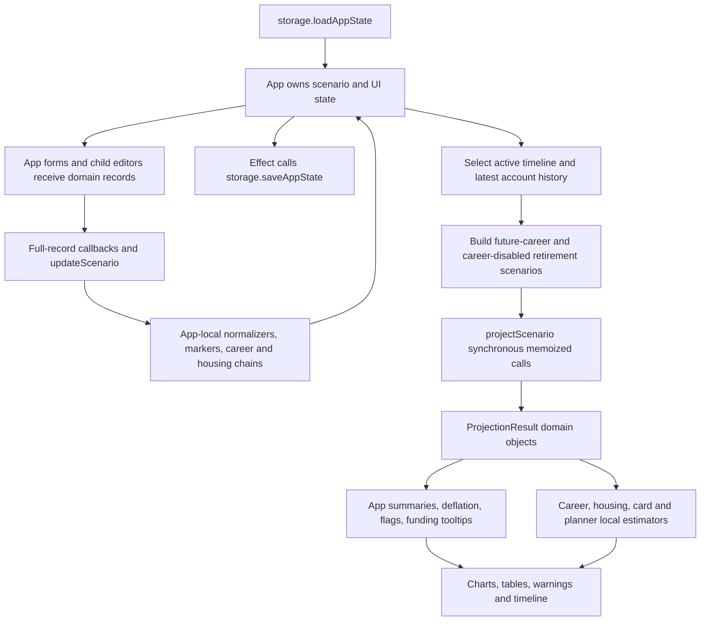

# GUI Compatibility Audit — Account-Only Cashflow Architecture

## Verdict and scope

**The React GUI can support the planned architecture, but the current GUI is not a drop-in compatible client of it.** Several controls write removed configuration, some edit paths would discard new fields, and multiple displays independently calculate financial results. Changing the engine/schema alone would cause build failures, lost settings, blank screens or misleading numbers.

This is a **source-grounded planning audit, not a browser validation of unimplemented changes**. No application, test or storage data changes in this phase. Based on the current working tree after the approved standalone-contribution removal; pool removal and the wider account/debt/event refactor remain planned. Line references describe this audit snapshot and can shift.

Targets: [architecture_specification.md](architecture_specification.md), [account_only_subplan.md](account_only_subplan.md), ADR-001–014, F01–F26. Preserve existing views/interactions except approved removal of Pools, obsolete card modes and standalone contributions. Do not keep fictional pool/income state solely to make old UI props compile.

RV/ADR-019/020: no indivisible toggle; G16/G17/G22 show funded/unpaid pending deposit and actual completion, no full home/mortgage before complete. Disclosed taxable gain20% gross/default editable LTCG15%, not observed basis. User withdrawal dates/residual0% payoff date/source/no duplicate principal/twelve ordinary months/view-only history/net-worth graph/exact warnings/eighty-year GUI profiles required. Earlier recommendations superseded where different.

## 1. Actual GUI ↔ finance interfaces



### Write boundary

- Most editors receive raw `Scenario` subrecords and emit spread copies, not a stable UI-specific command contract. App’s `updateScenario` normalizes **the entire scenario on many unrelated edits**.
- `App.tsx:1160–1451` rebuilds net-worth/account/history/loan records and recalculates source lines. Account normalization at 1204–1222 knows only ID/label/poolId/priority/type/balance. **Adding an account rate input without updating this function would drop the rate on the very next normalized edit.** Loan and history record construction have the same risk for new funding/liability fields.
- `storage.ts` is a second independent normalizer; adding fields only to load/save is insufficient. Account-sync effects (`App:1131–1158`) can rewrite source/plan arrays too.
- Timeline CRUD uses `applyToActiveTimeline` (`1636–1676`); new nested fallback arrays/policies must be deep-cloned by duplicate/add functions (`1687–1788`) or timelines may share mutable nested values.

### Read boundary

- `App:702–804` anchors account balances/history and builds two simulations. Primary result `projection` changes with top-level tab (`805–823`), while many editor warnings/previews use `futureProjection` directly. Those contexts are not interchangeable.
- Components consume `ProjectionYear`, `MonthlySnapshot`, `ProjectionResult` fields directly. There is no explicit adapter for money units, measurement kind, source dates or new liability metadata.
- Career/housing/card/planner estimates compute amounts independently of `projectScenario`; a renderer that still shows numbers is not proof those numbers match the authoritative state.
- Results/deflation/trajectory save paths assume pool-keyed maps and old annual fields. When target fields disappear, typed references fail to compile; optional/raw data may also lead to `Object.entries(undefined)`, `NaN` summaries or blank charts.

## 2. GUI elements that may not work

Failure labels: **write loss**, **schema/build**, **incorrect display**, **missing control**, **removed by design**, **context/state**. P0 means blocker for architecture cutover; P1 important correctness issue; P2 targeted adaptation/coverage. All predicted failures below arise if current consumers are left unchanged; not all are current runtime bugs.

### A. Configuration, accounts and retirement

| ID / priority | GUI element | Evidence and likely failure under target | Required adaptation |
|---|---|---|---|
| G01 / P0 | Any edit that calls `updateScenario` | `App:1160–1451`, storage normalizers: **write loss/schema**. Account rates/policies, loan funding policies, liability snapshots and account-only source fields can be dropped/replaced by legacy reconstruction. | One canonical normalization/default contract shared across load/edit/save; round-trip every new field through unrelated edits. |
| G02 / P0 | Top tabs and projection availability | `App:760–823,949–958`: **context/blank display**. Options/Finances use future results, other tabs select career-disabled retirement; future chart/table hidden when no career enabled, even if retirement/benefits/planner obligations still need projection. | Explicit named projection context across views; valid retirement-only/other-income plans must render. Keep optional what-if mode labeled rather than accidentally chosen by tab. |
| G03 / P0 | Net Worth **Add Pool**, pool name/enabled/priority/Pre-Ret %, account **Pool** dropdown | `App:2134–2189,4415–4514`: **removed by design/schema**. No target pool records/IDs/CRUD; account creation assumes first pool. | Remove pool management/membership UI; create independent account with new factory defaults. |
| G04 / P0 | Account interest/return, tax/rules and colors | `App:4482–4558`: **missing control**. Existing account table has no rate/color/policy controls; current rates elsewhere edit pools. | Account-specific annual rate and optional retirement override (pending decision), account withdrawal/eligibility settings, color. Persist independently per account. |
| G05 / P0 | Retirement spending source grid: Pool / 4% / Start Age / Post-Ret % / Tax % / Penalty % / HSA | `App:2377–2437,2540–2629`: **schema/incorrect writes**. Rows iterate pools, save pool source IDs and edit shared assumptions; display first-year value uses four legacy keys. | Account rows and explicit ordered retirement fallbacks; amount or user-configurable initial-balance percentage (4% new-item default), start links/min/max retained. Account rules shared with account editor; HSA follows accountType. Show planned net vs actual net/gross distinctly (ADR-021). |
| G06 / P1 | **Retirement Assets**, **First Year Expenses** and min/max controls | `App:959–973,2480–2537`: **incorrect display**. `sumSavingsBalances` expects four pool fields; changing to account maps yields NaN/missing totals. It sums career-end snapshots across careers, potentially counting the same growing account multiple times. | Derive assets at the actual retirement boundary once from monthly state; planned/paid spending totals from retirement summary. Define min/max net-spending units and period scope. |
| G07 / P1 | Account **Priority**, ordered account dropdowns/table columns | `App:676–690`, CareerPlanEditor:218–220: **semantic mismatch**. Pool+account priorities influence display; new explicit fallback order should not depend on table/label ordering. | Separate displayOrder, deposit order, payment priority and fallback order; chart/table reorder cannot change funding. |
| G08 / P0 | Account **Remove**, **Save Account Balance**, history anchor and “Total net worth” | `App:2215–2225,2290–2374,702–735,4404–4409,4613–4627`: **missing debt/provenance/context**. Snapshot saves assets only and clamps totals nonnegative; new funding/deposit/liability references need cleanup beyond two income fallbacks. | Snapshot assets/properties/liabilities with IDs/measurement/date; preserve signed net worth; clear/report invalid active+inactive references. History remains immutable observation, not computed closing state. |

### B. Careers, paycheck and account deposits

| ID / priority | GUI element | Evidence and likely failure under target | Required adaptation |
|---|---|---|---|
| G09 / P0 | Career savings grid and source-line editor | CareerPlanEditor:58–90,301–335,753–872; App source sync helpers: **schema/write loss**. Reads/writes sourceType/sourceId, falls back via account.poolId, legacy % mode name “percentOfSalary”; target uses accountId/net allocations. | Account-only line edits; preserve fixed/%/raise/cap controls; correct label to net pay; do not create duplicate deposit lines through pool conversion. |
| G10 / P1 | **Starting Balance**, **From previous career**, **Balance at end of period** | CareerPlanEditor:374–447,768–769,863–869: **incorrect display**. Local age-duration/monthly APR/12 forecast excludes many actual obligations, matching/funding and pay-plan changes; pool removal zeroes its rate lookup. | Query engine career-boundary account snapshots for selected career/plan and anchor, not local amortization. Distinguish projected state from configured opening balances. |
| G11 / P0 | **Configure Paycheck**, payroll **Deposit Account**, paycheck summary | PaycheckEditorModal:32–36,82–87,177–216; CareerPlanEditor:153–164,705–745: **schema/semantic mismatch**. Widget already selects actual accounts, but saves Initial through compilePaycheckInfo which flattens destinations; unknown targets shown as “No deposit.” | Retain granular payroll UI, multiple per-line destinations, employee/employer identity and account eligibility. Shared calculator for deduction summary; no duplicate flat-info income authority. |
| G12 / P0 | Net-pay destination/remainder and deposit date | Current career/paycheck interfaces contain no net-pay remainder-account or monthly deposit-day control: **missing control**. Posting all net pay cannot be configured from existing savings-only grid. | Add explicit destination/remainder control and allocation requested/posted/unallocated summary. Deposit-day control only if timing proposal approved; defaults visible. |
| G13 / P1 | **Net pay plan**, **Copy Pay from Previous**, add/duplicate career/plan | CareerPlanEditor:139–189,234–275,491–554; App:cloneCareer: **write loss/state**. Copy uses previous.flat paycheckInfo; selected plan new account/deposit/funding metadata could be omitted or copied to wrong plan. | Clone/copy canonical granular plan + allocation fields; selected-plan commands; preserve effective marker/date/raise rules without reintroducing deleted fields. |
| G14 / P0 | **Income Fallback Accounts** primary/secondary selectors | CareerPlanEditor:913–958; App:1399–1411: **semantic/missing control**. Only two income fallback IDs; target payments have primary account plus ordered eligible overrides/global defaults, retirement separate. | Rename as payment fallback defaults; list add/remove/reorder/dedup, per-obligation inheritance/override. Display eligibility and missing references; no income reservoir implied. |
| G15 / P1 | Monthly withdrawal expense rows, **Max Balance**, **Overflow Fallback** | CareerPlanEditor:838–904: **schema/status**. Expense errors keyed by sourceId; cap selector lists all accounts without new eligibility/policy distinctions; shortfall amounts in dollars expected. | Map account/source event IDs to common funding status; retain raise/cap behavior and distinguish configured/actual posted deposits/expense execution. Cap remains special policy, not an ordinary transfer UI. |

### C. Planned expenses, debt, housing and cards

| ID / priority | GUI element | Evidence and likely failure under target | Required adaptation |
|---|---|---|---|
| G16 / P0 | Purchase/long-term/loan/housing/card **Pay From**, **Down Pay From**, related sort | App:672–675,3332–3410, purchase/loan forms; HousingEditor:54–69: **schema/incorrect writes**. Options and casts still allow `income`/`account:*`/legacy pool values; only one account selector, no fallback or indivisibility editor. | Shared account FundingPolicy editor: primary + ordered fallbacks + inherited defaults; optional partial flag by approved policy. Pay From sorting uses displayed primary/summary label, never controls execution order. |
| G17 / P0 | Large-purchase red/yellow row and **Account Balance After Purchase** | `App:3500–3547`: **silent failure**. Red uses post-balance<0 or old income status, while target prohibits negative cash and failed atomic debit leaves positive opening balance. Income branch shows transient leftover rather than account close. | Use executed funding outcome/shortfall/skipped reason; balances after the actual occurrence for all used accounts; no negative hypothetical balance needed. Primary balance plus allocation detail can preserve compact table. |
| G18 / P1 | Long-term “Balance after last withdrawal”/funding indication | `App:3684–3695,3830+`: **incorrect display/context**. Uses feature-specific legacy shortfalls and yearly rows to approximate a month boundary; no per-occurrence split allocations. | Read final scheduled occurrence state, total requested/paid/unpaid and first fallback/shortfall from shared audit. Preserve inclusive duration/end synchronization. |
| G19 / P0 | Loan fields, **Payoff**, extra payment/down-payment rows | `App:489–515,3896+,1303–1329`: **schema/incorrect estimate**. UI assumes full-pay amortization and legacy paymentSourceAccount; new debt balance/interest/arrears/actual payment are separate. | Keep contractual payment inputs; payoff estimate based on engine funded schedule (or explicitly labeled nominal quote). Expose outstanding debt and interest/principal separately, down-payment transaction status. |
| G20 / P0 | Housing PI/rent/tax-insurance/HOA-maintenance/PMI/down selectors and colored chips | HousingEditor:54–69,91–153; `App:housingIncomeIndicators`: **schema/status gap**. Sources default income and chip indicators read income statuses, not all account-funded failures. | FundingPolicy for each retained payment group; common household/group outcome aggregation from all source types. Tooltip shows requested/paid/shortfall and account allocations. |
| G21 / P1 | Housing **Estimated Monthly** cost and payoff/PMI expectations | HousingEditor:71–85: **misleading estimate**. Locally computes original loan PI plus fixed PMI; ignores funded debt, payoff, actual LTV/drop and new opening mortgage balance. | Show nominal contract quote separately from selected month's engine requested/paid cost/PMI/payoff. Reuse calculation contract; avoid second simulation. |
| G22 / P0 | Housing/Net Worth opening property/mortgage and sale controls | HousingEntry/current editors: **missing controls**. Existing mortgage history reconstructed from purchase assumptions, no explicit observed opening mortgage liability/property identity. New net-worth/underwater sale cannot be entered/reconciled fully. | Existing property value + mortgage balance/link at opening; future acquisition atomic funding state; sale proceeds/debt deficiency shown without silently zeroing debt. Preserve career/date/end chaining. |
| G23 / P0 | Credit-card table/modal: Balance/APR/Intro/Charges/Payment Mode/Minimum/Fixed+Lump | `App:4771–4829,4975–5093`: **removed by design/schema**. All conditions reference five old modes; ordinary/0%-liability discriminants and start/target dates do not exist. | Two-type editor: ordinary expected payment/end, or permanent-0% initial debt/target; explicit start/payment day/funding. Ordinary balance column becomes schedule, 0% shows liability; obsolete APR/charges/mode fields removed. |
| G24 / P0 | Card **Payment Schedule Projection**, “Paid off”, estimated lump sum | `App:4850–4957,5041–5062`: **incorrect display/context**. Independent 24-month clock-based loop reduces desired payments even if unpaid; shares neither anchor nor adaptive linear target/deadline residual. Ordinary zero-balance schedule currently hidden. | Engine occurrence schedule for both types, requested vs funded/net allocations, remaining debt, overdue balance/warning. No auto “paid off” based on scheduled targets; no fresh wall-clock anchor. |

### D. Expense planner, reporting and navigation

| ID / priority | GUI element | Evidence and likely failure under target | Required adaptation |
|---|---|---|---|
| G25 / P0 | Planner one-time/recurring dialogs: **Account**, **Payment Account**, **Pay From** | ExpensesPlanner:985–1017,1084–1113 and writes: **conflicting selectors/write semantics**. Three notions of account may disagree; target needs one designated funding account, while existing account also selects category track. | Define category/display track versus primary payment account explicitly, remove competing income selector, preserve valid track/category links; one funding policy source of truth. |
| G26 / P1 | Planner weekly balance curve, max-balance coloring, recurring exhaustion warning | ExpensesPlanner:817–892: **incorrect forecasts**. Interpolates yearly balances using wall clock/approximate calendar and compares all recurring requested spending with current balance, ignoring deposits/fallbacks/dated liquidity. | Shared monthly/event-date engine balances and occurrence outcomes; label monthly resolution if no true daily forecast. Requested/paid weekly totals distinct; no second planner debit. |
| G27 / P0 | Planner recurrence/copy/paste/drag/import preview and **Pool** column | ExpensesPlanner:103–147,757–772,1427–1465; expenseImport API: **schema/timing**. Occurrence helper/day31 policy differs from proposed scheduler; import records carry pool metadata and historical dates become future planned rows. | Shared recurrence/date contract; projected execution flag/linked IDs; account-only import/columns. Preserve source preview/removal; imported-history execution default requires validation. |
| G28 / P2 | Expenses → **Tracking / Configure Accounts** | `App:4719–4769`: **existing partial implementation**, currently says “Expense tracking view coming soon.” Visibility settings fall back from empty to all. | Retain account configuration intent, distinguish intentionally empty from unset if redesigned; do not count placeholder as complete transaction tracking or remove it without decision. No new tracker product implied. |
| G29 / P0 | **Stacked Savings Graph**, legend/color/hover | SavingsStackedChart:8–14,48–66,95–173; App:5236–5242: **schema/blank series**. Series, sums and colors come entirely from enabled pools and membership. | One account layer/ID/color/visibility; include same-type accounts independently; totals reconcile to visible accounts; removal/rename does not alter math. |
| G30 / P1 | **Portfolio Graph**, credit-card debt overlay, age slider/flags | ChartPanel:29–49,75–105,251–262; App:975–1050,5245–5279: **metric/date/range mismatch**. Asset line monthly but debt line equally spaced yearly; baseline may be omitted from monthly points, flags use age/yearMonth, axis assumes nonnegative portfolio values. | Explicit asset vs net-worth metric; aligned monthly liabilities/dates, signed net-worth axis when selected; executed/skipped flag state and consistent range boundaries. Do not add ordinary-card fictional debt. |
| G31 / P1 | Summary “runs out of money” / ending balance | `App:944–958,5282–5288`: **semantic mismatch**. Reconstructs summary from annual depleted flag/account endBalance; new monthly liquidity failure differs from negative net worth/property equity/retirement restriction. | Dedicated engine summary/view selector with clear account-assets/net-worth/liquidity/shortfall meanings and actual date. Avoid congratulating a plan with retained overdue liability merely because cash>0. |
| G32 / P0 | **Results table**, Display months, net income/withdrawal/tax/End columns | ResultsTable:40–62; App:5305–5309: **schema/units/totals**. Assumes dollar fields, nonnegative account values and monthly vs annual withdrawal+signed extraCashflow semantics; no liability/net-worth/principal fields. | GUI dollars adapter from runtime cents; actual monthly/annual totals and separate spend/principal/interest/withholding; end metric labeled. Negative net worth not clamped as account cash. Stable row date key if calendar/age grouping changes. |
| G33 / P1 | Results row/account hover activity tooltips | `App:5310–5377`: **incorrect reconciliation/labels**. Infers friendly source by string prefixes; old activity net amount omits growth/withholding, new audit structured IDs/allocations. | View selector from event source metadata; gross debit/net payment/taxes/penalties/activity explicit, sums reconcile to opening/closing; same units/real-dollar factor as cell. |
| G34 / P0 | **Display values in current dollars** and comparison transformations | App:317–347,826–908,4283–4297: **runtime/incorrect display**. Unconditionally transforms savingsBalances/old card maps; removed maps could throw, new debt/property/activity values stay nominal; annual vs monthly factors differ. | One valuation-date/measurement adapter for every displayed money field; only transform supported shape; typed missing data handled explicitly rather than fabricated zero arrays. |
| G35 / P1 | **Warnings**, funding yellow/red rows/chips and fallback tooltips | `App:2813–2883,3235–3375`: **schema/semantic mismatch**. `incomeValidation`, group.pool and incomeFundedItemStatuses describe obsolete reservoirs; strings filtered by prefix. New account-funded events lack that path. | Common outcome summary for every obligation plus derived budget diagnostics using periodKind; structured warnings/severity. Show primary/fallback account/net/gross detail, unpaid cents, deadlines and skipped atomic events. |
| G36 / P0 | **Save Current Trajectory**, overlay/diffs and actual history chart | `App:1796–1827,2986+`; TrajectoryComparisonChart:34–67; NetWorthHistoryChart:33–50: **schema/measurement/sign**. Saves fixed old fields/pool totals, compares age-endBalance, history clamps negative net worth; old assets may be overlaid as new net worth. | Freeze supported version/measurement/date account+liability result; compare same measure/time basis only; signed net-worth history/axes. Keep asset-only history labeled, never reinterpret/prune supported observations indiscriminately. |
| G37 / P0 | Timeline **Add / Copy / Switch**, inline career/housing panels | `App:1636–1788,4397–4398`: **shared nested state/lost config**. Existing shallow clones safe for flat fields, not new fallback arrays/policies; panels repeat legacy prop wiring. Planner remains global while other plans are timeline-local. | Deep-clone target nested config; edit active timeline only; validate inactive links; keep account rate config global per current scope. Apply same editor adapters in both tab and inline panel; explicit global-planner semantics. |
| G38 / P1 | **Date Markers**, linked card ends/career/housing links | `App:2886–2945`, DateOrMarkerInput, dateMarkers resolver: **stale field registry/date semantics**. Card reference scan names introEnd/autopayEnd only; new ordinary start/end and 0% target links unregistered. | Canonical target date-reference registry for scan/resolve/delete/list, all timelines; preserve marker day vs month precision and dependency precedence. No date-label guess converting deadline semantics. |
| G39 / P1 | Chart empty-state transitions and selected-item state | ChartPanel return at 28 before later useMemo; SavingsStackedChart return at 147 before hover useMemo; editor selected IDs/modal state: **render/state risk**. Valid account-only/no-career empty states become more common; hook count/order changes can fail if same component stays mounted across empty/nonempty props. | Consistent hooks or empty-state wrapper, cleared/clamped stale selected IDs/ranges; test zero accounts/rows→populated→empty, active modal deletion and timeline switch. Static risk, not newly browser-reproduced. |
| G40 / P2 | Generic buffered inputs, date/marker inputs, colors/categories/sorting | BufferedNumberInput; DateOrMarkerInput; ColorPickerField; App category UI: **mostly reusable, numeric/prop policy matters**. Parents supply old min/max/step and whole-dollar format; cents/default/negative metrics/eligibility now matter. | Keep widgets and accessibility/focus behavior; bind explicit dollar→cent conversion and validation/rate ranges. Pool controls removed, category semantics unchanged; sort/filter only display, not execution. |

## 3. Critical contract gaps to settle before cutover

### New inputs the existing GUI cannot yet express

1. Account rate/optional retirement override and account-level tax/basis/eligibility/color settings (G04).
2. Net-pay remainder destination and optionally approved scheduled deposit day (G12).
3. Primary + ordered eligible fallbacks, per-obligation override/inheritance and indivisible/partial policy (G14/G16/G20/G25).
4. Distinct ordinary expected-payment versus permanent-0% card, liability identity/start/target (G23).
5. Opening property/loan/mortgage/0% liability observations and their snapshot identity links (G08/G22).
6. Requested/posted/unpaid allocation/spending state and skipped indivisible purchase explanation (G15/G17/G35).
7. Explicit asset-versus-net-worth metric and supported snapshot/comparison measurement (G30/G32/G36).
8. Planner projection flag/link and import source-vs-planned date/sign interpretation (G27).

Absence of an input cannot be fixed by an engine default that silently changes what a visible editor means. Proposed defaults remain visible and editable, and missing/dangling references are handled consistently under the accepted fresh-item rule.

Retirement add-ons/other-income editors (`CashflowItemEditor:39–139`, `App:2637–2678`) are included in G16/G35/G38/G40: their existing Account selector is already ID-based and largely reusable, but outflows need the shared funding policy/outcomes, inflows need posted destination validation, recurring amounts need an explicit annual/monthly unit label, and date links must use the same registry. No separate life-event editor was identified; do not invent GUI coverage for schema-only features.

### Proposed GUI integration boundary

Small configuration commands/selectors around existing App state suffice; no new state-management framework required.

- **Canonical writes:** account/plan/obligation update helpers call shared target normalizers. No UI-side financial inference of pool→account, gross→net deposits or debt payoff. Full-record callbacks may remain where safe but must preserve current canonical fields and active-plan/timeline targeting.
- **Named projection context:** engine input prepared from one resolved timeline/history/context. Consumers receive `contextId`, start/end date and measurement metadata; warnings/card/career/planner preview all refer to that context. A retirement-only what-if context is explicitly separate.
- **GUI view model:** engine owns runtime cents/posted state; view adapter exposes display dollars, date keys, account options/eligibility, monthly/yearly summaries, source/config labels and compatible metric series. Formatting/deflation never mutates financial results.
- **Shared funding editor:** primary ID + ordered fallback list + use-default toggle + approved partial policy. Eligibility lists and status panels use same purpose context as funding quote. Retain chosen invalid reference visibly rather than silently choose a different account.
- **Shared outcome selectors:** occurrence requested/paid/shortfall/atomic-skipped; first fallback/shortfall, totals and allocations from audit. They drive all red/yellow indicators, schedule previews and balance-after-payment displays.
- **Shared recurrence/date references:** scheduler/reference registry provides preview dates and marker resolution; GUI does not independently choose a different day31 or inclusive deadline policy.
- **Immutable snapshots/clones:** copy complete canonical nested plan safely; freeze supported output with engine/schema/measurement, never mutable references into current result/config.

Illustrative display-only contracts (not new source types yet):

```ts
interface FundingOutcomeView {
  occurrenceId: string;
  date: string;
  status: 'funded' | 'fallback' | 'partial' | 'unfunded' | 'skipped';
  requestedDollars: number;
  paidDollars: number;
  shortfallDollars: number;
  allocations: Array<{
    accountId: string;
    label: string;
    grossDebitDollars: number;
    netPaidDollars: number;
    taxesDollars: number;
    penaltiesDollars: number;
  }>;
}

interface ProjectionViewContext {
  contextId: string;
  activeTimelineId: string | null;
  startDate: string;
  endDate: string;
  displayBasis: 'nominal' | 'currentDollars';
  metric: 'accountAssets' | 'netWorth';
}
```

“Fallback” is display severity alongside execution completeness; the eventual type may separate `usedFallback` from funded/partial/skipped status so partial+fallback is not lost. GUI adapters never compute funded amounts by subtracting guessed income from desired payments.

## 4. Future adaptation sequence and verification

Implementation is authorized by ADR-022; the audit itself did not write or validate the target GUI. Intermediate components may be removed before their replacement is wired. Record affected G/GUI-A rows and broken flows honestly; final GUI acceptance waits for the integrated candidate.

1. Stabilize canonical config/view/context/funding/reference contracts and agreed schema defaults first (G01/G02). Current consumers may be deleted while adapting types; record failed or unavailable build/UI checks and the restoring tasks. A passing build, when available, does not establish financial parity.
2. Replace pool/account/retirement/role/fallback controls together (G03–G08/G14), verify account rate edits survive an unrelated edit/save/reload and disabled/hidden UI does not change balances.
3. Adapt career/paycheck/allocation/plan copying (G09–G15), keeping selected plan and both editor placements synchronized; replace local forecasts with engine selectors.
4. Adapt purchase/loan/housing/card/planner forms and execution indicators (G16–G28). Add missing liability/property inputs, atomic failure and actual-paid schedules; old output paths may be removed earlier rather than kept for temporary compatibility.
5. Adapt chart/table/summary/deflation/history/trajectory/timeline/markers together (G29–G40). Preserve approved user capabilities; no empty legacy pool maps as fake compatibility.
6. Run meaningful end-to-end UI acceptance tests plus engine invariants, full suite and build; compare displayed amounts to authoritative posted output from the same context.

### Acceptance checklist linked to GUI IDs

| Test | GUI IDs | What must be verified |
|---|---|---|
| GUI-A01 | G01/G03/G04/G07 | Two accounts have different rates; edit loan/name/timeline/category then save/reload; rates/policies/color persist; no pool controls or rate inheritance; reordering display leaves results unchanged. |
| GUI-A02 | G02/G05/G06/G31/G39 | No enabled careers but opening accounts/retirement/benefits/expenses present: chart/table/warnings render; source rows/min/max/4% and retirement-boundary assets match selected scenario; empty↔populated hooks/range safe. |
| GUI-A03 | G09–G15 | Paycheck employee/employer lines to distinct accounts, %/fixed allocations/remainder, changed pay plan, copy/duplicate and monthly expenses/caps reconcile; no overwritten fields/duplicate deposits; correct selected career preview. |
| GUI-A04 | G14/G16/G17/G35 | Primary + at least two fallbacks fund one obligation; row yellow and tooltip lists each actual net/gross allocation. Failed indivisible purchase leaves accounts unchanged but row red/skipped with correct shortfall. |
| GUI-A05 | G18–G22 | Monthly loan/housing partial PI keeps remaining debt; requested vs actual cost/PMI/payoff shown; down payment skipped acquisition visible; underwater sale retains deficiency in UI/net worth. |
| GUI-A06 | G23/G24/G30/G38 | Ordinary card schedule shows expenses to inclusive end with no debt; 0% missed payment raises future target, overdue debt remains charted/warned; schedule/table/audit share anchor; new date-marker refs update across all timelines. |
| GUI-A07 | G25–G28 | Planner one-time/recurrence executes once, correct designated account/category track; drag/copy changes occurrence not duplicate obligation; weekly chart aligns with declared engine resolution; imported-history defaults/promotion follow validated rules. |
| GUI-A08 | G08/G29/G32–G36 | Account layers sum once; signed negative net worth shown, account cash nonnegative; monthly/yearly totals reconcile; activity gross/net/tax/growth accurate; nominal/current-dollar table/chart/tooltip/comparison share basis and cents. |
| GUI-A09 | G13/G37/G38/G39 | Add/copy/switch timeline then change fallback/deposit/marker: original unaffected; account deletion clears/reports all linked destinations/sources, including inactive plans; no stale selected modal/row. |
| GUI-A10 | G36/G38/G40 | Supported historical asset-only and new net-worth snapshots labeled correctly, frozen values unchanged; date/category/flag/buffered input accessibility and commit behavior preserved. |

Existing `src/App.test.tsx` covers navigation, paycheck, plans, old funding indicators, housing links, planner/import, timeline isolation, history and trajectory controls. It does **not** establish compatibility with target schemas. Some assertions intentionally depend on soon-removed Income options/negative display balances/old card modes. Replace those with approved behavioral acceptance, retaining original baseline evidence.

Known pre-existing failure: insufficient-funding loan red row (`App.test.tsx:519` at audit snapshot). Last code run: 207/208 tests pass, build passes. Its root cause remains unclassified; do not hide it by renaming selectors or changing warnings. The tracker is a placeholder; static hook risk and several estimator discrepancies are not claimed as newly executed browser repros.

Supplementary static triage in TC01 narrows that loan failure to **after switching to Income**: target capped at outstanding debt, then funded from the old annual budget; a huge minimum entered in UI is not necessarily the amount requested. Reproduce with fixed source/debt/net/date setup before classifying/fixing; do not preserve annual income reuse or change styling assertions merely to hide failure. CA11 additionally requires new fields/defaults/recovery survive all GUI edit/load/save/reset paths and independent clones. See [testing/correctness audit](testing_correctness_audit.md).

## 5. Architecture readiness exit criteria

- Every G01–G40 item either adapted/tested, approved removed, or explicitly deferred with user-visible scope; no silent default-zero “fix”.
- All new persisted user inputs survive canonical writes/reload and clone correctly across selected plans/timelines.
- Every GUI money value derives from a known field/measure/unit/date/context; no old pool/income authority remains behind visible controls.
- Every scheduled outcome has visible funded/fallback/shortfall/skipped/overdue explanation across forms, reports and warnings.
- Shared view contracts cover signed net worth, liabilities, ordinary card schedule, planner obligations, retirement spending and account rates without removing unrelated UI functionality.
- Meaningful acceptance tests compare GUI to authoritative posted results; typechecking/browser render alone is insufficient.

**Conclusion:** retain the React components/layouts and reusable inputs, but treat App normalization/result selection, domain editors and financial preview/report consumers as part of the rearchitecture. An engine-only rewrite would not meet the GUI preservation requirement.

Scalability follow-up: [performance_scalability_audit.md](performance_scalability_audit.md) adds bounded/on-demand context compute, stable selectors, windowed account/month/audit/planner views, cached chart geometry, exact-data hover and complete compact audit queries. A worker alone does not address DOM/serialization work. GUI-A checks must remain financially exact while B-P benchmarks verify responsiveness/heap; no runtime changes made during the audits.
