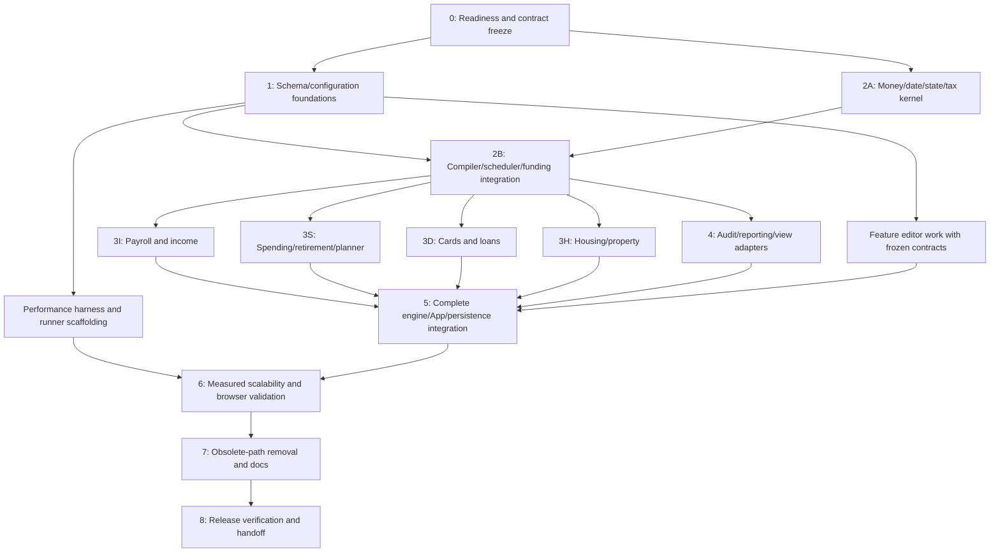

# Account-Only Finance Planner — Parallel Implementation Plan

> **As-of status (P7.5, 2026-10-16).** This is the historical consolidated implementation plan recorded at its planning time, retained as evidence. Authority is now the live `src/` runtime and [`phase5_handoff.md`](phase5_handoff.md): the plan's target is implemented as a runnable **Phase-5 integrated candidate, not a release** — Phase-6 measurements and Phase-7 code cleanup remain open. The "work ... are pending" framing below describes the earlier session, not current status.

## 1. Purpose, authority and current status

This is the consolidated execution plan for the new codebase described in `refactor/`. It turns the specifications, decisions and audits into assignable tasks, dependencies, deliverables and verification gates. **Incremental implementation is explicitly authorized by ADR-022 (2026-10-14); this plan does not claim it has been implemented, tested or released.**

Authority order:

1. Latest explicit user decisions, [recorded RV01–RV31 responses and follow-ups](review.md#recorded-responses), and ADR-019/020/021 in [architecture_decisions.md](architecture_decisions.md).
2. Other accepted ADRs and the account-only target contracts.
3. Architecture/save specifications and proposed engineering contracts, finalized in Phase 0.
4. Audits and observed feature inventory, used for coverage and historical evidence. Older recommendations conflicting with accepted decisions are superseded.

The standalone manual-contribution removal is already implemented and should remain removed. The account-only engine, schema, GUI and scalability work are pending. Last **recorded**, not newly executed, verification is 207/208 tests passing, one pre-existing loan-row App failure, and a passing build. Preserve `fixtures/projection.pre-refactor.snap` as historical evidence.

### Required target rules

- Accounts own balances, base APY/return, optional retirement-rate override, and withdrawal policies. Remove the pool domain. Missing rates are 0%, overrides null, opening cash $0; no scalar seed or inherited pool rates.
- Income posts once, directly to configured accounts. Net-pay allocations consume actual net pay in explicit order; remainder has an explicit destination. Individual employee/employer destinations remain separate. No spendable monthly/yearly income reservoir.
- Primary-first, ordered, eligible split funding; per-obligation fallbacks override global defaults, retirement has a separate explicit list. Every obligation allows partial funding. Actual related changes commit atomically; zero-fund/invalid transactions debit nothing. No implicit borrowing or retry.
- Partial home down-payment funding becomes a non-liquid held acquisition-deposit asset. Only complete funding creates the property/mortgage. Later funding is explicitly scheduled; deposit/property are never counted together.
- Taxable withdrawals assume gain equal to 20% of gross debit, with default editable LTCG rate 15%. This is a disclosed proxy, not actual basis or inferred tax brackets. Gross, net, tax and penalty are separate; withholding is not charged twice.
- Tax/penalty are rounded separately from gross once; use a provably bounded minimal-gross quote, with an unsupported-range diagnostic rather than approximate/unbounded search. Annualized allocations use per-line cumulative rounding (ADR-021).
- Retirement withdrawals are additional living spending, not income or transfers. Preserve fixed amount or a **per-source configurable initial-balance percentage (new-item default 4%)**, min/max, inflation, account order and user-selected withdrawal timing/valuation date; a later-start source defaults its basis date to its own first withdrawal date.
- Explicitly qualified HSA spending is tax/penalty-free. Non-qualified HSA spending retains configured tax; the separately configurable extra penalty defaults to 20% before age 65 and is waived at 65 regardless of retirement status (ADR-021).
- Ordinary cards are expected expenses, default twelve inclusive payments ending at start + 11 months, with no debt. Permanent-0% cards have identified opening debt, adaptive ceiling-cent funded-only repayment and an explicit residual lump-sum payoff; coincident final installment/payoff executes once.
- Manual planner entries and recurrences execute once per obligation/occurrence. Already-occurred imported transactions are permanently view-only with original date/sign/as-of provenance and no projection or planning-budget effect.
- Date-only arithmetic, stable event order, explicit integer-cent rounding, month-close effective APY, partial-month exponent, inclusive ends/day31 clamp, and calendar-year totals from actual months.
- Assets, liabilities, held deposits and signed net worth reconcile. Net worth is the default graph; account assets remain available. Exhaustion of eligible funding accounts and unmet obligations are separate conditions.
- Shared canonical load/edit/save/reset defaults preserve valid empty/0/false/null, isolate instances, recover malformed records locally and report diagnostics. New-save/pruning is accepted; equivalent obsolete-save conversion is not required.
- Support responsive projections of 80 years/960 full months from the selected opening date. Do not silently shorten the horizon, truncate audit data or approximate financial math to meet a performance goal.

## 2. Target codebase and ownership

Retain React 19, TypeScript, Vite, Vitest, existing app navigation and reusable components. Paths below are **proposed responsibility boundaries**, not assertions that these modules already exist. Keep `src/types.ts`, `src/defaultScenario.ts`, `src/storage.ts` and the `projectScenario` facade as public entry points where practical; extract internal modules only when they have a distinct contract.

| Area / proposed location | Single responsibility | Workstream |
|---|---|---|
| `src/types.ts` and optional internal domain types | Canonical config, runtime, event, audit, result and measurement contracts; explicit money units | S — Schema/configuration |
| `src/defaultScenario.ts`, shared configuration normalizers | Independent factories, structural validation, defaults, ID repair, allowlist/pruning | S |
| `src/storage.ts`, optional codec/backend modules | Hydration/save lifecycle, versioned envelope, diagnostics, durable storage; no financial calculations | S |
| Shared configuration commands/reference registry | Active-timeline writes, deep clones, marker/career/housing chains, deletion-reference cleanup | S |
| `src/engine/configuration.ts` | Compile selected named context, opening observations and indexed dependencies; immutable inputs | S + K |
| `src/engine/dates.ts`, `money.ts` | Valid calendar arithmetic, cents conversion, rounding, safe-range checks | K — Kernel |
| `src/engine/state.ts` | Private account/property/deposit/liability state; revision validation and sole atomic mutation entry point | K |
| `src/engine/taxes.ts`, `funding.ts` | Eligibility, exact gross-net quote, ordered sparse allocations and commit preparation | K |
| `src/engine/scheduler.ts` | Clipped month batches, recurrence cursors, stable date/phase/priority/ID order; no balance mutations | K |
| `src/engine/income.ts`, existing `src/paycheck.ts` | Shared payroll calculation, per-line destinations, net allocations, other inflows and cap policies | I — Income |
| `src/engine/obligations.ts`, feature-specific processors if warranted | Spending/debt/acquisition/sale handlers using the kernel, never separate ledgers | O — Obligations |
| `src/engine/valuation.ts` | Per-account APY, property appreciation and contractual debt accrual postings | O + K |
| `src/engine/reporting.ts`, result selectors | One compact complete audit, indexes, monthly closes, annual totals, outcomes and warnings | R — Reporting |
| `src/engine/projection.ts` | Public facade and orchestration of compiled configuration, event execution and reporting | K; integration owner |
| Shared GUI view adapters/selectors and funding editor | Named context, dollars conversion, measurement/date/deflation, actual-funded previews and common status | R + U — UI |
| `src/App.tsx` and existing components | Configuration commands, context selection, navigation and rendering; no competing financial simulation | U |
| Runner/cache and `src/utils/perfTools.ts` | On-demand computation, revision/cancellation, bounded cache, metrics; worker/chunking chosen from measurements | P — Performance |
| Tests, benchmark fixtures and docs | Independent expected values, traceability, browser/performance evidence and actual-code documentation | Q — Quality |

Workstreams are assignable roles, not a required team size. One contributor can own several. Assign one integration owner for shared files and one owner per rule before extraction.

## 3. Parallel execution model

### Dependency graph

Phase numbers describe milestones, **not a requirement to finish every task in one phase before starting another**. Phase 4 can start after Phase 2 while Phase 3 feature processors are being built. UI shells and benchmark infrastructure can start after Phase 1. Their acceptance waits for real feature/report outputs.

### Practical work waves

| Wave | Work that can run concurrently | Join condition |
|---|---|---|
| A | P0 baseline triage, coverage/default contracts, interface/ownership design, benchmark profile definition | Stable contracts and recorded readiness decisions |
| B | P1 schema/codec/commands; P2 money/date/state/tax primitives; Q numerical fixtures | Primitives and canonical inputs agree on units/IDs/defaults |
| C | P2 compiler/scheduler/funding integration; U shared UI shells; P instrumentation/runner interfaces | Tested kernel and event/result contracts |
| D | P3I income, P3S spending/planner, P3D cards/loans, P3H property; P4 reporting/adapters; paired feature editors | Feature handlers, canonical audit and editors integrate against the same contracts |
| E | P5 integrated user flows/save lifecycle; P6 runner/windowing/storage optimizations and browser checks as flows become available | Full financial/GUI coverage and measured 80-year behavior |
| F | P7 deletion/ownership/doc cleanup in separate modules; then P8 complete release verification | Final implementation, acceptance and handoff evidence |

### Rules that make parallel work safe

1. Each task below has an ID, owner, prerequisites and deliverable. Use its ID in work branches/PRs or handoff notes. Do not assign two tasks to rewrite the same module simultaneously.
2. S owns shared schema/default/storage edits; K owns projection facade/state/scheduler; the integration owner serializes `App.tsx` wiring. Feature owners propose contract changes to these owners instead of independently redefining them.
3. Publish TypeScript interfaces, factory examples, exact money/date rules and a small canonical result fixture at P0/P1. Contract changes update target producers, consumers and acceptance together; superseded consumers may be deleted before replacements are runnable under ADR-022.
4. Prefer separately owned processors, editor components, selectors and test files. Merge shared contracts first, then feature work. Existing consumer/module removal may begin in any relevant phase; adapters are optional, not mandatory compatibility work. Never fabricate empty pool maps or fictional income to satisfy legacy props.
5. Feature processors may be developed concurrently using small independent inputs and the real kernel. Combined chronological execution waits for integration. **Do not concurrently mutate one projection ledger**: events in one context remain sequentially ordered. Independent contexts or pure compilation can run in parallel when measured useful.
6. Old and new projections may coexist in a development-only comparison harness **if the old path still exists**; it is not required to keep the old engine running. Never blend old spending with new postings, or show warnings/previews from a different context/revision than the chart.
7. Every task hands off affected files, contracts, tests/results, F/R/ADR links, unresolved findings and next dependencies. A phase is complete only when its **scoped** exit criteria are verified; an intermediate App, build or existing suite may remain broken with exact failures and restoring owners recorded (ADR-022).

**Approved intermediate breakage:** removing current consumers, pool-era types and UI before every replacement is wired is allowed. Preserve target feature requirements, opening/history/import user data and archived evidence. Test independent modules as they become executable, record failures rather than skip them, and do not release an incomplete mixed-engine result. A runnable integrated candidate is needed to measure GUI/browser performance; final full-suite/build/release gates remain Phase 8.

## 4. Phase-by-phase task plan

### Phase 0 — Readiness, baseline triage and contract freeze

**Goal:** Convert approved product rules and audit findings into implementable, testable contracts before financial replacement. **Needs:** all refactor documents, current runtime, archived B01–B09 and authorization for subsequent runtime work.

| Task | Owner | Prerequisites | Needed work / deliverable |
|---|---|---|---|
| P0.1 | Q | None | Inventory existing working-tree changes; retain original snapshots; reproduce the loan-row failure with fixed date/paycheck/debt/source/fallbacks. Record capped request/actual covered/unpaid amounts and separate old annual-budget behavior from the target correction. |
| P0.2 | S + Q | None | Build one coverage register for F01–F26, R01–R26, G01–G40, TC01–TC13, MD01–MD11, PS01–PS20, CA01–CA13, GUI-A01–A10 and B-P1–B-P8. Each row needs owner, task, test/evidence and status. |
| P0.3 | K + R | None | Freeze config/event/posting/funding/result/context interfaces, phases/order, partial policy, cents rounding, cumulative allocation residuals, safe integer limits, exact bounded gross-net algorithm and unsupported-range diagnostics. Define any unresolved formula details explicitly. |
| P0.4 | S + U | None | Finalize independent first-launch/item factories, supported absent/empty/0/false/null semantics, local malformed recovery and hydration/autosave/future-version behavior. Specify initial $0 cash account and references without resurrecting hidden assets. |
| P0.5 | I + O | None | Specify withdrawal first date/day/optional links and available configurable initial-percentage basis observation (4% new-item default); payoff date/source defaults and one coincident final request; acquisition-deposit lifecycle; HSA/retirement purpose/age rules; raise/career-break boundaries. |
| P0.6 | Q | P0.3/P0.5 for assertions | Define independently calculated CA cases and approved before/after differences. Repair misleading 4% fixture/branch coverage and minimum-warning claims when test edits are authorized; never use archived defects as the oracle. |
| P0.7 | P + U | None | Declare 960-month household/large profiles, stage/counter metrics, browser/hardware procedure and proposed budgets. Assign cache/runner/audit-query/storage ownership. |

**Reuse:** audited feature inventory, ADRs, fixtures, existing suite structure and React/Vite tooling. **Exit:** one authoritative contract/coverage register; readiness decisions and remaining blockers recorded. Do not mark the historical baseline failure resolved until an executed repro/fix verifies it.

### Phase 1 — Canonical schema, defaults, persistence codec and configuration commands

**Goal:** Establish the shared input/write boundary needed by every engine and GUI stream. **Needs:** P0 contracts. Can run alongside Phase 2 primitive work.

| Task | Owner | Prerequisites | Needed work / deliverable |
|---|---|---|---|
| P1.1 | S | P0.3–P0.5 | Add target account/rate/policy, liability/property/held-deposit, opening snapshot, funding, allocation/remainder, per-source configurable initial withdrawal percentage/valuation date, two-card, planner provenance and result metadata types. Current pool-era consumers/types may be removed immediately; track resulting compile errors until dependent tasks restore them. Keep descriptive AccountType and payroll retirement/HSA kinds; no financial pools in the target. |
| P1.2 | S | P1.1 | Fresh scenario/UI/item factories with explicit date/ID inputs where needed; $0 opening/0%/null defaults, 4% new-withdrawal-source percentage, non-qualified HSA pre-65 extra penalty 20% (configurable), ordinary card end=start+11, zero 0% debt. Preserve supported payroll/housing/purchase/cashflow defaults deliberately. |
| P1.3 | S + Q | P1.1/P1.2 | Canonical structural normalizers and versioned allowlisted codec. Preserve valid siblings, empty collections and zero/false/null; deterministic ID repair; local diagnostics; no raw-input mutation; prune approved fields across base/inactive timelines/pay plans/import/UI. |
| P1.4 | S | P1.1/P1.2 | Shared active-timeline/selected-pay-plan commands, deep clone/freeze helpers, marker/reference registry, career/housing chain resolution and deletion cleanup. Separate global accounts/rates/planner from timeline-local plans. |
| P1.5 | S + K | P1.1/P1.4 | Opening-resolution contract: stable IDs and measurement/provenance; observed debt wins, including zero; configured debt used once when absent; old history remains asset-only; no speculative mortgage payment history or loan proceeds. |
| P1.6 | U + S | P1.3/P1.4 | Define canonical target editor writes, shared funding control and named-context/view boundaries; remove superseded editors/consumers without maintaining the old production path. Ensure unrelated canonical command edits retain every new field. Full App/UI rewiring is completed with feature editors and P5 integration. |
| P1.7 | Q | P1.2–P1.6 | CA11 factory isolation, reset/load equivalence, partial malformed records, round-trip/idempotence, inactive plans, orphan references, liability identity and command-level unrelated-edit tests. Check recovery/autosave without overwriting stored valid data; defer App-only checks for removed paths to P5 and record their status explicitly. |

**Reuse:** stable supported account/config IDs, tabs/UI preferences, date-marker and timeline interaction ideas, factory pattern and storage key `finance-planner-state` unless a measured need changes it. Existing duplicate normalizers are inputs to consolidation, not two authorities to preserve. **Exit:** canonical config and codecs tested in isolation; units/default/reference contracts available to all streams; no new field lost on implemented canonical command paths. Record removed consumers, broken App/build/suites and the owning later task; end-to-end UI persistence waits for P5. Phase-1 exit does not imply a runnable app.

### Phase 2 — Deterministic execution and atomic funding kernel

**Goal:** One private state and one valid funding/commit path. **Needs:** P0 financial contracts; P1 types/compiler inputs for integration. P2.1/P2.2 can begin after P0.

| Task | Owner | Prerequisites | Needed work / deliverable |
|---|---|---|---|
| P2.1 | K | P0.3 | Date-only parser/calendar/month ordinals, leap/day31 behavior, inclusive clipping, explicit start/end/horizon metadata. Cents conversion/half-away-from-zero posting policy, per-line cumulative target rounding, finite/safe-runtime sums and overflow diagnostics. |
| P2.2 | K | P0.3; P1.1 for final types | Private indexed account/liability/property/deposit state, opening construction, sparse change sets, revision checks and sole `commitChanges` mutation route. Validate conservation/nonnegative cash/ownership and reject invalid changes without mutation. |
| P2.3 | K | P2.1/P1.1 | Purpose/age/account eligibility and tax calculations: broker 20%-gross gain/default editable LTCG15%, HSA non-qualified 20% default extra penalty before 65/zero thereafter regardless of retirement, separately rounded gross-based tax/penalty identities, and ADR-021's bounded (max 256 candidates) minimal sufficient gross solver. |
| P2.4 | K | P2.2/P2.3 | Pure primary-first quote with deduplicated global/override/retirement sources and supported quotas, sparse overlays, actual partial/unpaid outcomes, stale quote handling and atomic commit including related debt/deposit changes. |
| P2.5 | S + K | P1.4/P1.5/P2.1 | Compile requested timeline/context only: immutable config, stable ID indexes, resolved date dependencies, active career/pay-plan intervals, rates and source orders. Inactive timelines are validated/persisted, not eagerly simulated. |
| P2.6 | K | P2.1/P2.5 | Month-batched scheduler and handler interfaces: recurrence cursors, active boundaries, stable date/phase/priority/occurrence order, dynamic execution-time targets and month close. No full-horizon eager expansion or per-event whole-ledger cloning. |
| P2.7 | K + Q | P2.2–P2.6 | `projectScenario` orchestration (development comparison boundary only if the old path still exists); tiny real-kernel projections and CA03/CA04/CA08/CA13 tests for split/no-op/partial/replenishment/stale/eligibility/rounding/determinism. |

**Reuse:** side-effect-free projection intent, account-ID-led math, effective APY formula and public facade. **Exit:** independent numerical and atomicity tests pass; no negative cash, future-income spending, unsafe cents or balance mutation outside commit. Funding plans reconcile gross=net+tax+penalty under the finalized rounding policy.

### Phase 3 — Parallel financial feature streams and paired editors

**Goal:** Implement every preserved cashflow/debt/property/planner capability on the kernel. **Needs:** Phase 2 handler/funding/state contracts and Phase 1 canonical inputs. The four streams below are independently assignable. Feature editor shells can start on P1; actual previews/outcomes wait for P4 selectors.

#### Stream I — Payroll, career plans and other income

| Task | Owner | Prerequisites | Needed work / deliverable |
|---|---|---|---|
| P3I.1 | I | P2.5/P2.6 | Month-scoped enabled career/pay-plan selection, explicit gap/overlap ties, raises, chaining, job changes and career breaks. No age-only fallback through explicit date gaps; no ordinary deposits outside employment. |
| P3I.2 | I | P3I.1/P2.2 | Granular paycheck calculation with frequency annualization, real payroll deductions, each employee/employer retirement/HSA destination, match caps and separate employer HSA. Retire flat paycheckInfo as a second authority after consumers migrate. |
| P3I.3 | I | P3I.2/P2.4 | Ordered bounded % of net/fixed-per-pay-period allocations, raise toggles, unmet allocations, explicit remainder destination and configurable posting day. Missing destinations stay visibly unresolved; no invented or duplicate deposits. |
| P3I.4 | I | P3I.3/P2.2 | Incoming cap overflow as direct allocation; explicit existing-excess policy with separate audit, missing/self/cycle/restriction validation. No general transfer editor. |
| P3I.5 | I + O | P2.6/P2.2 | Dated cashflow/life-event/rent/pension/benefit inflows and month-scoped overrides. Property sale handled by P3H, growth by valuation; neither mislabeled salary. |
| P3I.6 | U + Q | P1.6/P3I.1–P3I.5; P4 for previews | Adapt paycheck/career/pay-plan editors, remainder/day/allocation requested-posted-unmet controls, copy/duplicate and account-only savings/expense grids. Verify CA01/GUI-A03 plus salary-zero/multiple destination/cap/plan changes. |

#### Stream S — Spending, retirement, planner and imports

| Task | Owner | Prerequisites | Needed work / deliverable |
|---|---|---|---|
| P3S.1 | O | P2.4/P2.6 | Large/long-term purchases, source quotas, career monthly expenses, recurring/one-time cashflow and generic life-event outflows. Requested/paid/unpaid once; no automatic arrears debt/retry. |
| P3S.2 | O | P2.4/P2.6/P1.5 | Retirement account rows, user start/date/day/links, editable per-source initial-balance withdrawal percentage (4% default) and source-specific valuation date, amount/min/max/inflation and separate fallback order. Amounts are net additional living spending; use cumulative rounding for periodic targets. |
| P3S.3 | O + S | P2.6/P1.4 | Manual planner one-time and recurrence adapters, stable occurrence IDs, explicit same-obligation links and shared preview recurrence. One-time endDate is a display span; parent plus occurrence cannot double-charge. |
| P3S.4 | S + U | P1.3/P3S.3 contracts | Adapt `expenseImport.ts` and planner APIs to accounts/categories; preserve original source date/sign/as-of/batches/confidence/source removal. Occurred imports remain view-only even with older anchor or moved display date. Future plans use explicit status/new identity. Add meaningful parser fixtures. |
| P3S.5 | U + Q | P1.6/P3S.1–P3S.4; P4 for previews | Account retirement/funding/expense/planner controls, shared recurrence previews, requested vs paid weekly view and common statuses. Retain drag/copy/paste/categories/sorting/flags. Verify CA07/CA10 and GUI-A02/A04/A07; no tracker scope expansion. |

#### Stream D — Ordinary cards, permanent-0% liabilities and loans

| Task | Owner | Prerequisites | Needed work / deliverable |
|---|---|---|---|
| P3D.1 | O | P2.4/P2.6 | Ordinary expected-payment schedules: explicit start/day, inclusive end and twelve-payment factory; execute even without card debt. No charges/APR/balance simulation. |
| P3D.2 | O | P1.5/P2.4/P2.6 | Permanent-0% liability initialization once; adaptive ceiling-cent actual remaining-principal/payment-count targets recalculated after funded payments, funded-only reduction/early stop, explicit residual payoff date/source, overdue retained principal and one coincident final request. |
| P3D.3 | O | P2.4/P2.6 | Monthly contractual loan accrual/required installment/extra/down-payment requests. Payment allocates actual funds to interest then principal, caps at outstanding amount, retains unpaid debt and missed-payment info; no fabricated fees/proceeds. |
| P3D.4 | U + Q | P1.6/P3D.1–P3D.3; P4 for schedules | Two-type card editor/date links, loan contract and opening-liability inputs, actual-funded schedule/payoff views and common status. Remove old modes only when replacements are integrated. Verify CA05/CA06, GUI-A05/A06 and fixed-date loan-row regression. |

#### Stream H — Housing, property valuation, acquisition and sale

| Task | Owner | Prerequisites | Needed work / deliverable |
|---|---|---|---|
| P3H.1 | O | P1.5/P2.2/P2.6 | Observed opening property/mortgage identities and one consistent appreciation model. Independent account APY/retirement override/month-close valuation with partial exponent; contractual debt APR stays separate. Coordinate shared accrual with P3D.3, do not duplicate the formula. |
| P3H.2 | O | P2.4/P2.6 | Required down payment and explicitly dated funding events: net funded amount held as non-liquid deposit, no ownership costs/PMI/appreciation/full home/mortgage while pending; completion atomically exchanges deposit for configured property/debt. Cover zero-down/zero-fund/invalid completion. |
| P3H.3 | O | P3H.1/P3H.2/P3D.3 accrual contract | Required PI/extra, tax-insurance, HOA-maintenance, PMI, rent and rental income groups with distinct policies. Funded-only debt reduction; actual principal/value drives PMI; ancillary costs persist after payoff until end/sale. |
| P3H.4 | O | P3H.1/P2.2 | Atomic sale/disposition: costs, linked debt settlement, actual proceeds destination and retained deficiency; configured same-date sale/purchase order. No guessed past amortization or silent underwater debt clearing. |
| P3H.5 | U + Q | P1.6/P3H.1–P3H.4; P4 for outcomes | Adapt mixed mortgage/rental editor, opening observations, deposit/funding/completion status, grouped funding, sale deficiency and actual PMI/cost/payoff views. Preserve reorder/duplicate/previous-end/career links. Verify CA08/CA09 and GUI-A05. |

**Phase 3 exit:** all F03–F20/F22 handlers use the same scheduler/posting path and approved account-only inputs. Each stream has meaningful tests and paired UI behavior; combined scenarios remain a Phase 5 gate. CA09 must demonstrate $30k held toward $60k, then an explicit $30k completion into $300k property/$240k mortgage, without a second down-payment expense.

### Phase 4 — Authoritative audit, reports and display adapters

**Goal:** Replace every competing financial preview with a view of one known result. **Needs:** P2 posting/output contracts; consumes P3 events incrementally. Can run in parallel with all P3 streams.

| Task | Owner | Prerequisites | Needed work / deliverable |
|---|---|---|---|
| P4.1 | R | P2.2/P2.6 | One compact complete audit: occurrence/source/date/phase, requested/paid/unpaid, gross/net/tax/penalty/proxy metadata, touched account/debt/property/deposit postings and stable indexes. Query by source/account/month/window; no repeated global copies or truncated trace. |
| P4.2 | R | P4.1 | Monthly account/property/deposit/liability closes, total assets/liabilities/signed net worth and reconciliation. Keep `endBalance` explicitly account-assets-only if retained. Aggregate annual calendar sums and separately labeled optional age grouping; balances are first/last observations. |
| P4.3 | R | P4.1/P4.2 | Common outcome/warning/funding selectors: fallback separate from completeness, first failure dates, actual eligible exhaustion, requested vs executed budgets (periodKind), career boundaries, retirement by account and card/loan/housing/planner schedules. |
| P4.4 | R + U | P4.2/P4.3 | Named-context display-dollars adapter with measurement/start/end/revision metadata and one date-based current-dollar factor for amounts, debt, property, activity and comparisons. Nominal results immutable; view-only edits do not rerun finance. |
| P4.5 | U | P4.4 | Adapt charts/table/summary/tooltips/warnings: net-worth default/optional assets, aligned monthly debt, signed axes, account-keyed stack/colors/legend, event flags/ranges and no-career/empty transitions. Retain buffered input and accessible interaction behavior. |
| P4.6 | S + R + U | P1.3/P4.4 | Freeze supported trajectories with schema/engine/measurement/date metadata; retain supported asset-only history labels, signed new history and compatible measure/time comparisons; never reinterpret old assets as net worth. |
| P4.7 | Q | P4.1–P4.6 | CA02/CA12, GUI-A08/A10 and stream preview checks: annual=sum(months), account closing=opening+postings, principal-neutral net worth, withholding not double spend, current-dollar tooltip consistency and frozen snapshots. |

**Reuse:** existing chart/table layouts, hover/flags/color utilities, warning visibility/grouping idea, history/trajectory workflows and display-only deflation intent. Replace obsolete pool maps and local simulated previews. **Exit:** reports and all previews expose the same context/units/date/actual-funded results; no account/debt/deposit double-counting.

### Phase 5 — Complete application integration and save-format cutover candidate

**Goal:** Assemble a coherent new engine/UI/schema candidate. **Needs:** P1–P4 deliverables; remaining producer/consumer tasks may finish incrementally, but the exit waits for all.

| Task | Owner | Prerequisites | Needed work / deliverable |
|---|---|---|---|
| P5.1 | K + integration owner | P3 streams/P4 | Full `projectScenario` orchestration with one dated ledger, all event phases and shared reports. Exercise cross-feature contention: payroll allocation, card, rent/mortgage, loan, retirement, planner and discretionary purchase competing for the same funds. |
| P5.2 | U + integration owner | P1.6/P3 editors/P4 | Wire App and every duplicate/inline editor placement to canonical commands and named contexts. Render valid no-career plans; selected timeline/pay plan, markers, deletion cleanup and stale modal/range state work. Remove independent preview loops from visible paths. |
| P5.3 | S | P1 codec/P3 shapes/P4.6 | Integrate hydration/recovery/reset/autosave/final flush and visible save diagnostics. Canonical save retains supported history/import/trajectory/UI/config and prunes approved fields across all plans. Never persist live audits/caches/expanded recurrences or calculated balances over openings. |
| P5.4 | Q + U | P5.1–P5.3 | Execute GUI-A01–A10 adapted to accepted rules: universal partial purchases, held deposits and view-only occurred imports replace superseded indivisible/promotion wording. Verify every G01–G40 row, including empty↔populated hooks, clone isolation and new-field unrelated-edit/reload persistence. |
| P5.5 | Q | P5.1–P5.3 | Complete CA01–CA13 cross-feature acceptance and target before/after table for B01–B09. Preserve original snapshots; document authorized income/debt/annual/growth/card/planner corrections instead of blanket snapshot refreshes. |

**Required warnings:** “Some scheduled payments could not be fully funded, beginning in [month].” Use “eligible funding accounts exhausted” only when those configured eligible sources actually exhaust; signed net worth, restrictions and property equity do not prove cash exhaustion.

**Exit:** target cross-feature finance/GUI/default behavior has focused CA/GUI evidence; historical loan failure is resolved/classified in target behavior; a sufficiently runnable integrated result/UI is available for Phase-6 browser measurement. Record any remaining whole-suite/build failures and their owners without treating them as passing. Final full-suite/build/release verification remains Phase 8, after measured scalability and residual cleanup (ADR-022).

### Phase 6 — Measured 80-year scalability, responsive UI and durable storage

**Goal:** Verify the required horizon with full financial fidelity and responsive user flows. **Needs:** P5 integrated candidate for final measurements. Instrumentation/runner prototypes can begin after P1/P2; view windowing can begin in P4.

| Task | Owner | Prerequisites | Needed work / deliverable |
|---|---|---|---|
| P6.1 | P + Q | P0.7/P2 interfaces | Synthetic fixed-date/seed B-P1–B-P8 harness; compile/schedule/funding/commit/audit/output/view/transport/paint/save metrics, E/L/K and solver iterations, bytes, peak footprint, bounded diagnostic ring buffer. |
| P6.2 | P + K | P2.5/P5.1 for full validation | On-demand named-context computation and bounded financial-revision cache; correct global/opening/timeline/schema/engine dependencies. Separate labels/colors/ranges/current-dollars from finance invalidation. |
| P6.3 | P | P6.1/P6.2 measurements | Implement measured chunked/background runner as needed: revision/context IDs, genuine cancellation at safe checkpoints or worker termination, stale rejection, summary-first/paged complete audit queries and bounded transport/copy overhead. Never present incomplete results as complete. |
| P6.4 | P + U | P4/P5.2 | Window monthly/account tables, audit/schedules/planner; indexed planner cells, cached chart geometry, efficient exact hover, display-only coordinated decimation if necessary. Preserve keyboard/focus/export and full data accessibility. |
| P6.5 | P + S | P5.3/P6.1 | Measure config/history/import/frozen trajectory payloads and storage failure/quota. Coalesce writes with tested flush; adopt async browser storage when measurements require it, retain all valid user data and expose failures. Typed buffers remain optional and safe-cent checked. |
| P6.6 | Q + P + U | P5/P6.1–P6.5 | Production-browser measurements on declared hardware/browser/build and throttled profile: B-P1/P2 at 960 months, P3 sparse/P4 dense/P5 funding/P6 saved growth/P7 UI/P8 sustained revisions. Report p50/p95/sample count/input/cancel/scroll/heap/bytes and actual supported envelope. |
| P6.7 | Q | Each optimization | CA13 optimized/reference equivalence and safe-cent stress tests: identical ordered IDs, sources, dates, taxes, balances, debt, net worth and shortfalls; replenished fallback remains usable. No per-cent search, audit loss, horizon shortening or silent numeric saturation. |

Use the audit's budgets as **proposed measurement goals**, not proven commitments: household input echo p95 ≤50ms/fresh result ≤250ms; large fresh result initially ≤2s; cancellation ≤100ms; footprint goals 64MiB household/256MiB large, including worker/in-flight copies. If missed, document measured causes, revise implementation and remeasure affected profiles; any revised acceptance envelope must be explicit. Dense 1,000-weekly-schedule stress is not an assumed household guarantee.

**Exit:** required 80-year horizon verified, browser responsiveness and complete audit measured, invalidation/cancellation/storage failures correct, PS01–PS20 covered and achieved results distinguished from targets.

### Phase 7 — Remove obsolete paths and align ownership/documentation

**Goal:** Verify and finish removal of obsolete paths rather than leave parallel legacy authorities. **Needs:** P5 integrated candidate and P6 measurements for the final sweep. ADR-022 permits deleting obsolete consumers/modules earlier; this phase checks for leftovers and aligns actual-code docs. Cleanup in separately owned modules can proceed concurrently.

| Task | Owner | Prerequisites | Needed work / deliverable |
|---|---|---|---|
| P7.1 | S + K | P5/P6 exits | Verify and remove any **remaining** runtime pool definitions/membership/source variants/shared rates/rules/helpers/legacy aggregate maps, spendable income reservoirs, scalar starting-asset authority and superseded payroll/card aliases. Earlier removal is authorized. Preserve AccountType/payroll benefit kinds/housing payment groups. |
| P7.2 | U + R | P5/P6 exits | Verify and remove any **remaining** pool management/filter/import/chart UI, legacy result consumers, duplicate local normalizers/calculators and old card controls. Budget diagnostic naming becomes periodKind; no fake compatibility maps. |
| P7.3 | K + Q | P7.1/P7.2 | Remove any surviving development-only old-engine comparison path, confirm one formula/write/state/report owner and search all consumers for obsolete references. Review unused helpers/static checks against actual callers; no unrelated work or archives deleted. |
| P7.4 | Q | P7.1–P7.3 | Update obsolete tests to approved behavior, retain archived evidence, remove misleading coverage claims and close TC/MD coverage register rows with actual proof. Confirm standalone contribution pruning remains effective. |
| P7.5 | S + Q | Implemented modules confirmed | Refresh README, AGENTS/CODEMAP and runtime docs for actual architecture/domain/calc/money flow/features/persistence/tests; remove nonexistent bank-import coverage claims. Update refactor status/ADRs and changelogs with implemented vs historical distinction. Update CHANGES.md before any requested commit/push. |

**Exit:** no obsolete pool domain or alternate financial authority in runtime/schema/UI; current docs describe actual code; historical plans/snapshots remain labeled evidence. MD01–MD11 and all feature preservation rows accounted for.

### Phase 8 — Release verification, manual acceptance and handoff

**Goal:** Release the engine/schema/UI together with accurate evidence. **Needs:** all previous exits, including cleanup.

| Task | Owner | Prerequisites | Needed work / deliverable |
|---|---|---|---|
| P8.1 | Q | P7 exit | Run full suite/build after final changes; recheck relevant CA/GUI cases and benchmarks affected by cleanup. Record commands/date/results and remaining reviewed exceptions without claiming green when failures remain. |
| P8.2 | U + Q | P8.1 | Complete manual review sign-off: paycheck/retirement, partial spending/debt, held acquisition, two cards, view-only imports, signed metrics/current dollars, save/reload/reset and responsive horizon. |
| P8.3 | S + K | P8.1/P8.2 | Release new canonical schema and engine together; normal saves prune accepted obsolete fields. Confirm hydration/save and no production mixing of old/new calculation paths. Git code rollback exists; equivalent old pruned save reconstruction is not promised. |
| P8.4 | integration owner | P8.3 | Publish final coverage register, numeric change table, test/browser/performance evidence, supported-range/storage behavior, implemented module map and any explicitly deferred scope. Mark cutover complete only after required verification. |

## 5. Code and ideas to reuse

“Reuse” means preserve verified capability or extract suitable code behind the new contracts. It does not mean copying a legacy implementation whose audit identified incorrect math.

| Existing code / idea | Reuse decision | Necessary adaptation / phase |
|---|---|---|
| React/TypeScript/Vite/Vitest, `src/main.tsx`, app navigation | Keep stack, bootstrap and tab/sub-tab interaction | App becomes composition/commands/context/rendering boundary; P1/P5 |
| `projectScenario` facade and private deterministic simulation intent | Keep entry point and immutability expectation | Replace internals with compiled dated posting engine; explicit dates; P2/P5 |
| Account IDs and `accountBalancesById` | Keep ID-led account authority and supported historical identity | Cents runtime, explicit property/debt/deposit state, accounts counted once; P1/P2/P4 |
| Effective APY `(1 + rate)^(1/12) - 1` | Keep formula; twelve unrounded full months match stated APY | Per-account rates, accepted month-close/partial timing and explicit cent-posting reconciliation; P2/P3H |
| Granular `Paycheck`, `PaycheckEditorModal`, frequency helpers in `paycheck.ts` | Keep labeled categories/lines, frequencies, actual deductions and benefit capabilities | Preserve all per-line destinations; shared payroll compiler, no competing flat authority; P3I |
| Career/pay-plan selected editing, date chaining, overlaps/raises/caps | Keep controls and plan-snapshot idea | Correct month gaps/inactivity, ordered net deposits/remainder, explicit cap policy and authoritative previews; P1/P3I |
| Retirement amount/configurable initial-balance percentage (4% default)/min/max/inflation/HSA/exhaustion capability | Keep product capability | Account-specific plans/rules, selected start/basis dates and additional net spending; P3S |
| `HousingEditor` chips, mixed mortgage/rental CRUD, links/chaining/grouped sources | Keep interaction/layout and independent funding groups | Opening identity, held deposit, funded-only debt, consistent PMI/value, deficiency; P3H |
| Purchases/long-term expenses, categories/sort/filter/flags | Keep schedules, categories and display interactions | Shared funding/actual partial outcomes, no negative hypothetical cash; P3S/P4 |
| `ExpensesPlanner`, manual entry/recurrence/copy/paste/drag | Keep planning workflow and account/category track idea | Shared scheduler/actual forecast, no pool dependencies, one obligation identity; P3S |
| `expenseImport.ts` parsing and source review/removal ideas | Reuse suitable parser/account matching and provenance UI | Preserve original signs/dates, local validation/account indexes, view-only occurred records and parser tests; P3S/P6 |
| Timeline CRUD and `applyToActiveTimeline` concept | Keep active-timeline isolation and existing global/local scope | Canonical commands/deep nested clones/all-plan reference validation; P1/P5 |
| `ageDate.ts`, `dateMarkers.ts`, marker/date inputs | Keep marker/link UX and valid calendar utility pieces | One validated date/reference owner, timezone-safe arithmetic and all new fields registered; P1/P2/P5 |
| `ChartPanel`, `SavingsStackedChart`, `ResultsTable` | Keep layouts, hover/flags/range/monthly toggle concepts | Account series, signed metrics/aligned debt/dollars adapter/windowing/empty hooks; P4/P6 |
| `NetWorthHistoryChart`, `TrajectoryComparisonChart` | Keep history and frozen-comparison workflows | Measurement/version/date labels, signed net worth and compatible comparisons; P4 |
| `BufferedNumberInput`, `YearMonthInput`, `DateOrMarkerInput`, `ColorPickerField`, color/flag utilities | Reuse widgets/accessibility/focus and display helpers | Bind approved numeric/date validation and cents conversion; preserve display-only sorting/colors; P3/P4 |
| Red/yellow funding indication, tooltips and grouped warnings | Keep visibility and grouping idea | Shared requested/paid/unpaid outcomes for all sources; structured severity, exact warning language; P4/P5 |
| Current-dollar toggle | Keep display-only concept | One opening-date valuation factor applied consistently to every visible money field; P4 |
| Storage key and local-first saved-plan UX | Keep when measured suitable | Versioned allowlist, independent defaults/local recovery, final flush/errors and measured async backend; P1/P5/P6 |
| Existing tests and B01–B09 | Keep useful branch tests and archived evidence | Correct false coverage/titles, independently prove accepted changes and add CA/GUI/parser/scale acceptance; P0–P8 |
| `perfTools.ts` instrumentation concept | Keep optional development metrics | Bounded logs and separate full-pipeline/browser metrics; P6 |

**Replace rather than preserve:** first-account-in-pool lookup in `financeModel.ts`/App; unposted income reservoirs; duplicated App/storage normalizers; local card/career/planner balance simulations; desired-payment debt reduction; speculative historical mortgage catch-up; old card APR/charges/modes; pool-keyed results and filters; mutable default singletons. Standalone contributions stay removed. Expense Tracking's current placeholder is retained accurately; this refactor does not imply a new full transaction-tracking product. *(P7.5, 2026-10-16 — audit-era note superseded: the "current placeholder" here described the audit-time Expenses → Tracking / Configure Accounts view. The live runtime mounts `AccountExpensesPlanner` under Tracking ("Expense history", `src/App.tsx:281`) with recorded/imported expenses view-only. This remains a limited Expense-history route, not a complete transaction tracker, and no complete tracker is claimed.)*

## 6. Coverage and verification requirements

### Feature-to-phase coverage

| Features | Primary implementation | Acceptance |
|---|---|---|
| F01 accounts/history, F02 horizon, F23 timelines/markers, F26 persistence | P1/P2/P4/P5 | CA08/CA11/CA12, GUI-A01/A02/A09/A10 |
| F03–F06 careers/payroll/matches/allocations/caps | P3I | CA01/CA11, GUI-A03/A09 |
| F07 career expenses, F08 funding, F09 taxes/eligibility | P2/P3S/P4 | CA03/CA04/CA10/CA12, GUI-A04 |
| F10 retirement spending | P3S/P4 | CA07, GUI-A02/A08 |
| F11 growth/inflation | P2/P3H/P3S/P4 | CA08/CA13 |
| F12/F13 purchases/long-term | P3S/P4 | CA03/CA10, GUI-A04 |
| F14 loans, F15/F16 two-card model | P3D/P4 | CA05/CA06, GUI-A05/A06 |
| F17/F18 housing/rent/property/sale | P3H/P4 | CA05/CA09, GUI-A05 |
| F19/F20 cashflow/life events | P3I/P3S | CA01/CA10 |
| F21 removed standalone contribution | Retain existing removal; P1/P7 verification | Existing removal regressions/CA11; no restored controls/income |
| F22 planner/tracking/import workflows | P3S/P4/P6 | CA10/CA11, GUI-A07 |
| F24 reporting/warnings, F25 current dollars/comparisons | P4/P5/P6 | CA02/CA12, GUI-A08/A10 |

### Audit-to-task coverage

| Register | Implementation / evidence home |
|---|---|
| R01–R26 and accepted ADR-001–020 | P0 register assigns each to schema/kernel/feature/report/cutover tasks; approved policy vs engineering proposals explicit |
| G01–G08 | P1 canonical writes; P3 account/retirement/opening editors; P4 context/summary; GUI-A01/A02 |
| G09–G15 | P3I career/paycheck/allocation/cap/plan-copy editors and shared fallback policy; GUI-A03 |
| G16–G24 | P3S/P3D/P3H funding and actual outcomes/schedules; GUI-A04/A05/A06 |
| G25–G28 | P3S planner/import semantics and retained tracker scope; GUI-A07 |
| G29–G36 | P4 charts/table/activity/deflation/warnings/history; GUI-A08/A10 |
| G37–G40 | P1 commands/references; P5 clones/empty/selection/input transitions; GUI-A09/A10 |
| TC01–TC04 | P0 fixed-date loan triage, genuine 4% branch/minimum assertions and baseline-vs-target evidence |
| TC05–TC08 | P1/P5 CA11 defaults, isolation, malformed recovery and field-preserving save/edit/reset |
| TC09–TC13 | P2–P5 target numerical/GUI/parser/date/solver tests; P6 optimized equivalence and browser evidence |
| MD01–MD07 | P0 ownership; P1 canonical input/defaults; P2/P4 single financial/view owners; P7 helper/type/test cleanup |
| MD08–MD11 | P7 actual-code docs/authority/status and P8 accurately recorded quality gates; CI optional if separately requested |
| PS01–PS10 | P2 indexes/batches/sparse solver; P4 compact audit; P6 on-demand contexts/runner/transport/save |
| PS11–PS19 | P4/P6 windowing/chart/planner compilation/grouping/deflation/props/import/metrics |
| PS20 | P2 safe-runtime cents and aggregate checks; P6 growth/horizon stress/reference equivalence |
| CA01–CA13, GUI-A01–A10, B-P1–B-P8 | P0 test contracts; per-stream checks; P5 functional/UI; P6 benchmark/browser; P8 final evidence |

The coverage register created by P0.2 is the per-item source of completion status; this overview does not declare any audit row passing.

### Required checks and phase handoff evidence

- Financial/account/funding/career/housing/card/retirement changes: run focused new-module/CA tests as soon as their modules are executable. Attempt `npm run test -- --run src/engine/projection.test.ts` and `npm run test -- --run src/App.test.tsx` when those paths can run; if an old consumer is removed, record the exact unavailable/failing test and its restoring task instead of treating it as passed.
- Intermediate handoffs: attempt `npm run test -- --run` and `npm run build` where useful, record exact outcomes even when broken by authorized removals; a passing whole suite/build is **not** an intermediate-phase gate. Final Phase-8 handoff requires complete test/build verification and accurately reviewed exceptions, with no skipped assertions or false green claims.
- Browser/worker/layout/storage-quota/performance checks are separate evidence from jsdom tests or build success. Record actual environment and results.
- Numeric proof includes posted income once; closing=opening+postings; totalAssets−totalLiabilities=netWorth; debt decreases only by funded payment/settlement; partial execution changes only actual funds; invalid atomic commit changes nothing; annual totals=sum(actual months); input unchanged.
- Preserve the original snapshots and report intentional before/after corrections by F/R/ADR. Tests must exercise the actual percentage, source, debt, default and date branches with independently established expected values.
- Each phase handoff includes completed task IDs, module/contract changes, coverage status, exact commands/results, measured evidence where relevant, unresolved blockers and parallel tasks now unblocked. No phase completion is inferred from writing documentation or creating files.

## 7. Source map

This plan consolidates all planning/audit records in this folder:

- [README](README.md), [audit readiness](audit_status.md) and [manual review](review.md): status, authority and accepted responses.
- [Existing phased plan](account_cashflow_refactor_plan.md): historical sub-plans A–E, expanded here into assignable milestones.
- [Feature specification](feature_specification.md): F/N/R coverage and original observed behavior.
- [Architecture specification](architecture_specification.md) and [decisions](architecture_decisions.md): module/rule/ownership contracts and accepted overrides.
- [Account-only sub-plan](account_only_subplan.md): pool-removal consumers, account rates/policies and pruning scope.
- [Save-format transition](migration_plan.md): canonical envelope/default/recovery/identity/save lifecycle.
- [GUI audit](gui_compatibility_audit.md): G01–G40 and GUI-A01–A10; earlier indivisible/import-promotion language yields to accepted partial/view-only rules.
- [Performance audit](performance_scalability_audit.md): PS01–PS20, B-P1–B-P8, proposed budgets and measurement procedures.
- [Testing/correctness audit](testing_correctness_audit.md): TC01–TC13/CA01–CA13 and historical loan/test-coverage findings.
- [Maintainability/documentation audit](maintainability_documentation_audit.md): MD01–MD11, one-rule ownership and actual-vs-target documentation.
- [Archived original projection evidence](fixtures/projection.pre-refactor.snap): retained unchanged as historical inputs/outputs.
- [Phase 1 task breakdown](phase1_plan.md): detailed P1.1–P1.7 breakdown with decisions D1–D4 recorded in [frozen contracts](frozen_contracts.md).
